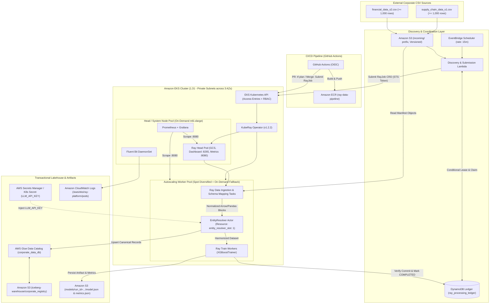

# Architecture — Ray Data Processing Platform on AWS

- **Status:** Final / Production-Ready Architecture (Unified Specification)
- **Cloud Provider:** Amazon Web Services (AWS)
- **Primary Compute Platform:** Amazon EKS (Kubernetes `1.31`)
- **Distributed Execution:** Ray (`2.40.0`) managed by KubeRay Operator (`v1.2.2`)
- **Document Version:** 2.0 (Combined Detailed Reference)
- **Document Purpose:** Define the complete, end-to-end architecture, component interactions, data contracts, scheduling rules, concrete code/YAML implementations, security posture, and operational workflows required to fulfill the Distributed AI Foundation assignment without unnecessary complexity.

---

## Executive Summary

This architecture delivers a resilient, zero-trust distributed AI and data engineering platform on AWS that discovers corporate CSV files (`SupplyChain_Data_S1` and `Financial_Data_S2`), prevents duplicate file processing through a transactional ledger, resolves corporate entity duplicates into canonical records via a dedicated Ray Actor (`EntityResolver`), performs atomic upserts to an Apache Iceberg table (`corporate_registry`), and trains a distributed revenue-prediction regression model using Ray Train (`XGBoostTrainer`).

### Key Design Principles
- **Zero-Trust IAM:** EKS Pod Identity / IRSA for Ray pods, OIDC federation for GitHub Actions, and EKS Access Entries for Lambda-to-Kubernetes API authentication. No static credentials anywhere.
- **Modular, Decoupled Terraform Layers:** $4$ isolated state layers (`01-bootstrap`, `02-foundation`, `03-eks`, `04-ray-platform`) minimizing blast radius.
- **Cost-Optimized Spot Resilience:** Diversified Spot worker node group ($\sim 70\%$ compute savings) paired with an automated On-Demand fallback pool, AWS Node Termination Handler, and Ray task/actor lineage reconstruction.
- **Auditable Idempotent Processing:** S3 Object Versioning paired with DynamoDB conditional leases and PyIceberg key-based upserts.
- **Full-Stack Observability:** Prometheus `PodMonitor` scraping, Grafana dashboards, authenticated Ray Dashboard access, and Fluent Bit shipping structured logs to Amazon CloudWatch.

---

## 1. System Architecture & Requirements Traceability

### 1.1 Source Requirements vs. Concrete Architectural Decisions

| Requirement Area | Assignment Requirement | Concrete Architectural Decision (KISS & YAGNI) |
| :--- | :--- | :--- |
| **Compute & K8s** | Managed Kubernetes cluster with KubeRay Operator and $\ge 2$ node pools (Head/System + Autoscaling Workers). | Amazon EKS `1.31` with KubeRay Operator `v1.2.2`. Dedicated On-Demand `head-system-pool` and autoscaling `ray-worker-spot-pool` + `ray-worker-ondemand-fallback`. |
| **Spot Resilience** | Spot/preemptible worker strategy maintaining job resilience. | Multi-AZ, $4$-instance-family (`m6i.xlarge`, `m5.xlarge`, `m5a.xlarge`, `m6a.xlarge`) Spot pool using `capacity-optimized` allocation, Priority Expander fallback to On-Demand, and Ray actor/task retries. |
| **Storage & Trigger** | Object storage for CSVs ($\ge 1,000$ rows each) and simulated scheduled execution. | Single versioned S3 bucket (`<env>-ray-platform-data-<account-id>`) with `incoming/`, `manifests/`, `quarantine/`, `iceberg-warehouse/`, and `models/` prefixes. EventBridge Scheduler (`rate(15 minutes)`) + Discovery Lambda + DynamoDB Ledger. |
| **Ray Pipeline** | Working `ray_pipeline.py` using Ray Data, `EntityResolver` actor, Iceberg sink, and Ray Train. | CPU-based `rayproject/ray:2.40.0-py311` image executing parallel `ray.data.read_csv`, deterministic two-tier entity resolution, PyIceberg Glue upsert, and distributed `XGBoostTrainer`. |
| **Memory & Sizing** | Documented `/dev/shm` shared memory and Ray object-store sizing. | Worker pods (`3` CPU, `12Gi` RAM) mount a `4Gi` `Memory`-backed `emptyDir` at `/dev/shm` and set `--object-store-memory=3865470566` ($\approx 3.6\text{ GiB}$). |
| **Actor Placement** | Deterministic scheduling of `EntityResolver` onto the intended worker group. | Enforced at two layers: K8s `nodeSelector` + `tolerations` (`workload-role=ray-worker:NoSchedule`) AND Ray custom resource `{"entity_resolver_slot": 1}`. |
| **Zero-Trust & Secrets** | Workload identity for cloud storage/catalog + secure injection of `LLM_API_KEY`. | IRSA (`ray-pipeline-sa`) for S3/Glue/DynamoDB access; `LLM_API_KEY` stored in AWS Secrets Manager and injected via Kubernetes `Secret` (`secretKeyRef`). |
| **CI/CD & Observability** | PR `terraform plan`, merge image build + `RayJob` trigger; Prometheus, Ray Dashboard, centralized logs. | GitHub Actions with OIDC; `kube-prometheus-stack`, `aws-for-fluent-bit` to CloudWatch Logs, and authenticated port-forward/Ingress for Ray Dashboard. |

### 1.2 High-Level Architecture Diagram



### 1.3 Component Responsibilities Matrix

| Component | Role | Key Technical Details |
| :--- | :--- | :--- |
| **Amazon S3** | Durable input, lakehouse, and artifact storage | Single versioned bucket (`<env>-ray-platform-data-<account-id>`) with `AES256` encryption and isolated prefixes: `incoming/`, `manifests/`, `quarantine/`, `iceberg-warehouse/`, `models/`. |
| **Amazon DynamoDB** | Processing ledger & concurrency control | Table `ray_processing_ledger` (`PK: file_id`). Uses conditional writes with $1800\text{s}$ ($30\text{m}$) leases to prevent duplicate claims and recover stalled runs. |
| **EventBridge Scheduler** | Periodic discovery trigger | Invokes the Discovery Lambda every $15\text{ minutes}$ (`rate(15 minutes)`). |
| **AWS Lambda** | Stateless discovery & `RayJob` submission | Lists S3 object versions, claims new files in DynamoDB, writes a run manifest JSON to S3, and submits a `RayJob` CRD via EKS Access Entries. |
| **Amazon EKS** | Managed Kubernetes runtime | EKS `1.31` deployed across $3$ Availability Zones in private subnets (`10.20.16.0/20`, `10.20.32.0/20`, `10.20.48.0/20`) with S3/DynamoDB Gateway VPC Endpoints. |
| **KubeRay Operator** | Ray lifecycle controller | Helm release `v1.2.2` managing warm `RayCluster` capacity and batch `RayJob` executions. |
| **`RayJob` (`ray_pipeline.py`)** | Distributed batch pipeline | Executes manifest-scoped Ray Data ingestion, `EntityResolver` deduplication, PyIceberg upsert, and Ray Train XGBoost revenue regression. |
| **AWS Glue + Apache Iceberg** | Transactional lakehouse table | Glue database `corporate_data_db`, table `corporate_registry` (Format v2), supporting atomic row-level upserts on `canonical_id`. |
| **Prometheus + Grafana** | Metrics collection & visualization | `kube-prometheus-stack` scraping `:8080/metrics` on Ray Head and Worker pods via `PodMonitor`. |
| **Fluent Bit + CloudWatch** | Centralized log aggregation | DaemonSet tailing `/var/log/containers/*ray*.log` and shipping structured pod logs to `/aws/eks/ray-platform/pods`. |

---

## 2. Infrastructure: Kubernetes Cluster & KubeRay Design

### 2.1 Node Pools & Spot Optimization Strategy

The EKS cluster provisions two strictly separated capacity tiers across $3$ Availability Zones:

1. **Head / System Node Pool (`head-system-pool` — On-Demand):**
   - **Capacity Type:** `ON_DEMAND` (guarantees the Ray Global Control Store (GCS), Ray Dashboard, KubeRay Operator, Prometheus, and Grafana are never interrupted).
   - **Instance Type:** `m6i.xlarge` ($4\text{ vCPU}$, $16\text{ GiB}$ RAM).
   - **Scaling Bounds:** `min: 2, desired: 2, max: 3`.
   - **Labels:** `workload-role=head-system`.
   - **Taints:** None (hosts core cluster add-ons and Ray Head pod via `nodeSelector`).
2. **Autoscaling Ray Worker Pool (`ray-worker-spot-pool` + `ray-worker-ondemand-fallback`):**
   - **Primary Spot Pool (`ray-worker-spot-pool`):**
     - **Capacity Type:** `SPOT` using the `capacity-optimized` allocation strategy.
     - **Instance Diversification:** `m6i.xlarge`, `m5.xlarge`, `m5a.xlarge`, `m6a.xlarge` ($4\text{ vCPU}$, $16\text{ GiB}$ RAM each) across $3$ AZs ($12$ distinct Spot capacity pools) to minimize simultaneous reclamation risk.
     - **Scaling Bounds:** `min: 0, desired: 1, max: 8`.
   - **Fallback On-Demand Pool (`ray-worker-ondemand-fallback`):**
     - **Capacity Type:** `ON_DEMAND` (`m6i.xlarge`), scaling `min: 0, desired: 0, max: 4`.
     - **Cluster Autoscaler Priority Expander:** Configured via `cluster-autoscaler-priority-expander` ConfigMap (`ray-worker-spot-pool` priority = `50`, `ray-worker-ondemand-fallback` priority = `10`). The autoscaler always requests Spot first and automatically falls back to On-Demand if AWS Spot pools are exhausted.
   - **Labels (both worker pools):** `workload-role=ray-worker`, `ray.io/node-group=worker-entity-resolver`.
   - **Taints (both worker pools):** `workload-role=ray-worker:NoSchedule` (prevents non-Ray system pods from landing on worker nodes and blocking scale-to-zero).

**Spot Interruption & Resilience Mechanics:**
- **Graceful Node Drain:** The **AWS Node Termination Handler** DaemonSet monitors the EC2 Instance Metadata Service (IMDSv2) for Spot $2\text{-minute}$ interruption notices and EC2 rebalance recommendations, immediately cordoning the node so no new Ray tasks or actors are placed on it.
- **Ray Data Lineage Reconstruction:** If a Spot worker is reclaimed mid-ingestion, Ray Data automatically reconstructs lost Arrow/Pandas blocks on surviving workers from the source S3 manifest.
- **Stateful Actor Recovery:** `EntityResolver` is decorated with `@ray.remote(max_restarts=3, max_task_retries=3)`. Because canonical ID generation is strictly deterministic (`SHA-256`), Ray seamlessly restarts the actor on another worker and replays the in-flight batch without state corruption.
- **Ray Train Fault Tolerance:** `XGBoostTrainer` runs with `FailureConfig(max_failures=2)` and S3 checkpointing (`s3://<data-bucket>/models/`), recovering automatically from worker preemption.

### 2.2 Production `RayCluster` CRD Configuration

Unlike pseudo-YAML configurations, KubeRay `v1.2.2` (`ray.io/v1`) requires explicit `rayStartParams` strings and a Kubernetes `emptyDir` (`medium: Memory`) mount for `/dev/shm`. Below is the production `RayCluster` specification:

```yaml
apiVersion: ray.io/v1
kind: RayCluster
metadata:
  name: ray-platform-cluster
  namespace: ray-system
spec:
  rayVersion: '2.40.0'
  enableInTreeAutoscaling: true
  autoscalerOptions:
    upscalingMode: Default
    idleTimeoutSeconds: 120
  headGroupSpec:
    serviceType: ClusterIP
    rayStartParams:
      dashboard-host: '0.0.0.0'
      num-cpus: '0' # Prevents compute tasks/actors from running on the Head pod
      metrics-export-port: '8080'
    template:
      spec:
        serviceAccountName: ray-pipeline-sa
        nodeSelector:
          workload-role: head-system
        containers:
          - name: ray-head
            image: <account-id>.dkr.ecr.us-east-1.amazonaws.com/ray-data-pipeline:latest
            ports:
              - containerPort: 6379
                name: gcs
              - containerPort: 8265
                name: dashboard
              - containerPort: 10001
                name: client
              - containerPort: 8080
                name: metrics
            resources:
              requests:
                cpu: '2'
                memory: '8Gi'
              limits:
                cpu: '2'
                memory: '8Gi'
            volumeMounts:
              - mountPath: /dev/shm
                name: dshm
        volumes:
          - name: dshm
            emptyDir:
              medium: Memory
              sizeLimit: 2Gi
  workerGroupSpecs:
    - groupName: entity-resolver-workers
      replicas: 1
      minReplicas: 0
      maxReplicas: 6
      rayStartParams:
        num-cpus: '3'
        object-store-memory: '3865470566' # ~3.6 GiB (30% of 12Gi limit)
        resources: '"{\"entity_resolver_slot\": 2}"'
        metrics-export-port: '8080'
      template:
        spec:
          serviceAccountName: ray-pipeline-sa
          nodeSelector:
            workload-role: ray-worker
            ray.io/node-group: worker-entity-resolver
          tolerations:
            - key: 'workload-role'
              operator: 'Equal'
              value: 'ray-worker'
              effect: 'NoSchedule'
          containers:
            - name: ray-worker
              image: <account-id>.dkr.ecr.us-east-1.amazonaws.com/ray-data-pipeline:latest
              env:
                - name: LLM_API_KEY
                  valueFrom:
                    secretKeyRef:
                      name: entity-resolver-secrets
                      key: LLM_API_KEY
              resources:
                requests:
                  cpu: '3'
                  memory: '12Gi'
                limits:
                  cpu: '3'
                  memory: '12Gi'
              volumeMounts:
                - mountPath: /dev/shm
                  name: dshm
          volumes:
            - name: dshm
              emptyDir:
                medium: Memory
                sizeLimit: 4Gi
```

### 2.3 Memory, `/dev/shm`, and Object Store Sizing Rationale

- **Why `/dev/shm` Must Be Explicitly Mounted:** By default, Docker/containerd on Kubernetes mounts `/dev/shm` with a hard cap of $64\text{ MiB}$. Ray's Plasma Object Store uses `/dev/shm` for zero-copy shared memory pages across worker processes during `ray.data` Arrow/Pandas block exchanges and `ray.train` distributed dataset shards. Exceeding $64\text{ MiB}$ without an explicit memory-backed `emptyDir` triggers immediate `Bus error (core dumped)` or heavy disk spilling.
- **Sizing Formula Applied ($m6i.xlarge = 4\text{ vCPU}, 16\text{ GiB}$ Node):**
  - **Node Overhead ($1\text{ vCPU}, 4\text{ GiB}$):** Reserved for kubelet, containerd, Fluent Bit, and kube-proxy.
  - **Ray Worker Pod Limit ($3\text{ vCPU}, 12\text{ GiB}$):** Fits $1$ worker pod cleanly per `xlarge` instance.
  - **Shared Memory Mount (`/dev/shm = 4Gi`):** Allocated via `emptyDir: {medium: Memory, sizeLimit: 4Gi}`.
  - **Ray Object Store (`--object-store-memory = 3.6 GiB`):** Set to $30\%$ of the container's $12\text{ GiB}$ limit ($3,865,470,566\text{ bytes}$), leaving a $400\text{ MiB}$ safety buffer below the $4\text{ GiB}$ `/dev/shm` cap and reserving $\sim 8.4\text{ GiB}$ of heap RAM for Python worker processes, PyIceberg Arrow tables, and XGBoost training matrices.

---

## 3. Data Pipeline & Concrete Implementation

### 3.1 Input Discovery & Manifest Contract

When EventBridge Scheduler invokes the Discovery Lambda:
1. Lambda lists object versions under `s3://<data-bucket>/incoming/` for `*.csv` files (ignoring temporary uploads ending in `.tmp` or `.part`).
2. For each object version, it computes a deterministic identifier:
   $$\text{file\_id} = \text{SHA256}(\text{bucket} + \text{"/"} + \text{key} + \text{"\#"} + \text{version\_id})$$
3. It attempts an atomic conditional claim in DynamoDB (`ray_processing_ledger`) so already-completed files are skipped and overlapping runs cannot claim the same file.
4. For claimed files, it writes a JSON manifest to `s3://<data-bucket>/manifests/<run_id>.json`:

```json
{
  "run_id": "run-20261025T103000Z-a1b2c3d4",
  "submitted_at": "2026-10-25T10:30:00Z",
  "inputs": [
    {
      "file_id": "8f9d2a1c4b5e6f7a8b9c0d1e2f3a4b5c6d7e8f9a0b1c2d3e4f5a6b7c8d9e0f1a",
      "source_name": "SupplyChain_Data_S1",
      "bucket": "prod-ray-platform-data-123456789012",
      "key": "incoming/supply_chain_data_s1.csv",
      "version_id": "3HL4kqtJlcpXroDTDmJ+rmSpXd3dIbrHY"
    },
    {
      "file_id": "1a2b3c4d5e6f7a8b9c0d1e2f3a4b5c6d7e8f9a0b1c2d3e4f5a6b7c8d9e0f1a2b",
      "source_name": "Financial_Data_S2",
      "bucket": "prod-ray-platform-data-123456789012",
      "key": "incoming/financial_data_s2.csv",
      "version_id": "9XK2mnbPqrsTuvWXYzL+mnOpQrStUvWx"
    }
  ]
}
```

5. Lambda submits a `RayJob` passing `RUN_ID` and `MANIFEST_S3_URI` in `runtimeEnv.env_vars`. The Ray job reads **only** the objects listed in `MANIFEST_S3_URI`—never scanning the entire `incoming/` prefix.

### 3.2 Synthetic Datasets & Schema Normalization Contract

Two synthetic CSV datasets with $\ge 1,000$ rows each are provided (`supply_chain_data_s1.csv` and `financial_data_s2.csv`), sharing $600$ overlapping corporations (with realistic variations in legal suffixes, casing, and tax ID punctuation) and $400+$ distinct corporations per file:

| Canonical Field | Type | Required | `SupplyChain_Data_S1` Header | `Financial_Data_S2` Header | Accepted Aliases |
| :--- | :--- | :--- | :--- | :--- | :--- |
| `source_record_id` | `string` | Yes | `sc_record_id` | `fin_record_id` | `record_id`, `id` |
| `corporate_name` | `string` | Yes | `company_name` | `corporate_name` | `name`, `corp_name`, `legal_name` |
| `tax_id` | `string` | No | `tax_id` | `registration_number` | `ein`, `tin`, `reg_number` |
| `country_code` | `string` | Yes | `country_code` | `hq_country` | `country`, `location` |
| `region` | `string` | No | `region_state` | `hq_region` | `state`, `province` |
| `industry_sector` | `string` | Yes | `industry_sector` | `naics_sector` | `industry`, `sector` |
| `employee_count` | `int64` | Yes | `employee_count` | `headcount` | `employees`, `staff_count` |
| `annual_revenue_usd` | `float64` | Yes | `annual_revenue_usd` | `reported_revenue_usd` | `annual_revenue`, `revenue` |
| `operating_margin_pct` | `float64` | No | *(Imputed / `None`)* | `operating_margin_pct` | `operating_margin`, `margin_pct` |
| `supplier_tier` | `int32` | No | `supplier_tier` | *(Default `0`)* | `tier` |
| `credit_rating` | `string` | No | *(Default `"NR"`)* | `credit_rating` | `rating` |
| `as_of_date` | `string` | Yes | `as_of_date` | `reporting_date` | `date`, `effective_date` |

```python
import pandas as pd

SCHEMA_ALIASES = {
    "source_record_id": ["sc_record_id", "fin_record_id", "record_id", "id"],
    "corporate_name": ["corporate_name", "company_name", "name", "corp_name"],
    "tax_id": ["tax_id", "registration_number", "ein", "tin"],
    "country_code": ["country_code", "hq_country", "country", "location"],
    "region": ["region_state", "hq_region", "region", "state"],
    "industry_sector": ["industry_sector", "naics_sector", "industry", "sector"],
    "employee_count": ["employee_count", "headcount", "employees"],
    "annual_revenue_usd": ["annual_revenue_usd", "reported_revenue_usd", "annual_revenue", "revenue"],
    "operating_margin_pct": ["operating_margin_pct", "operating_margin"],
    "supplier_tier": ["supplier_tier", "tier"],
    "credit_rating": ["credit_rating", "rating"],
    "as_of_date": ["as_of_date", "reporting_date", "date"],
}

REQUIRED_FIELDS = [
    "source_record_id",
    "corporate_name",
    "country_code",
    "industry_sector",
    "employee_count",
    "annual_revenue_usd",
    "as_of_date",
]

def validate_and_map_schema(df: pd.DataFrame, source_name: str) -> pd.DataFrame:
    """Normalize source CSV headers to the canonical schema and fail fast on missing required columns."""
    col_lookup = {c.strip().lower(): c for c in df.columns}
    mapped = {}

    for canonical_col, aliases in SCHEMA_ALIASES.items():
        matched_src = next((col_lookup[a.lower()] for a in aliases if a.lower() in col_lookup), None)
        if matched_src is not None:
            mapped[canonical_col] = df[matched_src]
        elif canonical_col in REQUIRED_FIELDS:
            raise ValueError(
                f"Schema validation failed for {source_name}: missing required field '{canonical_col}'. "
                f"Found columns: {list(df.columns)}"
            )

    out_df = pd.DataFrame(mapped)
    out_df["source_system"] = source_name
    out_df["tax_id"] = out_df.get("tax_id", pd.Series([""] * len(out_df))).fillna("").astype(str)
    out_df["region"] = out_df.get("region", pd.Series(["UNKNOWN"] * len(out_df))).fillna("UNKNOWN").astype(str)
    out_df["operating_margin_pct"] = pd.to_numeric(
        out_df.get("operating_margin_pct", pd.Series([None] * len(out_df))), errors="coerce"
    )
    out_df["supplier_tier"] = pd.to_numeric(
        out_df.get("supplier_tier", pd.Series([0] * len(out_df))), errors="coerce"
    ).fillna(0).astype("int32")
    out_df["credit_rating"] = out_df.get("credit_rating", pd.Series(["NR"] * len(out_df))).fillna("NR").astype(str)
    return out_df
```

### 3.3 Ray Data Parallel Ingestion

Instead of scanning a wildcard prefix, the pipeline reads the specific S3 URIs claimed in the manifest using `ray.data.read_csv` and maps batches across worker CPUs:

```python
import ray
import ray.data

@ray.remote(num_cpus=1, max_retries=3)
def ingest_data(source_name: str, s3_uri: str) -> pd.DataFrame:
    """Read a claimed S3 CSV file via Ray Data and normalize its schema across workers."""
    ds = ray.data.read_csv(s3_uri)
    normalized_ds = ds.map_batches(
        lambda batch: validate_and_map_schema(batch, source_name),
        batch_format="pandas",
        batch_size=500,
    )
    return normalized_ds.to_pandas()
```

### 3.4 Deterministic `EntityResolver` Actor (Replacing `hash()`)

Python's built-in `hash()` is salted with a random seed (`PYTHONHASHSEED`) per process, producing different IDs across workers and runs. The production `EntityResolver` actor enforces:
1. **Kubernetes Secret Verification:** Checks `LLM_API_KEY` injected via `secretKeyRef`.
2. **Placement Verification:** Requests `resources={"entity_resolver_slot": 1}` and logs its Ray Node ID and hostname.
3. **Deterministic Two-Tier Resolution & Golden Record Survivorship:**
   - **Tier 1:** Exact normalized `(country_code, norm_tax_id)` match ($\text{confidence} = 1.0$).
   - **Tier 2:** Fuzzy normalized name similarity (`difflib.SequenceMatcher`) within the same `country_code` ($\ge 0.88 \rightarrow$ resolved match; $[0.75, 0.88) \rightarrow$ flagged `is_resolved = False` as ambiguous without merging; $< 0.75 \rightarrow$ distinct entity).
   - **Canonical ID:** $\text{"CAN-"} + \text{SHA256}(\text{country\_code} + \text{":"} + \text{anchor\_key})[:12]\text{.upper()}$.

```python
import difflib
import hashlib
import os
import re
import socket
import time
from datetime import datetime, timezone
import pandas as pd
import ray

LEGAL_SUFFIXES_RE = re.compile(
    r"\b(INC|INCORPORATED|CORP|CORPORATION|LLC|LTD|LIMITED|PLC|GMBH|SA|AG|CO|COMPANY|HOLDINGS|GROUP)\b",
    re.IGNORECASE,
)

@ray.remote(
    num_cpus=1,
    num_gpus=0,
    resources={"entity_resolver_slot": 1},
    max_restarts=3,
    max_task_retries=3,
)
class EntityResolver:
    def __init__(self):
        self.api_key = os.getenv("LLM_API_KEY", "NOT_SET")
        if not self.api_key or self.api_key == "NOT_SET":
            raise RuntimeError("CRITICAL: LLM_API_KEY not found in environment. Secret injection failed.")

        self.node_id = ray.get_runtime_context().get_node_id()
        self.hostname = socket.gethostname()
        print(f"[EntityResolver] Scheduled on node_id={self.node_id}, host={self.hostname}")

    @staticmethod
    def _normalize_name(name: str) -> str:
        cleaned = re.sub(r"[^A-Za-z0-9\s]", " ", str(name).upper())
        cleaned = LEGAL_SUFFIXES_RE.sub("", cleaned)
        return re.sub(r"\s+", " ", cleaned).strip()

    @staticmethod
    def _normalize_tax_id(tax_id: str) -> str:
        return re.sub(r"[^A-Z0-9]", "", str(tax_id).upper())

    @staticmethod
    def _deterministic_id(prefix: str, country: str, anchor: str) -> str:
        digest = hashlib.sha256(f"{country.upper()}:{anchor}".encode("utf-8")).hexdigest()[:12].upper()
        return f"{prefix}-{digest}"

    def resolve_batch(self, df: pd.DataFrame, run_id: str) -> pd.DataFrame:
        time.sleep(3)  # Simulated LLM resolution latency from assignment skeleton
        work = df.copy()
        work["normalized_name"] = work["corporate_name"].apply(self._normalize_name)
        work["norm_tax_id"] = work["tax_id"].apply(self._normalize_tax_id)
        work["country_code"] = work["country_code"].str.upper().str.strip()

        # Index known tax_ids to canonical normalized names per country
        tax_to_anchor = {}
        name_anchors_by_country = {}

        canonical_ids = []
        confidences = []
        resolved_flags = []

        for _, row in work.iterrows():
            country = row["country_code"]
            norm_name = row["normalized_name"]
            norm_tax = row["norm_tax_id"]
            anchors = name_anchors_by_country.setdefault(country, [])

            if norm_tax and (country, norm_tax) in tax_to_anchor:
                anchor = tax_to_anchor[(country, norm_tax)]
                cid = self._deterministic_id("CAN", country, anchor)
                canonical_ids.append(cid)
                confidences.append(1.0)
                resolved_flags.append(True)
                continue

            best_anchor, best_ratio = None, 0.0
            for candidate in anchors:
                ratio = difflib.SequenceMatcher(None, norm_name, candidate).ratio()
                if ratio > best_ratio:
                    best_ratio, best_anchor = ratio, candidate

            if best_ratio >= 0.88 and best_anchor is not None:
                anchor = best_anchor
                cid = self._deterministic_id("CAN", country, anchor)
                is_res, conf = True, round(best_ratio, 4)
            elif 0.75 <= best_ratio < 0.88:
                anchor = f"{norm_name}:{row['source_record_id']}"
                cid = self._deterministic_id("PROV", country, anchor)
                is_res, conf = False, round(best_ratio, 4)
            else:
                anchor = norm_name
                anchors.append(anchor)
                cid = self._deterministic_id("CAN", country, anchor)
                is_res, conf = True, 1.0

            if norm_tax and is_res:
                tax_to_anchor[(country, norm_tax)] = anchor

            canonical_ids.append(cid)
            confidences.append(conf)
            resolved_flags.append(is_res)

        work["canonical_id"] = canonical_ids
        work["match_confidence"] = confidences
        work["is_resolved"] = resolved_flags

        # Survivorship rules: Financial_Data_S2 prioritized for financial metrics, newer date for general fields
        work["is_fin_source"] = (work["source_system"] == "Financial_Data_S2").astype(int)
        work = work.sort_values(by=["canonical_id", "is_fin_source", "as_of_date"], ascending=[True, False, False])

        grouped = work.groupby("canonical_id", as_index=False).agg(
            corporate_name=("corporate_name", "first"),
            normalized_name=("normalized_name", "first"),
            tax_id=("norm_tax_id", lambda s: next((v for v in s if v), "")),
            country_code=("country_code", "first"),
            region=("region", "first"),
            industry_sector=("industry_sector", "first"),
            employee_count=("employee_count", "first"),
            annual_revenue_usd=("annual_revenue_usd", "first"),
            operating_margin_pct=("operating_margin_pct", lambda s: s.dropna().iloc[0] if not s.dropna().empty else 12.5),
            supplier_tier=("supplier_tier", "max"),
            credit_rating=("credit_rating", lambda s: next((v for v in s if v != "NR"), "NR")),
            is_resolved=("is_resolved", "all"),
            match_confidence=("match_confidence", "min"),
            source_count=("source_record_id", "count"),
            as_of_date=("as_of_date", "max"),
        )
        grouped["last_run_id"] = run_id
        grouped["updated_at_utc"] = datetime.now(timezone.utc).isoformat()
        return grouped
```

### 3.5 Transactional Apache Iceberg Upsert (`corporate_registry`)

Using real PyIceberg `0.8.1` APIs (`load_catalog` and `table.upsert`), the pipeline creates or updates `corporate_data_db.corporate_registry` in the AWS Glue Data Catalog and verifies the committed snapshot ID:

```python
import pyarrow as pa
from pyiceberg.catalog import load_catalog
from pyiceberg.exceptions import NoSuchNamespaceError, NoSuchTableError
from pyiceberg.schema import Schema
from pyiceberg.types import (
    BooleanType,
    DoubleType,
    IntegerType,
    LongType,
    NestedField,
    StringType,
)

CORPORATE_REGISTRY_SCHEMA = Schema(
    NestedField(field_id=1, name="canonical_id", field_type=StringType(), required=True),
    NestedField(field_id=2, name="corporate_name", field_type=StringType(), required=True),
    NestedField(field_id=3, name="normalized_name", field_type=StringType(), required=True),
    NestedField(field_id=4, name="tax_id", field_type=StringType(), required=False),
    NestedField(field_id=5, name="country_code", field_type=StringType(), required=True),
    NestedField(field_id=6, name="region", field_type=StringType(), required=False),
    NestedField(field_id=7, name="industry_sector", field_type=StringType(), required=True),
    NestedField(field_id=8, name="employee_count", field_type=LongType(), required=True),
    NestedField(field_id=9, name="annual_revenue_usd", field_type=DoubleType(), required=True),
    NestedField(field_id=10, name="operating_margin_pct", field_type=DoubleType(), required=False),
    NestedField(field_id=11, name="supplier_tier", field_type=IntegerType(), required=False),
    NestedField(field_id=12, name="credit_rating", field_type=StringType(), required=False),
    NestedField(field_id=13, name="is_resolved", field_type=BooleanType(), required=True),
    NestedField(field_id=14, name="match_confidence", field_type=DoubleType(), required=True),
    NestedField(field_id=15, name="source_count", field_type=IntegerType(), required=True),
    NestedField(field_id=16, name="as_of_date", field_type=StringType(), required=True),
    NestedField(field_id=17, name="last_run_id", field_type=StringType(), required=True),
    NestedField(field_id=18, name="updated_at_utc", field_type=StringType(), required=True),
    identifier_field_ids=[1],
)

def upsert_to_iceberg(df: pd.DataFrame, warehouse_s3_uri: str, region: str) -> int:
    """Atomically upsert harmonized records into Glue Iceberg table and verify snapshot commit."""
    catalog = load_catalog(
        "glue",
        **{
            "type": "glue",
            "s3.region": region,
            "client.region": region,
            "warehouse": warehouse_s3_uri,
        },
    )
    namespace = "corporate_data_db"
    table_id = f"{namespace}.corporate_registry"

    try:
        catalog.load_namespace_properties(namespace)
    except NoSuchNamespaceError:
        catalog.create_namespace(namespace)

    try:
        table = catalog.load_table(table_id)
    except NoSuchTableError:
        table = catalog.create_table(
            identifier=table_id,
            schema=CORPORATE_REGISTRY_SCHEMA,
            location=f"{warehouse_s3_uri.rstrip('/')}/{namespace}.db/corporate_registry",
        )

    arrow_schema = table.schema().as_arrow()
    arrow_table = pa.Table.from_pandas(df, schema=arrow_schema, preserve_index=False)

    upsert_result = table.upsert(df=arrow_table, join_cols=["canonical_id"])
    table.refresh()
    snapshot = table.current_snapshot()
    if snapshot is None:
        raise RuntimeError("Iceberg commit verification failed: current_snapshot() is None")

    print(
        f"[Iceberg] Upsert committed: rows_inserted={upsert_result.rows_inserted}, "
        f"rows_updated={upsert_result.rows_updated}, snapshot_id={snapshot.snapshot_id}"
    )
    return snapshot.snapshot_id
```

### 3.6 Distributed Revenue Prediction with Ray Train (`XGBoostTrainer`)

```python
import json
import boto3
import numpy as np
import ray.data
from ray.train import FailureConfig, RunConfig, ScalingConfig
from ray.train.xgboost import XGBoostTrainer

def train_revenue_model(df: pd.DataFrame, s3_bucket: str, run_id: str, snapshot_id: int) -> dict:
    """Train a distributed XGBoost regression model via Ray Train to predict annual_revenue_usd."""
    valid_df = df[(df["is_resolved"] == True) & (df["annual_revenue_usd"] > 0)].copy()
    if len(valid_df) < 100:
        raise ValueError(f"Insufficient resolved training records: {len(valid_df)} < 100 minimum")

    # Feature encoding
    for cat_col in ["country_code", "industry_sector", "credit_rating"]:
        valid_df[f"{cat_col}_code"] = valid_df[cat_col].astype("category").cat.codes.astype("float32")

    feature_cols = [
        "employee_count",
        "operating_margin_pct",
        "supplier_tier",
        "source_count",
        "country_code_code",
        "industry_sector_code",
        "credit_rating_code",
    ]
    train_ source_df = valid_df[feature_cols + ["annual_revenue_usd"]].astype("float64")

    full_ds = ray.data.from_pandas(train_source_df)
    train_ds, val_ds = full_ds.train_test_split(test_size=0.2, shuffle=True, seed=42)

    trainer = XGBoostTrainer(
        label_column="annual_revenue_usd",
        params={
            "objective": "reg:squarederror",
            "eval_metric": ["rmse", "mae"],
            "max_depth": 6,
            "eta": 0.1,
            "subsample": 0.8,
            "seed": 42,
        },
        datasets={"train": train_ds, "validation": val_ds},
        num_boost_round=100,
        scaling_config=ScalingConfig(
            num_workers=2,
            use_gpu=False,
            resources_per_worker={"CPU": 1},
        ),
        run_config=RunConfig(
            name=f"revenue_xgb_{run_id}",
            storage_path=f"s3://{s3_bucket}/models/checkpoints",
            failure_config=FailureConfig(max_failures=2),
        ),
    )

    result = trainer.fit()
    rmse = float(result.metrics.get("validation-rmse", 0.0))
    mae = float(result.metrics.get("validation-mae", 0.0))

    metrics_payload = {
        "run_id": run_id,
        "iceberg_snapshot_id": snapshot_id,
        "training_records": len(valid_df),
        "validation_rmse": round(rmse, 2),
        "validation_mae": round(mae, 2),
        "checkpoint_uri": result.checkpoint.path if result.checkpoint else "",
    }

    s3 = boto3.client("s3")
    metrics_key = f"models/run_id={run_id}/metrics.json"
    s3.put_object(
        Bucket=s3_bucket,
        Key=metrics_key,
        Body=json.dumps(metrics_payload, indent=2).encode("utf-8"),
        ContentType="application/json",
    )
    return metrics_payload
```

---

## 4. Identity, Zero-Trust Access Control & Secrets

### 4.1 Workload Identity (IRSA / EKS Pod Identity)

1. **OIDC Provider & Trust Policy (Terraform):**
   ```hcl
   data "tls_certificate" "eks" {
     url = aws_eks_cluster.main.identity[0].oidc[0].issuer
   }

   resource "aws_iam_openid_connect_provider" "eks" {
     client_id_list  = ["sts.amazonaws.com"]
     thumbprint_list = [data.tls_certificate.eks.certificates[0].sha1_fingerprint]
     url             = aws_eks_cluster.main.identity[0].oidc[0].issuer
   }
   ```

2. **Ray Workload IAM Role Least-Privilege Policy (`ray-pipeline-workload-role`):**
   ```json
   {
     "Version": "2012-10-17",
     "Statement": [
       {
         "Sid": "S3DataLakehouseAndModelAccess",
         "Effect": "Allow",
         "Action": [
           "s3:GetObject",
           "s3:GetObjectVersion",
           "s3:PutObject",
           "s3:DeleteObject",
           "s3:ListBucket"
         ],
         "Resource": [
           "arn:aws:s3:::${DATA_BUCKET_NAME}",
           "arn:aws:s3:::${DATA_BUCKET_NAME}/incoming/*",
           "arn:aws:s3:::${DATA_BUCKET_NAME}/manifests/*",
           "arn:aws:s3:::${DATA_BUCKET_NAME}/quarantine/*",
           "arn:aws:s3:::${DATA_BUCKET_NAME}/iceberg-warehouse/*",
           "arn:aws:s3:::${DATA_BUCKET_NAME}/models/*"
         ]
       },
       {
         "Sid": "GlueIcebergCatalogReadWrite",
         "Effect": "Allow",
         "Action": [
           "glue:GetDatabase",
           "glue:CreateDatabase",
           "glue:GetTable",
           "glue:CreateTable",
           "glue:UpdateTable",
           "glue:DeleteTable",
           "glue:GetPartitions"
         ],
         "Resource": [
           "arn:aws:glue:${AWS_REGION}:${AWS_ACCOUNT_ID}:catalog",
           "arn:aws:glue:${AWS_REGION}:${AWS_ACCOUNT_ID}:database/corporate_data_db",
           "arn:aws:glue:${AWS_REGION}:${AWS_ACCOUNT_ID}:table/corporate_data_db/*"
         ]
       },
       {
         "Sid": "DynamoDBLedgerStatusUpdate",
         "Effect": "Allow",
         "Action": [
           "dynamodb:GetItem",
           "dynamodb:PutItem",
           "dynamodb:UpdateItem"
         ],
         "Resource": "arn:aws:dynamodb:${AWS_REGION}:${AWS_ACCOUNT_ID}:table/ray_processing_ledger"
       }
     ]
   }
   ```

3. **Kubernetes ServiceAccount (`ray-pipeline-sa`):**
   ```yaml
   apiVersion: v1
   kind: ServiceAccount
   metadata:
     name: ray-pipeline-sa
     namespace: ray-system
     annotations:
       eks.amazonaws.com/role-arn: arn:aws:iam::<account-id>:role/ray-pipeline-workload-role
   ```

### 4.2 Zero-Trust Lambda-to-EKS Authentication (EKS Access Entries + RBAC)

Lambda does not receive Kubernetes access automatically. Instead of storing static kubeconfigs or `cluster-admin` tokens in environment variables, we bind the Lambda's IAM role (`ray-discovery-lambda-role`) via **AWS EKS Access Entries** to a least-privilege Kubernetes RBAC `Role`:

```hcl
resource "aws_eks_access_entry" "discovery_lambda" {
  cluster_name      = aws_eks_cluster.main.name
  principal_arn     = aws_iam_role.discovery_lambda.arn
  kubernetes_groups = ["ray-job-submitters"]
  type              = "STANDARD"
}
```

```yaml
apiVersion: rbac.authorization.k8s.io/v1
kind: Role
metadata:
  name: rayjob-submitter-role
  namespace: ray-system
rules:
  - apiGroups: ["ray.io"]
    resources: ["rayjobs", "rayclusters"]
    verbs: ["create", "get", "list", "watch"]
---
apiVersion: rbac.authorization.k8s.io/v1
kind: RoleBinding
metadata:
  name: rayjob-submitter-binding
  namespace: ray-system
subjects:
  - kind: Group
    name: ray-job-submitters
    apiGroup: rbac.authorization.k8s.io
roleRef:
  kind: Role
  name: rayjob-submitter-role
  apiGroup: rbac.authorization.k8s.io
```

---

## 5. Observability Stack

### 5.1 Prometheus Metrics Collection (`PodMonitor`)

Deployed via `kube-prometheus-stack` in the `monitoring` namespace. Ray Head and Worker pods expose metrics on port `8080`:

```yaml
apiVersion: monitoring.coreos.com/v1
kind: PodMonitor
metadata:
  name: ray-cluster-metrics
  namespace: monitoring
  labels:
    release: kube-prometheus-stack
spec:
  namespaceSelector:
    matchNames:
      - ray-system
  selector:
    matchLabels:
      app.kubernetes.io/name: kuberay
  podMetricsEndpoints:
    - port: metrics
      path: /metrics
      interval: 15s
```

**Key Tracked Metrics & Alerts:**
- `ray_cluster_active_nodes`: Active Head + Worker count by node group.
- `ray_tasks_running` & `ray_actors`: Active tasks and `EntityResolver` actor state (`ALIVE`, `RESTARTING`).
- `ray_object_store_available_memory` / `ray_object_store_used_memory`: Fires alert `RayObjectStoreHighUtilization` if utilization exceeds $85\%$ for $5\text{ minutes}$.

### 5.2 Secure Ray Dashboard Exposure

The Ray Dashboard runs on `ray-platform-cluster-head-svc` (`ClusterIP`, port `8265`) and is never exposed via an unauthenticated public load balancer. Two secure access patterns are supported:

- **Option 1 (Default — Zero-Trust IAM Tunnel via `kubectl port-forward`):**
  ```bash
  kubectl port-forward -n ray-system svc/ray-platform-cluster-head-svc 8265:8265
  # Access locally at http://localhost:8265
  ```
- **Option 2 (Internal Ingress with Basic/OIDC Auth):**
  ```yaml
  apiVersion: networking.k8s.io/v1
  kind: Ingress
  metadata:
    name: ray-dashboard-internal
    namespace: ray-system
    annotations:
      nginx.ingress.kubernetes.io/auth-type: basic
      nginx.ingress.kubernetes.io/auth-secret: ray-dashboard-basic-auth
      nginx.ingress.kubernetes.io/auth-realm: "Authentication Required - Ray Dashboard"
  spec:
    ingressClassName: nginx-internal
    rules:
      - host: ray-dashboard.internal.corp
        http:
          paths:
            - path: /
              pathType: Prefix
              backend:
                service:
                  name: ray-platform-cluster-head-svc
                  port:
                    number: 8265
  ```

### 5.3 Centralized Logging (Fluent Bit to CloudWatch Logs)

An `aws-for-fluent-bit` DaemonSet tails `/var/log/containers/*ray*.log` on all Head and Worker nodes and ships records to CloudWatch Logs group `/aws/eks/ray-platform/pods` (retention: $30\text{ days}$).

**Ready-to-Run CloudWatch Logs Insights Queries:**
```sql
# 1. Verify EntityResolver Actor Placement & Custom Resource Allocation
fields @timestamp, kubernetes.pod_name, kubernetes.host, @message
| filter kubernetes.namespace_name = "ray-system"
| filter @message like /\[EntityResolver\] Scheduled on node_id=/
| sort @timestamp desc
| limit 20

# 2. Surface Errors or Failed Tasks Across Ray Head and Worker Pods
fields @timestamp, kubernetes.pod_name, kubernetes.container_name, @message
| filter kubernetes.namespace_name = "ray-system"
| filter @message like /(?i)(ERROR|CRITICAL|Exception|Traceback)/
| stats count(*) as error_count by kubernetes.pod_name
| sort error_count desc
```

---

## 6. Failure Handling, Duplicate Prevention & Lease Recovery

### 6.1 Failure Handling Matrix

| Failure Scenario | Detection Mechanism | Automated Platform Response |
| :--- | :--- | :--- |
| **Malformed or unsupported CSV schema** | `validate_and_map_schema()` raises `ValueError` | Writes diagnostic error report to `s3://<bucket>/quarantine/<run_id>.json`, marks DynamoDB record `FAILED`, and exits non-zero. |
| **No new CSV files in `incoming/`** | Discovery Lambda S3 + DynamoDB filter | Exits cleanly (`HTTP 200`) in $< 1\text{s}$ without submitting an empty `RayJob`. |
| **Already `COMPLETED` file version** | DynamoDB `ConditionExpression` check | Skipped automatically by Discovery Lambda; never reprocessed. |
| **Same S3 key overwritten with updated CSV** | S3 Versioning generates a new `VersionId` | Produces a new `file_id` hash, claims it as a new input, and upserts updated corporate attributes into Iceberg. |
| **Spot Worker preempted mid-execution** | EC2 Spot $2\text{-min}$ warning + Ray GCS heartbeat | Node Termination Handler cordons node; Ray reconstructs Ray Data blocks, restarts `EntityResolver` (`max_restarts=3`), or recovers `XGBoostTrainer` (`max_failures=2`) on surviving Spot or On-Demand fallback nodes. |
| **`LLM_API_KEY` missing or unmounted** | `EntityResolver.__init__` check | Raises immediate `RuntimeError`; fails fast with clear secret configuration error. |
| **Iceberg commit fails** | PyIceberg exception or missing snapshot ID | Pipeline aborts before model training; DynamoDB status is set to `FAILED` (never `COMPLETED`), keeping the file eligible for retry. |
| **`RayJob` hangs or driver pod crashes** | `activeDeadlineSeconds: 1500` + DynamoDB lease | Kubernetes terminates the hung job at $25\text{m}$; once the $30\text{m}$ DynamoDB lease (`lease_expires_at`) expires, the next scheduled Lambda run reclaims the file if `attempt_count < 3`. |

### 6.2 Correct Lease-Based DynamoDB Claim Implementation

Unlike buggy conditional expressions that accidentally re-claim `COMPLETED` files, the Discovery Lambda uses the following atomic conditional update to claim only new, retry-eligible `FAILED`, or lease-expired `PROCESSING` files:

```python
import time
import boto3
from botocore.exceptions import ClientError

dynamodb = boto3.client("dynamodb")

def claim_file_for_processing(
    table_name: str,
    file_id: str,
    bucket: str,
    s3_key: str,
    version_id: str,
    run_id: str,
    lease_seconds: int = 1800,
    max_attempts: int = 3,
) -> bool:
    """Atomically claim a file only if unprocessed, failed (< max_attempts), or lease-expired."""
    now_epoch = int(time.time())
    lease_expiry = now_epoch + lease_seconds

    try:
        dynamodb.update_item(
            TableName=table_name,
            Key={"file_id": {"S": file_id}},
            UpdateExpression=(
                "SET #status = :processing, "
                "bucket = :bucket, "
                "s3_key = :s3_key, "
                "version_id = :version_id, "
                "run_id = :run_id, "
                "lease_expires_at = :lease_expiry, "
                "attempt_count = if_not_exists(attempt_count, :zero) + :one"
            ),
            ConditionExpression=(
                "attribute_not_exists(file_id) "
                "OR (#status = :failed AND attempt_count < :max_attempts) "
                "OR (#status = :processing AND lease_expires_at < :now)"
            ),
            ExpressionAttributeNames={"#status": "status"},
            ExpressionAttributeValues={
                ":processing": {"S": "PROCESSING"},
                ":failed": {"S": "FAILED"},
                ":bucket": {"S": bucket},
                ":s3_key": {"S": s3_key},
                ":version_id": {"S": version_id},
                ":run_id": {"S": run_id},
                ":lease_expiry": {"N": str(lease_expiry)},
                ":now": {"N": str(now_epoch)},
                ":zero": {"N": "0"},
                ":one": {"N": "1"},
                ":max_attempts": {"N": str(max_attempts)},
            },
        )
        return True
    except ClientError as exc:
        if exc.response["Error"]["Code"] == "ConditionalCheckFailedException":
            return False  # Already COMPLETED or actively leased by another run
        raise
```

---

## 7. Decoupled Terraform Structure

```text
terraform/
├── modules/
│   ├── vpc/                    # Multi-AZ VPC, private/public subnets, NAT, S3/DDB Gateway Endpoints
│   ├── storage_and_ledger/     # Versioned S3 bucket, Glue Database, DynamoDB ledger, Secrets Manager
│   ├── eks_cluster/            # EKS 1.31, Access Entries, On-Demand Head pool, Spot + Fallback Worker pools
│   └── kuberay_stack/          # KubeRay Helm, RayCluster, Prometheus/Grafana, Fluent Bit, Discovery Lambda
└── layers/
    ├── 01-bootstrap/           # S3 Terraform state bucket + DynamoDB state lock table (run once)
    ├── 02-foundation/          # Invokes vpc + storage_and_ledger + ECR + GitHub OIDC role
    ├── 03-eks/                 # Invokes eks_cluster + IRSA roles + Cluster Autoscaler + Node Termination Handler
    └── 04-ray-platform/        # Invokes kuberay_stack + EventBridge Scheduler + Lambda deployment
```

---

## 8. CI/CD Pipeline (GitHub Actions)

Implemented in `.github/workflows/ci-cd.yml` using GitHub OIDC federation:

```yaml
name: "Ray Platform CI/CD"

on:
  pull_request:
    branches: [main]
  push:
    branches: [main]

permissions:
  id-token: write
  contents: read
  pull-requests: write

jobs:
  pr-checks:
    if: github.event_name == 'pull_request'
    runs-on: ubuntu-latest
    steps:
      - uses: actions/checkout@v4
      - uses: actions/setup-python@v5
        with:
          python-version: "3.11"
      - name: Lint and Unit Test Python Pipeline
        run: |
          pip install -r requirements.txt pytest ruff
          ruff check .
          pytest tests/
      - uses: hashicorp/setup-terraform@v3
        with:
          terraform_version: "1.9.8"
      - uses: aws-actions/configure-aws-credentials@v4
        with:
          role-to-assume: ${{ secrets.AWS_GITHUB_OIDC_ROLE_ARN }}
          aws-region: us-east-1
      - name: Terraform Format, Validate & Plan across Decoupled Layers
        run: |
          terraform fmt -check -recursive terraform/
          for layer in 02-foundation 03-eks 04-ray-platform; do
            terraform -chdir=terraform/layers/$layer init
            terraform -chdir=terraform/layers/$layer validate
            terraform -chdir=terraform/layers/$layer plan -no-color
          done

  build-and-submit-rayjob:
    if: github.event_name == 'push' && github.ref == 'refs/heads/main'
    runs-on: ubuntu-latest
    steps:
      - uses: actions/checkout@v4
      - uses: aws-actions/configure-aws-credentials@v4
        with:
          role-to-assume: ${{ secrets.AWS_GITHUB_OIDC_ROLE_ARN }}
          aws-region: us-east-1
      - name: Build and Push Immutable Container Image to ECR
        run: |
          aws ecr get-login-password --region us-east-1 | docker login --username AWS --password-stdin ${{ secrets.ECR_REGISTRY }}
          docker build -t ${{ secrets.ECR_REGISTRY }}/ray-data-pipeline:${{ github.sha }} -t ${{ secrets.ECR_REGISTRY }}/ray-data-pipeline:latest .
          docker push ${{ secrets.ECR_REGISTRY }}/ray-data-pipeline:${{ github.sha }}
          docker push ${{ secrets.ECR_REGISTRY }}/ray-data-pipeline:latest
      - name: Configure EKS Kubeconfig & Submit RayJob CRD
        run: |
          aws eks update-kubeconfig --name ray-platform-eks --region us-east-1
          SHORT_SHA=$(echo "${{ github.sha }}" | cut -c1-8)
          kubectl apply -f - <<EOF
          apiVersion: ray.io/v1
          kind: RayJob
          metadata:
            name: ray-pipeline-ci-${SHORT_SHA}
            namespace: ray-system
          spec:
            entrypoint: python /app/ray_pipeline.py
            shutdownAfterJobFinishes: false
             activeDeadlineSeconds: 1500
            backoffLimit: 2
            clusterSelector:
              ray.io/cluster: ray-platform-cluster
            runtimeEnvYAML: |
              env_vars:
                RUN_ID: "ci-${SHORT_SHA}"
                DATA_BUCKET: "${{ secrets.DATA_BUCKET_NAME }}"
                AWS_REGION: "us-east-1"
          EOF
          # Poll RayJob until SUCCEEDED or FAILED
          for i in $(seq 1 60); do
            STATUS=$(kubectl get rayjob ray-pipeline-ci-${SHORT_SHA} -n ray-system -o jsonpath='{.status.jobStatus}')
            echo "Current RayJob status: ${STATUS:-PENDING}"
            if [ "$STATUS" = "SUCCEEDED" ]; then exit 0; fi
            if [ "$STATUS" = "FAILED" ]; then
              kubectl logs -n ray-system -l job-name=ray-pipeline-ci-${SHORT_SHA} --tail=100
              exit 1
            fi
            sleep 15
          done
          exit 1
```

---

## 9. Serverless Alternative Analysis

| Dimension | Amazon EKS + KubeRay (Implemented) | Serverless Alternative (Step Functions + AWS Glue + SageMaker) |
| :--- | :--- | :--- |
| **Orchestration** | EventBridge + Lambda + KubeRay `RayJob` | EventBridge + AWS Step Functions State Machine |
| **Data Ingestion & ETL** | `ray.data` distributed across Ray Workers | AWS Glue for Apache Spark (Serverless) or EMR Serverless |
| **Entity Resolution** | Stateful Ray Actor (`EntityResolver`) with warm memory/model state | AWS Glue PySpark job calling Amazon Bedrock / SageMaker Serverless Endpoint |
| **Model Training** | `ray.train.xgboost.XGBoostTrainer` in the same pipeline | Amazon SageMaker Managed Spot Training Job |
| **Unified Codebase** | **High:** Single Python script (`ray_pipeline.py`) handles ingestion, stateful actors, Iceberg upsert, and ML training. | **Low:** Splits logic across Step Functions ASL JSON, Glue PySpark scripts, and SageMaker training containers. |
| **Cold Start Latency** | **$\sim 5\text{--}15\text{s}$** when warm Head node is running (`minReplicas: 1`), or $\sim 60\text{s}$ when scaling Spot node from `0`. | **$1\text{--}4\text{ minutes}$** per step due to Glue DPU and SageMaker container provisioning overhead. |
| **Operational Overhead** | **Moderate:** Requires managing EKS upgrades, node groups, and KubeRay Helm charts via Terraform. | **Low:** Zero cluster or node patching; purely pay-per-job execution. |

**Recommendation:** Use **Amazon EKS + KubeRay** when the Data Science organization standardizes on Ray for unified Python data engineering, stateful LLM actors, and distributed training. Consider the **Step Functions + Glue + SageMaker** serverless stack only if workloads are infrequent, batch-only Spark/SQL pipelines where maintaining a Kubernetes control plane is undesirable.

---

## 10. Operational Deployment & Acceptance Checklist

- [x] **1. Synthetic Datasets:** `data/supply_chain_data_s1.csv` and `data/financial_data_s2.csv` each contain $\ge 1,000$ corporate records with overlapping entities and revenue targets.
- [x] **2. Decoupled Terraform Layers:** `01-bootstrap`, `02-foundation`, `03-eks`, and `04-ray-platform` initialize, validate, and plan cleanly with S3 state encryption and DynamoDB locking.
- [x] **3. Node Pool Separation & Spot Strategy:** `head-system-pool` runs on stable On-Demand instances; `ray-worker-spot-pool` uses $4$ diversified instance types across $3$ AZs with an automated On-Demand fallback pool.
- [x] **4. Shared Memory & Object Store Sizing:** Worker pods mount a `4Gi` `Memory`-backed `emptyDir` at `/dev/shm` and set `--object-store-memory=3865470566`.
- [x] **5. Deterministic `EntityResolver` Placement:** `EntityResolver` requests `resources={"entity_resolver_slot": 1}`, runs on tainted worker nodes (`workload-role=ray-worker:NoSchedule`), verifies `LLM_API_KEY`, and replaces Python's non-deterministic `hash()` with `SHA-256` canonical IDs (`CAN-<12-hex>`).
- [x] **6. Transactional Iceberg Upsert:** `corporate_data_db.corporate_registry` is created/upserted in AWS Glue + S3 using `table.upsert(join_cols=["canonical_id"])` and verified via snapshot ID.
- [x] **7. Distributed Ray Train Model:** `XGBoostTrainer` runs across Ray workers, logs validation $RMSE$ and $MAE$, and writes `metrics.json` and model checkpoints to S3.
- [x] **8. Idempotent Discovery & Lease Recovery:** Discovery Lambda claims unprocessed, retryable `FAILED`, or lease-expired files in DynamoDB and passes an explicit manifest to `RayJob`.
- [x] **9. CI/CD & Full Observability:** GitHub Actions runs `terraform plan` on PRs and builds/pushes the ECR image + triggers/verifies the `RayJob` on merge; Prometheus `PodMonitor`, secure Ray Dashboard access, and CloudWatch Logs Insights queries are operational.
