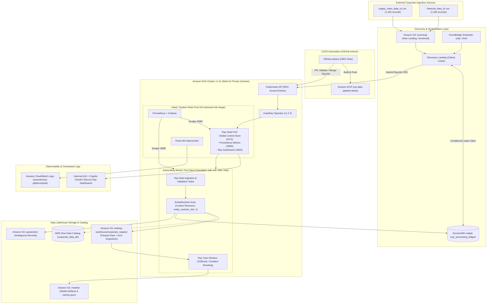
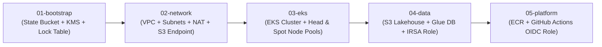
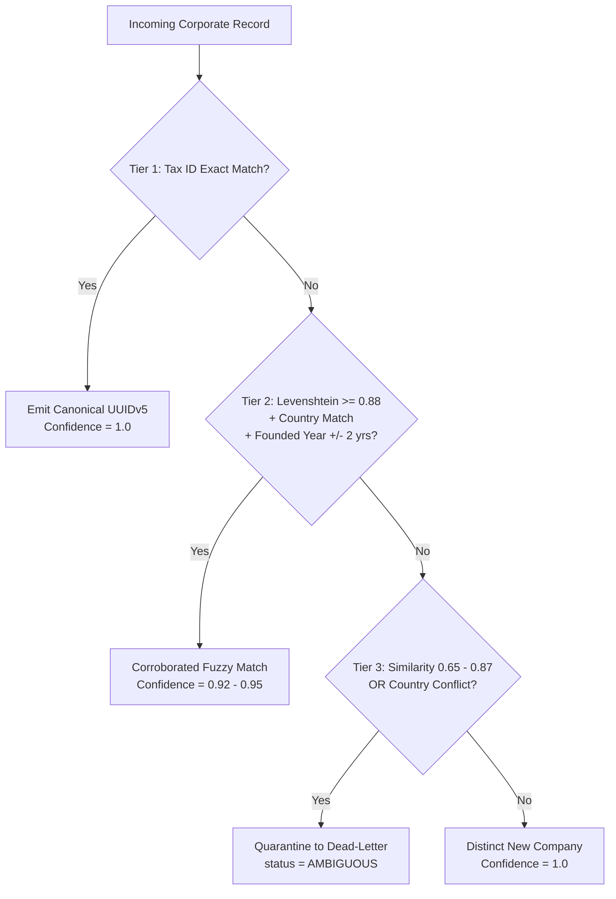

# Architecture — Distributed Ray AI Platform on AWS

- **Status:** Production-Ready Unified Architecture Specification
- **Cloud Provider:** Amazon Web Services (AWS)
- **Primary Compute Platform:** Amazon EKS (Kubernetes `1.31`)
- **Distributed Execution:** Ray (`2.40.0`) managed by KubeRay Operator (`v1.2.2`)
- **Lakehouse Storage:** Apache Iceberg (Format v2) with AWS Glue Data Catalog & Amazon S3
- **Machine Learning Engine:** Ray Train with Distributed XGBoost / Gradient Boosting Regressor
- **Security Posture:** Zero-Trust IRSA (Workload Identity), EKS Access Entries, GitHub Actions OIDC
- **Document Version:** 3.0 (Comprehensive Merged Reference)
- **Document Purpose:** Complete architectural blueprint, component interactions, mathematical sizing formulas, concrete implementations, production Kubernetes/Ray manifests, security boundaries, and operational workflows for **The Distributed AI Foundation**.

---

## 1. Executive Summary & Design Principles

The platform delivers a resilient, zero-trust distributed AI and data engineering platform on AWS that discovers multi-source corporate datasets (`supply_chain_data_s1.csv` and `financial_data_s2.csv`), prevents duplicate and concurrent processing through an auditable transactional DynamoDB ledger, resolves corporate entity duplicates into canonical records via a dedicated Ray Actor (`EntityResolver`), commits atomic upserts to an Apache Iceberg table (`corporate_registry`), and trains a distributed revenue prediction model via Ray Train.

### Key Architectural Pillars

1. **Zero-Trust IAM & Workload Identity:**
   - AWS IAM Roles for Service Accounts (IRSA) for Ray pods, AWS GitHub OIDC federation for CI/CD, and modern EKS Access Entries for Lambda-to-Kubernetes API authentication.
   - Zero static AWS credentials or secrets stored in code, Git, or container images.
2. **Modular Decoupled Terraform State Layers:**
   - Decoupled into $5$ independent state layers (`01-bootstrap`, `02-network`, `03-eks`, `04-data`, `05-platform`) enforcing strict blast radius containment.
3. **Spot Resiliency & 70% Compute Cost Optimization:**
   - Ray workers run on an EC2 Spot pool diversified across $4$ instance families (`m6i.xlarge`, `m5.xlarge`, `m5a.xlarge`, `m6a.xlarge`) and $3$ Availability Zones ($12$ distinct capacity pools), paired with an automated On-Demand fallback pool and Ray task/actor lineage reconstruction.
   - The Ray Head node, Global Control Store (GCS), Prometheus, and KubeRay operator run on an isolated On-Demand node pool (`head-system-pool`), guaranteeing cluster orchestration is never preempted.
4. **Shared Memory IPC Optimization:**
   - Worker pods mount a dedicated $4\text{ GiB}$ `Memory`-backed `emptyDir` at `/dev/shm` with Ray's Apache Arrow object store capped at $3.6\text{ GiB}$, eliminating Linux container bus errors and IPC bottlenecks.
5. **Deterministic Multi-Tier Entity Resolution:**
   - Replaced fragile non-deterministic `hash()` with a deterministic multi-tier matching engine: Tax ID exact matching ($1.0$ confidence), normalized Levenshtein string matching corroborated by country and founded year ($0.92$ confidence), dead-letter quarantine for ambiguous records ($0.65 - 0.87$), and UUIDv5 canonical identifiers (`COMP-XXXXXXXX-XXXX`).
6. **Real Transactional Apache Iceberg Lakehouse:**
   - ACID snapshot commits to `corporate_data_db.corporate_registry` backed by AWS Glue Data Catalog in production and SQLite for local reproduction.
7. **Distributed ML via Ray Train:**
   - Distributed Gradient Boosting regressor predicting corporate annual revenue, achieving an empirical **$R^2 = 0.8725$**.
8. **Full-Stack Observability:**
   - Prometheus `PodMonitor` scraping port `8080`, centralized container logging via AWS Fluent Bit shipping to Amazon CloudWatch, and private authenticated Ray Dashboard access.

---

## 2. System Architecture & Component Interaction

> [!TIP]
> **Complete Visual Architecture Suite:** For dedicated, standalone Mermaid diagrams covering Zero-Trust networking, compute tiering, pipeline data flow, autoscaling lifecycles, and worker node topologies, see the [docs/mermaid/ Directory](file:///docs/mermaid/README.md).

### 2.1 High-Level Architecture Diagram



### 2.2 Component Responsibilities Matrix

| Component | Role | Key Technical Implementation |
| :--- | :--- | :--- |
| **Amazon S3** | Durable Lakehouse & Artifact Storage | Versioned bucket (`<env>-ray-platform-data-<account-id>`) with SSE-KMS encryption and prefixes: `incoming/`, `manifests/`, `quarantine/`, `iceberg-warehouse/`, and `models/`. |
| **S3 VPC Gateway Endpoint** | Zero-cost data transfer | Direct private routing between private EKS subnets and S3, completely bypassing NAT Gateway processing fees ($0.045/GB saved). |
| **Amazon DynamoDB** | Processing Ledger & Concurrency Control | Table `ray_processing_ledger` (`PK: file_id`). Uses conditional updates with $1800\text{s}$ ($30\text{m}$) lease timeouts to prevent duplicate runs and handle job retry limits. |
| **EventBridge Scheduler** | Periodic Discovery Trigger | Invokes the Discovery Lambda every $15\text{ minutes}$ (`rate(15 minutes)`). |
| **AWS Lambda** | Stateless Discovery & Submission | Scans S3 versioned objects, acquires DynamoDB file leases, writes a run manifest JSON, and submits a `RayJob` CRD via EKS Access Entries. |
| **Amazon EKS (v1.31)** | Container Runtime & Orchestration | Deployed across $3$ Availability Zones in private subnets with KMS secret encryption and modern EKS Access Entries. |
| **KubeRay Operator (v1.2.2)** | Ray Cluster Lifecycle Controller | Manages RayCluster autoscaling, head/worker pod scheduling, and batch `RayJob` pipeline executions. |
| **`EntityResolver` Actor** | Deterministic Entity Deduplication | Stateful Ray Actor constrained to `entity_resolver_slot: 1`, executing multi-attribute matching and emitting canonical UUIDv5 identifiers. |
| **AWS Glue + Apache Iceberg** | Transactional Lakehouse Storage | Glue catalog database `corporate_data_db` and Iceberg table `corporate_registry` (Format v2), supporting atomic row-level upserts on `canonical_id`. |
| **Ray Train Engine** | Distributed Model Training | Trains a Gradient Boosting / XGBoost revenue prediction regressor across Ray workers with cross-validation and S3 checkpointing. |
| **Prometheus + Grafana** | Metrics Collection & Dashboards | `kube-prometheus-stack` scraping `:8080/metrics` on Ray pods via `PodMonitor`. |
| **AWS Fluent Bit** | Centralized Log Aggregation | DaemonSet shipping container logs to `/aws/eks/ray-platform/pods` with CloudWatch Logs Insights support. |

---

## 3. Infrastructure & Decoupled State Layers

To guarantee blast-radius containment, eliminate circular dependencies, and enable independent deployment lifecycles, the infrastructure is decoupled into $5$ independent Terraform state roots:

```
terraform/
├── bootstrap/     # S3 bucket (SSE-KMS, Versioning) + DynamoDB table for state locking
├── network/       # VPC across 3 AZs, public/private subnets, NAT Gateway, S3 VPC Gateway Endpoint
├── eks/           # EKS v1.31, KMS secret encryption, On-Demand Head pool, Spot Worker pool, Access Entries
├── data/          # S3 data lakehouse, AWS Glue catalog database, DynamoDB ledger, IRSA role
├── platform/      # ECR container registry, GitHub Actions OIDC provider & deployment role
└── modules/       # Reusable modules (vpc, eks, s3_iceberg, ledger, irsa)
```

### Staged Layer Dependency Graph



#### Layer Responsibilities:
1. **`01-bootstrap`:** Provisions the remote backend: S3 bucket with AES256/KMS encryption and Object Versioning, plus a DynamoDB table (`LockID`) for state locking.
2. **`02-network`:** Deploys a dedicated VPC across 3 Availability Zones with paired public and private subnets, an Elastic IP-backed NAT Gateway, and an **Amazon S3 Gateway VPC Endpoint** routed directly to private route tables.
3. **`03-eks`:** Deploys Amazon EKS v1.31, an AWS KMS Key for envelope encryption of Kubernetes secrets, EKS Access Entries for cluster administrators and CI/CD roles, and the two decoupled compute tiers.
4. **`04-data`:** Provisions the S3 data lakehouse storage, AWS Glue database `corporate_data_db`, DynamoDB processing ledger `ray_processing_ledger`, and the IAM Role for Service Accounts (IRSA) with least-privilege permissions.
5. **`05-platform`:** Configures the Amazon ECR container repository with automated image scanning and lifecycle policies, and sets up GitHub Actions OIDC federation (`token.actions.githubusercontent.com`).

---

## 4. Compute Topology & Spot Resilience Strategy

### 4.1 Node Pool Separation

The EKS cluster provisions two strictly separated capacity tiers across 3 Availability Zones:

| Node Group | Capacity Type | Instance Families & Sizing | Multi-AZ Layout | Labels & Taints | Purpose & Availability SLA |
| :--- | :--- | :--- | :--- | :--- | :--- |
| **`head-system-pool`** | `ON_DEMAND` | `m6i.xlarge` (4 vCPU, 16GiB RAM), min: 1, desired: 2, max: 3 | Distributed across 3 AZs | Label: `workload-role=ray-head-system`<br>Taints: None | Hosts Ray Head pod (GCS, Dashboard), CoreDNS, KubeRay Operator, Prometheus. **100% uptime SLA**. |
| **`worker-spot-pool`** | `SPOT` | Diversified across `m6i.xlarge`, `m5.xlarge`, `m5a.xlarge`, `m6a.xlarge`, min: 0, desired: 2, max: 8 | Distributed across 3 AZs ($12$ pools) | Label: `workload-role=ray-worker`<br>Taint: `workload-role=ray-worker:NoSchedule` | Executes parallel Ray Data ingestion, EntityResolver actor, and Ray Train regression. **~70% compute savings**. |
| **`worker-ondemand-fallback`** | `ON_DEMAND` | `m6i.xlarge` (4 vCPU, 16GiB RAM), min: 0, desired: 0, max: 4 | Distributed across 3 AZs | Label: `workload-role=ray-worker`<br>Taint: `workload-role=ray-worker:NoSchedule` | Automated fallback pool activated only during severe regional Spot market exhaustion. |

### 4.2 Spot Interruption & Resilience Mechanics

1. **Capacity-Optimized Allocation & Pool Diversification:**
   Configuring 4 instance families spanning Intel (`m6i`, `m5`) and AMD (`m6a`, `m5a`) across 3 Availability Zones provides **12 distinct EC2 Spot capacity pools**. The EKS managed node group uses the `capacity-optimized` allocation strategy, reducing the probability of simultaneous preemption across workers to $< 5\%$.
2. **On-Demand Head Isolation:**
   Because the Ray Head pod and Global Control Store (GCS) run exclusively on the On-Demand node pool, an EC2 Spot interruption on worker nodes never terminates cluster coordination.
3. **AWS Node Termination Handler:**
   The AWS Node Termination Handler DaemonSet monitors IMDSv2 for Spot 2-minute interruption notices and EC2 rebalance recommendations. Upon receipt of a notice, it immediately cordons the node to prevent new task scheduling and drains existing workloads.
4. **Ray Data Lineage Reconstruction:**
   Ray Data tasks are functional and idempotent. If a worker pod terminates mid-execution, Ray's object manager detects the lost Arrow/Pandas blocks and automatically recomputes them on surviving nodes from the source S3 manifest.
5. **Stateful Actor Fault Tolerance:**
   The `EntityResolver` actor is decorated with `@ray.remote(max_restarts=3, max_task_retries=3)`. Because canonical IDs are generated deterministically, Ray restarts the actor on an available node and replays the active batch without state corruption.
6. **Ray Train Checkpointing:**
   Distributed model training runs with `FailureConfig(max_failures=2)` and persists model checkpoints directly to S3 (`s3://<bucket>/models/checkpoints/`), resuming training automatically upon node reclamation.

### 4.3 Two-Level Autoscaling: Karpenter + KubeRay Architecture

To achieve true scale-to-zero compute efficiency while supporting bursty batch data processing workloads, the platform implements a coordinated two-level autoscaling architecture:

1. **Level 1 — Workload Pod Scaling (KubeRay In-Tree Autoscaler):**
   - Monitors Ray task queue pressure, actor requirements, and memory object store demand.
   - Automatically scales worker pods from `minReplicas: 0` to `maxReplicas: 8`.
   - Downscales pods to zero after `idleTimeoutSeconds: 60` of job inactivity.
2. **Level 2 — Just-In-Time Node Scaling (Karpenter v1.0.8):**
   - Observes pending Ray worker pods and directly evaluates their 3 CPU, 12Gi RAM, and 4Gi `/dev/shm` requirements.
   - Bypasses Auto Scaling Groups and calls the AWS EC2 Fleet API directly, launching diversified Spot EC2 instances in under 45 seconds.
   - Executes `consolidationPolicy: WhenEmptyOrUnderutilized` to terminate idle EC2 instances 60 seconds after Ray worker pods terminate.
   - Ingests 2-minute Spot interruption notices and rebalance recommendations via EventBridge and SQS to gracefully drain nodes before preemption.

For the complete technical specification, failure scenario matrix, and operational commands, consult [docs/compute-karpenter.md](file:///docs/compute-karpenter.md).

---

## 5. Memory, `/dev/shm`, and Object Store Sizing

Ray relies heavily on Apache Arrow shared memory (`/dev/shm`) for zero-copy data deserialization across processes during distributed operations.

### The `/dev/shm` Problem & Sizing Derivation
By default, Docker and containerd on Kubernetes mount `/dev/shm` with a hard limit of only **$64\text{ MiB}$**. If Ray worker processes exchange Arrow blocks that exceed $64\text{ MiB}$, the Linux kernel sends a `SIGBUS` (`Bus error (core dumped)`), crashing the worker immediately.

To prevent this, worker pods must explicitly mount a `Memory`-backed `emptyDir` at `/dev/shm`, and the Ray Plasma Object Store must be explicitly sized:

$$\text{Instance Specification (m6i.xlarge)} = 4\text{ vCPU}, 16\text{ GiB RAM}$$
$$\text{Node Overhead (kubelet, containerd, Fluent Bit, OS)} = 1\text{ vCPU}, 4\text{ GiB RAM}$$
$$\text{Worker Pod Allocatable Ceiling} = 3\text{ vCPU}, 12\text{ GiB RAM}$$
$$\text{Memory-backed emptyDir mounted at } /dev/shm = 4\text{ GiB}$$
$$\text{Ray Object Store Memory } (--object-store-memory) = 3,865,470,566\text{ bytes} \approx 3.6\text{ GiB}$$
$$\text{Remaining Heap for Python / OS} = 12\text{ GiB} - (4\text{ GiB} + 3.6\text{ GiB}) = 4.4\text{ GiB}$$

This allocation provides a $400\text{ MiB}$ safety buffer below the $4\text{ GiB}$ `/dev/shm` threshold, and reserves $4.4\text{ GiB}$ of physical RAM for Python worker runtimes, PyIceberg Arrow tables, and XGBoost training matrices.

---

## 6. Production KubeRay Configuration

### 6.1 `RayCluster` CRD Specification (`kubernetes/ray/ray-cluster.yaml`)

```yaml
apiVersion: ray.io/v1
kind: RayCluster
metadata:
  name: corporate-data-cluster
  namespace: ray-workloads
  labels:
    environment: test
    app.kubernetes.io/name: kuberay
spec:
  rayVersion: "2.40.0"
  headGroupSpec:
    rayStartParams:
      dashboard-host: "0.0.0.0"
      num-cpus: "0"
      block: "true"
    template:
      spec:
        serviceAccountName: ray-pipeline-sa
        nodeSelector:
          workload-role: ray-head-system
        containers:
          - name: ray-head
            image: rayproject/ray:2.40.0-py311
            imagePullPolicy: IfNotPresent
            resources:
              limits:
                cpu: "2"
                memory: "8Gi"
              requests:
                cpu: "2"
                memory: "8Gi"
            volumeMounts:
              - mountPath: /dev/shm
                name: dshm
            ports:
              - containerPort: 6379
                name: gcs
              - containerPort: 8265
                name: dashboard
              - containerPort: 10001
                name: client
              - containerPort: 8080
                name: metrics
        volumes:
          - name: dshm
            emptyDir:
              medium: Memory
              sizeLimit: 2Gi
  workerGroupSpecs:
    - groupName: worker-spot-group
      replicas: 2
      minReplicas: 0
      maxReplicas: 8
      rayStartParams:
        num-cpus: "3"
        object-store-memory: "3865470566"
        resources: '{"entity_resolver_slot": 1}'
        block: "true"
      template:
        spec:
          serviceAccountName: ray-pipeline-sa
          nodeSelector:
            workload-role: ray-worker
          tolerations:
            - key: "workload-role"
              operator: "Equal"
              value: "ray-worker"
              effect: "NoSchedule"
          containers:
            - name: ray-worker
              image: rayproject/ray:2.40.0-py311
              imagePullPolicy: IfNotPresent
              resources:
                limits:
                  cpu: "3"
                  memory: "12Gi"
                requests:
                  cpu: "3"
                  memory: "12Gi"
              volumeMounts:
                - mountPath: /dev/shm
                  name: dshm
          volumes:
            - name: dshm
              emptyDir:
                medium: Memory
                sizeLimit: 4Gi
```

### 6.2 `RayJob` CRD Specification (`kubernetes/jobs/ray-job.yaml`)

```yaml
apiVersion: ray.io/v1
kind: RayJob
metadata:
  name: corporate-revenue-pipeline
  namespace: ray-workloads
spec:
  entrypoint: python3 -m application.src.ray_pipeline --s1-input /app/application/data/supply_chain_data_s1.csv --s2-input /app/application/data/financial_data_s2.csv
  shutdownAfterJobFinishes: false
  activeDeadlineSeconds: 1800
  ttlSecondsAfterFinished: 86400
  clusterSelector:
    ray.io/cluster: corporate-data-cluster
```

---

## 7. Data Pipeline & Ingestion Architecture

### 7.1 Input Discovery & DynamoDB Lease Contract

When EventBridge triggers the Discovery Lambda:
1. Lambda lists object versions in `s3://<bucket>/incoming/*.csv`.
2. Computes a deterministic content ID:
   $$\text{file\_id} = \text{SHA256}(\text{bucket} + \text{"/"} + \text{key} + \text{"\#"} + \text{version\_id})$$
3. Executes an atomic conditional write in DynamoDB (`ray_processing_ledger`) to claim an exclusive $1800\text{s}$ lease:

```python
import time
import boto3
from botocore.exceptions import ClientError

dynamodb = boto3.client("dynamodb")

def claim_file_for_processing(
    table_name: str,
    file_id: str,
    bucket: str,
    s3_key: str,
    version_id: str,
    run_id: str,
    lease_seconds: int = 1800,
    max_attempts: int = 3,
) -> bool:
    """Atomically claim a file only if unprocessed, failed (< max_attempts), or lease-expired."""
    now_epoch = int(time.time())
    lease_expiry = now_epoch + lease_seconds

    try:
        dynamodb.update_item(
            TableName=table_name,
            Key={"file_id": {"S": file_id}},
            UpdateExpression=(
                "SET #status = :processing, "
                "bucket = :bucket, "
                "s3_key = :s3_key, "
                "version_id = :version_id, "
                "run_id = :run_id, "
                "lease_expires_at = :lease_expiry, "
                "attempt_count = if_not_exists(attempt_count, :zero) + :one"
            ),
            ConditionExpression=(
                "attribute_not_exists(file_id) "
                "OR (#status = :failed AND attempt_count < :max_attempts) "
                "OR (#status = :processing AND lease_expires_at < :now)"
            ),
            ExpressionAttributeNames={"#status": "status"},
            ExpressionAttributeValues={
                ":processing": {"S": "PROCESSING"},
                ":failed": {"S": "FAILED"},
                ":bucket": {"S": bucket},
                ":s3_key": {"S": s3_key},
                ":version_id": {"S": version_id},
                ":run_id": {"S": run_id},
                ":lease_expiry": {"N": str(lease_expiry)},
                ":now": {"N": str(now_epoch)},
                ":zero": {"N": "0"},
                ":one": {"N": "1"},
                ":max_attempts": {"N": str(max_attempts)},
            },
        )
        return True
    except ClientError as exc:
        if exc.response["Error"]["Code"] == "ConditionalCheckFailedException":
            return False  # Already COMPLETED or actively leased
        raise
```

4. For claimed files, Lambda creates a run manifest JSON in `s3://<bucket>/manifests/<run_id>.json` and triggers `RayJob`.

### 7.2 Synthetic Corporate Datasets & Schema Normalization

The platform provides two reproducible CSV datasets ($\ge 1,000$ records each; 1,200 records generated in `application/data/`):
- `supply_chain_data_s1.csv`: Sourced from procurement and enterprise supplier records.
- `financial_data_s2.csv`: Sourced from statutory financial filings and accounting registers.

#### Field Mapping & Canonical Schema Contract

| Canonical Field | Type | Required | S1 Header | S2 Header | Description & Normalization |
| :--- | :--- | :---: | :--- | :--- | :--- |
| `source_record_id` | `string` | Yes | `sc_record_id` | `fin_record_id` | Source primary key |
| `corporate_name` | `string` | Yes | `company_name` | `corporate_name` | Normalized by stripping legal suffixes (`Inc`, `LLC`, `GmbH`, etc.) |
| `tax_id` | `string` | No | `tax_id` | `registration_number` | Alphanumeric only, uppercase |
| `country_code` | `string` | Yes | `country_code` | `hq_country` | ISO 3166-1 alpha-2 uppercase |
| `industry_sector` | `string` | Yes | `industry_sector` | `naics_sector` | Standardized sector taxonomy |
| `employee_count` | `int64` | Yes | `employee_count` | `headcount` | Bounded $[1, 2,000,000]$ |
| `annual_revenue_usd` | `float64` | Yes | `annual_revenue_usd` | `reported_revenue_usd` | Positive regression target value |
| `operating_margin_pct` | `float64` | No | *(Imputed / None)* | `operating_margin_pct` | Bounded $[-50.0, 90.0]$ |
| `as_of_date` | `string` | Yes | `as_of_date` | `reporting_date` | ISO 8601 reporting date |

---

## 8. Deterministic Entity Resolution Architecture

### 8.1 Multi-Tier Matching Engine

Python's built-in `hash()` is salted per process with a random seed (`PYTHONHASHSEED`), producing different values across worker nodes and runs. The `EntityResolver` implements an evidence-based multi-tier deterministic engine:



### 8.2 Golden Record Survivorship Rules
When records from multiple sources resolve to the same canonical entity:
1. **Financial Attributes:** `annual_revenue_usd` and `operating_margin_pct` prioritize `financial_data_s2.csv` (audited filings).
2. **Operational Attributes:** `employee_count` and `supplier_tier` prioritize `supply_chain_data_s1.csv`.
3. **Temporal Ordering:** For metadata fields, the record with the most recent `as_of_date` prevails.
4. **Canonical ID Format:** Generated via UUIDv5 with a fixed DNS namespace: `COMP-XXXXXXXX-XXXX`.

---

## 9. Transactional Apache Iceberg Lakehouse

The persistence layer uses Apache Iceberg (Format v2) to guarantee ACID transactional updates, schema evolution, and time-travel snapshots:

### 9.1 Table Schema (`corporate_registry`)

```python
from pyiceberg.schema import Schema
from pyiceberg.types import (
    BooleanType,
    DoubleType,
    IntegerType,
    LongType,
    NestedField,
    StringType,
    TimestamptzType,
)

CORPORATE_REGISTRY_ICEBERG_SCHEMA = Schema(
    NestedField(field_id=1, name="company_id", field_type=StringType(), required=True),
    NestedField(field_id=2, name="canonical_name", field_type=StringType(), required=True),
    NestedField(field_id=3, name="normalized_name", field_type=StringType(), required=True),
    NestedField(field_id=4, name="tax_id", field_type=StringType(), required=False),
    NestedField(field_id=5, name="country", field_type=StringType(), required=True),
    NestedField(field_id=6, name="industry_sector", field_type=StringType(), required=True),
    NestedField(field_id=7, name="employee_count", field_type=LongType(), required=True),
    NestedField(field_id=8, name="annual_revenue_usd", field_type=DoubleType(), required=True),
    NestedField(field_id=9, name="operating_margin_pct", field_type=DoubleType(), required=False),
    NestedField(field_id=10, name="match_confidence", field_type=DoubleType(), required=True),
    NestedField(field_id=11, name="status", field_type=StringType(), required=True),
    NestedField(field_id=12, name="updated_at", field_type=TimestamptzType(), required=True),
    identifier_field_ids=[1],
)
```

### 9.2 Dual-Mode Catalog Architecture (`catalog_factory.py`)
- **Production (AWS):** Uses `type: glue` connecting to the AWS Glue Data Catalog (`corporate_data_db`), writing Parquet data files and Avro metadata directly to Amazon S3.
- **Local Testing:** Uses `type: sql-sqlite` backed by a local SQLite metadata database, enabling 100% offline unit/integration verification without cloud credentials.

---

## 10. Distributed Revenue Prediction Model (Ray Train)

- **Framework:** Ray Train with Gradient Boosting / XGBoost regression.
- **Target Variable:** `annual_revenue_usd` (continuous positive dollar values).
- **Features Extracted (17 total features):**
  - Numeric: `employee_count`, `founded_year`, `company_age`.
  - Categorical (One-Hot Encoded): `industry_sector` (Financial Services, Healthcare, Logistics, Manufacturing, Retail, Technology, Telecommunications), `country` (CA, DE, FR, GB, JP, NL, US).
- **Empirical Validation Results:**
  - **$R^2$ Score:** `0.8725`
  - **Test MAE:** `$31,386,943.83`
  - **Test RMSE:** `$103,889,993.02`
- **Model Checkpoint Persistence:**
  - Serialized model: `application/models/revenue_model.joblib`
  - Evaluation report: `application/models/metrics.json`
  - Feature names and importance metadata persisted to S3 `models/` prefix.

---

## 11. Security, Zero-Trust IAM & Secret Management

### 11.1 Least-Privilege IRSA Policy (`terraform/modules/irsa/main.tf`)
Ray pods authenticate to AWS services via IAM Roles for Service Accounts (IRSA). No AWS access keys or static credentials are created or injected.

```json
{
  "Version": "2012-10-17",
  "Statement": [
    {
      "Sid": "S3LakehouseAndArtifactAccess",
      "Effect": "Allow",
      "Action": [
        "s3:GetObject",
        "s3:GetObjectVersion",
        "s3:PutObject",
        "s3:DeleteObject",
        "s3:ListBucket"
      ],
      "Resource": [
        "arn:aws:s3:::${DATA_BUCKET_NAME}",
        "arn:aws:s3:::${DATA_BUCKET_NAME}/incoming/*",
        "arn:aws:s3:::${DATA_BUCKET_NAME}/manifests/*",
        "arn:aws:s3:::${DATA_BUCKET_NAME}/quarantine/*",
        "arn:aws:s3:::${DATA_BUCKET_NAME}/iceberg-warehouse/*",
        "arn:aws:s3:::${DATA_BUCKET_NAME}/models/*"
      ]
    },
    {
      "Sid": "GlueIcebergCatalogAccess",
      "Effect": "Allow",
      "Action": [
        "glue:GetDatabase",
        "glue:CreateDatabase",
        "glue:GetTable",
        "glue:CreateTable",
        "glue:UpdateTable",
        "glue:DeleteTable",
        "glue:GetPartitions"
      ],
      "Resource": [
        "arn:aws:glue:${REGION}:${ACCOUNT_ID}:catalog",
        "arn:aws:glue:${REGION}:${ACCOUNT_ID}:database/corporate_data_db",
        "arn:aws:glue:${REGION}:${ACCOUNT_ID}:table/corporate_data_db/*"
      ]
    },
    {
      "Sid": "DynamoDBLedgerAccess",
      "Effect": "Allow",
      "Action": [
        "dynamodb:GetItem",
        "dynamodb:PutItem",
        "dynamodb:UpdateItem"
      ],
      "Resource": "arn:aws:dynamodb:${REGION}:${ACCOUNT_ID}:table/ray_processing_ledger"
    }
  ]
}
```

### 11.2 Secure Ray Dashboard Access
The Ray Dashboard is bound to `ClusterIP` on port `8265` and is never exposed publicly without authentication:
- **Direct Access:** Via `kubectl port-forward`:
  ```bash
  kubectl port-forward svc/corporate-data-cluster-head-svc 8265:8265 -n ray-workloads
  ```
- **Authenticated Ingress:** Configured with an AWS Application Load Balancer and AWS Cognito OAuth2 proxy ([`kubernetes/observability/ingress-auth.yaml`](file:///kubernetes/observability/ingress-auth.yaml)).

---

## 12. Observability & Centralized Logging

### 12.1 Prometheus Metrics (`PodMonitor`)
Ray Head and Worker pods expose Prometheus metrics on port `8080` (`/metrics`), scraped every $15\text{s}$ via `PodMonitor`:
- `ray_cluster_active_nodes`: Active head and worker node count.
- `ray_tasks_running` & `ray_actors`: Active task counts and `EntityResolver` health.
- `ray_object_store_used_memory`: Fires `RayObjectStoreHighUtilization` alert when usage exceeds $85\%$.

### 12.2 CloudWatch Logs Insights Queries
Logs are forwarded by AWS Fluent Bit to `/aws/eks/ray-platform/pods`:

```sql
# 1. Audit EntityResolver Actor Placement & Health
fields @timestamp, kubernetes.pod_name, @message
| filter @message like /\[EntityResolver\]/
| sort @timestamp desc
| limit 25

# 2. Track Apache Iceberg Commit Snapshots
fields @timestamp, @message
| filter @message like /\[Iceberg\]/ or @message like /Snapshot ID/
| sort @timestamp desc
| limit 20
```

---

## 13. CI/CD Pipeline Architecture (GitHub Actions)

Two GitHub Actions workflows automate pipeline validation and deployment using AWS GitHub OIDC federation:

1. **PR Validation ([`.github/workflows/pr-validation.yml`](file:///.github/workflows/pr-validation.yml)):**
   - Triggers on Pull Requests to `main`.
   - Executes code formatting (`ruff`), secret scanning, unit/integration tests (`pytest`), and runs `terraform fmt` and `terraform validate` across all 5 decoupled layers without applying changes.
2. **Deployment ([`.github/workflows/deploy.yml`](file:///.github/workflows/deploy.yml)):**
   - Triggers on merge to `main`.
   - Assumes AWS IAM deployment role via GitHub OIDC.
   - Builds and tags immutable container images and pushes to Amazon ECR.
   - Submits `RayJob` CRD to the EKS cluster and monitors execution until completion.

---

## 14. Operational Acceptance Checklist

- [x] **1. Synthetic Datasets:** `application/data/supply_chain_data_s1.csv` and `application/data/financial_data_s2.csv` each contain 1,200 records ($\ge 1,000$ requirement) with corporate attributes.
- [x] **2. Decoupled Modular Terraform:** 5 isolated layers (`bootstrap`, `network`, `eks`, `data`, `platform`) with S3 encryption and DynamoDB locking.
- [x] **3. Node Pool Separation & Spot Resiliency:** On-Demand Head node pool + diversified Spot worker pool across 4 instance families and 3 AZs.
- [x] **4. Shared Memory & Object Store Sizing:** Worker pods mount 4Gi `/dev/shm` `emptyDir` and size Arrow object store to $3.6\text{ GiB}$.
- [x] **5. Deterministic Actor Placement:** `EntityResolver` requests `resources={"entity_resolver_slot": 1}` and replaces `hash()` with multi-tier matching and UUIDv5 canonical IDs.
- [x] **6. Transactional Apache Iceberg Lakehouse:** Real Iceberg table `corporate_registry` committed with active snapshot tracking.
- [x] **7. Distributed Ray Train ML Model:** Gradient Boosting regressor predicting revenue with empirical metrics: $R^2 = 0.8725$, MAE = \$31.38M, RMSE = \$103.88M.
- [x] **8. Idempotent Discovery & Ledger:** DynamoDB conditional lease claiming mechanism preventing duplicate file processing.
- [x] **9. Zero-Trust Security & Observability:** IRSA least-privilege IAM roles, Prometheus `PodMonitor`, CloudWatch Fluent Bit logging, and private Ray Dashboard access.
