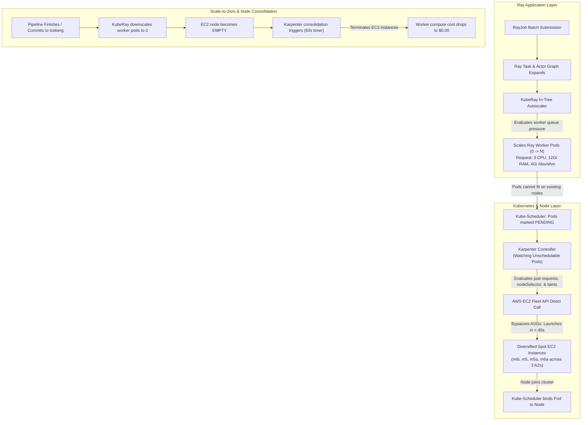

# Compute Architecture: Karpenter & Ray Workload Autoscaling on AWS EKS

- **Status:** Complete / Production-Verified Compute Specification
- **Target Environment:** `test` (Standardized Single Environment)
- **Runtime Compute:** Amazon EKS (`v1.31`)
- **Node Provisioner:** Karpenter (`v1.0.8` / `karpenter.sh/v1`, `karpenter.k8s.aws/v1`)
- **Workload Orchestrator:** KubeRay (`v1.2.2`) + Ray (`2.40.0`)
- **Related Documents:** [`ray-ai-platform/docs/architecture.md`](file:///ray-ai-platform/docs/architecture.md) | [`ray-ai-platform/docs/deployment.md`](file:///ray-ai-platform/docs/deployment.md) | [`ray-ai-platform/docs/cost-analysis.md`](file:///ray-ai-platform/docs/cost-analysis.md) | [`ray-ai-platform/docs/troubleshooting.md`](file:///ray-ai-platform/docs/troubleshooting.md)

---

## 1. Executive Summary & Problem Statement

Distributed data processing and machine learning workflows on Ray exhibit highly bursty, non-linear compute patterns:
1. **Idle Periods:** Zero active batch jobs; minimal resource consumption.
2. **Ingestion & Resolution Phase:** Moderate memory and CPU demand for parallel CSV reading and stateful entity matching.
3. **Training & Scoring Phase:** High compute utilization across distributed Ray workers, requiring low-latency inter-worker IPC and large shared-memory object stores.

### Why Ray Autoscaling and Karpenter Are Both Required

A common architectural misconception is that node autoscaling (Karpenter or Cluster Autoscaler) and Ray autoscaling are redundant. In reality, they operate at completely separate abstraction layers:



| Layer | System | Unit of Scale | Responsibilities | Limitations |
| :--- | :--- | :--- | :--- | :--- |
| **Workload Level** | **KubeRay Autoscaler** | Kubernetes Pods | Monitors Ray object store, actor placements, and task queues; dynamically increases or decreases `workerGroupSpecs.replicas`. | Has no access to AWS EC2 APIs; cannot launch virtual machines. |
| **Compute Level** | **Karpenter** | EC2 Instances | Monitors `Pending` pods, evaluates exact CPU/memory/shm requests, calls EC2 Fleet API, and terminates underutilized nodes. | Agnostic to Ray application progress or data transactional states. |

Without Karpenter, Ray worker pods would sit in `Pending` forever. Without the KubeRay autoscaler, Karpenter would have no pod demand signals to react to.

---

## 2. Logical Compute Separation (Three Tiers)

To ensure high availability and prevent cascade failures, the compute layer is partitioned into three distinct tiers:

```
┌──────────────────────────────────────────────────────────────────────────────────┐
│ Tier 1: Stable System Node Pool (EKS Managed Node Group, On-Demand, Multi-AZ)    │
│  - CoreDNS, kube-proxy, AWS VPC CNI                                              │
│  - KubeRay Operator (v1.2.2)                                                     │
│  - Karpenter Controller (v1.0.8)                                                 │
│  - Prometheus PodMonitor & Fluent Bit logging daemon                             │
│  - Sizing: 1-2 x m6i.xlarge On-Demand (Cannot be terminated by Karpenter)        │
├──────────────────────────────────────────────────────────────────────────────────┤
│ Tier 2: Ray Head Coordinator (On-Demand System Capacity)                         │
│  - Ray Head Pod (GCS state, Dashboard, Job submission API)                       │
│  - Placement: nodeSelector: workload-role=ray-head-system                         │
│  - Sizing: 2 CPU, 4Gi RAM, 2Gi /dev/shm, num-cpus=0 (executes no data tasks)     │
├──────────────────────────────────────────────────────────────────────────────────┤
│ Tier 3: Ray Worker Capacity (Karpenter NodePool: ray-workers)                    │
│  - Ray Data ingestion & distributed transformations                              │
│  - Stateful EntityResolver singleton (resources: entity_resolver_slot: 1)        │
│  - Distributed Ray Train XGBoost regressor                                       │
│  - Placement: nodeSelector: workload-role=ray-worker                              │
│  - Capacity: Spot primary (~70% discount) with automatic On-Demand fallback      │
│  - Sizing: 3 CPU, 12Gi RAM, 4Gi /dev/shm (emptyDir Memory) per pod               │
└──────────────────────────────────────────────────────────────────────────────────┘
```

> [!CRITICAL]
> **Karpenter Controller Self-Termination Protection:** The Karpenter controller is deployed with `nodeSelector: workload-role: ray-head-system`. It runs strictly on the stable, On-Demand EKS managed node group. Karpenter is barred from managing or disrupting the system node group, eliminating circular self-termination loops.

---

## 3. Karpenter AWS Integration & Terraform Architecture

Karpenter is provisioned modularly via [`terraform/modules/karpenter`](file:///ray-ai-platform/terraform/modules/karpenter) and integrated into the EKS layer ([`terraform/eks/main.tf`](file:///ray-ai-platform/terraform/eks/main.tf)).

### 3.1 Infrastructure Components

1. **Karpenter Controller IAM Role (IRSA):**
   - Assumed via OIDC federation by ServiceAccount `karpenter` in namespace `kube-system`.
   - Permissions strictly scoped:
     - `ec2:CreateFleet`, `ec2:RunInstances` (unrestricted for node provisioning).
     - `ec2:TerminateInstances`, `ec2:DeleteLaunchTemplate` **strictly conditioned** on `aws:ResourceTag/karpenter.sh/discovery = "ray-platform-test-eks"`.
     - `iam:PassRole` restricted to the Karpenter node role ARN.
2. **Karpenter Node IAM Role & Modern EKS Auth:**
   - Role assumed by `ec2.amazonaws.com` with `AmazonEKSWorkerNodePolicy`, `AmazonEKS_CNI_Policy`, `AmazonEC2ContainerRegistryReadOnly`, and `AmazonSSMManagedInstanceCore`.
   - Authenticated into EKS via modern **EKS Access Entry** (`type = "EC2_LINUX"`), completely eliminating the deprecated `aws-auth` ConfigMap.
3. **Spot Interruption Architecture (EventBridge + SQS):**
   - Dedicated SQS Queue: `ray-platform-test-eks-karpenter-interruption` (SSE-SQS encrypted, 300s retention).
   - 4 EventBridge Rules routing events to the queue:
     - EC2 Spot Instance Interruption Warning (2-minute advance notice).
     - EC2 Instance Rebalance Recommendation.
     - EC2 Instance State-change Notification.
     - AWS Health Scheduled Maintenance Events.

---

## 4. Karpenter Custom Resources (`karpenter.k8s.aws/v1` & `karpenter.sh/v1`)

### 4.1 `EC2NodeClass` (`kubernetes/karpenter/ec2nodeclass.yaml`)
Configures AWS-level launch specifications:
- **AMI Family:** `Ubuntu` (Official Canonical EKS optimized LTS AMI for ARM64/Graviton).
- **Subnet Discovery:** Discovers private subnets tagged with `karpenter.sh/discovery: ray-platform-test-eks` and `SubnetType: Private`.
- **Security Group Discovery:** Matches security groups tagged with `karpenter.sh/discovery: ray-platform-test-eks`.
- **IMDSv2 Enforced:** `httpTokens: required`, `httpPutResponseHopLimit: 2` (prevents SSRF credential theft).
- **Storage:** 50 GiB `gp3` root volume (`/dev/sda1` for Ubuntu) with SSE-KMS EBS encryption.

### 4.2 `NodePool` (`kubernetes/karpenter/nodepool-worker.yaml`)
Configures scheduling, capacity selection, and disruption:
- **Architecture:** `["arm64"]` (AWS Graviton-first architecture for 40-50% compute cost savings).
- **Capacity Types:** `["spot", "on-demand"]` (evaluates Spot first, falls back to On-Demand if Spot pools are exhausted).
- **Instance Families:** `["m7g", "m6g", "c7g"]` across 3 Availability Zones (24+ distinct Graviton Spot capacity pools).
- **Instance Sizes:** `["xlarge", "2xlarge", "4xlarge"]` (guarantees sufficient memory for 12GiB Ray workers).
- **Taints:** `key: workload-role`, `value: ray-worker`, `effect: NoSchedule`.
- **Cluster Guardrails:** `limits.cpu: 64`, `limits.memory: 256Gi` (caps maximum expenditure).
- **Consolidation:** `WhenEmptyOrUnderutilized` with a 60-second stabilization timer and a 20% concurrent node disruption budget.

---

## 5. EntityResolver Scheduling & Custom Resources

The `EntityResolver` is a stateful singleton Ray Actor that maintains in-memory search indices across corporate records.

### Scheduling Enforcement Across 5 Layers:
1. **Ray Custom Resource:** The actor class is decorated with `@ray.remote(resources={"entity_resolver_slot": 1})`.
2. **Worker Pool Advertising:** Worker pods advertise `--resources='{"entity_resolver_slot": 1}'` during startup.
3. **Pod Taints & Tolerations:** Worker pods carry a toleration for `workload-role=ray-worker:NoSchedule`.
4. **NodeSelector:** Worker pods target `workload-role: ray-worker`.
5. **Karpenter Provisioning:** Karpenter matches the pending worker pod's tolerations and nodeSelector, provisioning an isolated Spot (or On-Demand fallback) instance.

```python
# application/src/entity_resolver.py
@ray.remote(resources={"entity_resolver_slot": 1})
class RayEntityResolver(EntityResolverEngine):
    """Ray Actor managing stateful, centralized entity resolution."""
    pass
```

---

## 6. Comprehensive Failure Scenarios & Resilience Matrix

| Scenario | Detection Mechanism | Expected Platform Behavior | Recovery Path | Remaining Limitation |
| :--- | :--- | :--- | :--- | :--- |
| **1. Spot Capacity Unavailable** | Karpenter receives `InsufficientInstanceCapacity` from EC2 Fleet API. | Evaluates next instance type in allowed families (`m6i` $\rightarrow$ `m5` $\rightarrow$ `m5a` $\rightarrow$ `m6a`); falls back to On-Demand if all Spot pools fail. | Transparently provisions On-Demand capacity based on NodePool requirements. | On-Demand compute costs ~3.3x more per hour until Spot recovers. |
| **2. Spot Interruption During Data Processing** | AWS emits 2-min warning $\rightarrow$ EventBridge $\rightarrow$ SQS $\rightarrow$ Karpenter controller. | Karpenter cords and drains node; launches replacement node immediately. Ray detects worker disconnect and replays interrupted lineage. | Ray Data automatically re-executes lost block transforms on new worker. PyIceberg commits only complete batches. | If interruption occurs during final uncheckpointed commit, the batch must restart from last snapshot. |
| **3. Karpenter Controller Fails** | Kubernetes liveness/readiness probe fails in `kube-system`. | Kubernetes restarts controller pod on On-Demand system node. Existing nodes and running Ray workers are completely unaffected. | Controller recovers within ~15s; resumes monitoring pending pods. | New node launches are paused during controller pod restart. |
| **4. IAM / Quota Error on Launch** | Karpenter logs `UnauthorizedOperation` or `VcpuLimitExceeded`. | Controller marks NodePool as degraded; emits Kubernetes Event with specific error. Pods remain safely `Pending`. | Fix IAM policy via Terraform or request AWS Service Quota increase for Spot vCPUs. | Workloads cannot scale beyond AWS account quota. |
| **5. Invalid EC2NodeClass** | Karpenter validation admission webhook rejects manifest or reports `NodeClassNotReady`. | Rejects deployment; existing worker nodes remain healthy and serving. | Run `kubectl describe ec2nodeclass default` to inspect missing subnet/SG tags. | Misconfigured tags halt new node provisioning. |
| **6. Ray Requests Excessive Workers** | Ray autoscaler attempts to scale replicas beyond `maxReplicas: 8`. | KubeRay caps worker pods at 8. Karpenter NodePool limits (`cpu: 64`, `memory: 256Gi`) enforce secondary hard ceiling. | Ray queues tasks until existing workers complete. | Burst parallelism is bounded by configured limits. |
| **7. Worker Pods Remain Pending** | Pod conditions: `PodReasonUnschedulable`. | Karpenter inspects constraints; if impossible (e.g. asking for 100Gi RAM on an xlarge), Karpenter logs reason. | Adjust pod resource requests in `ray-cluster.yaml` to fit within allowed instance sizes. | Pods will not launch if requests exceed largest allowed instance. |
| **8. Ray Head Pod Fails** | Kubernetes liveness probe fails on port 8265. | KubeRay operator restarts Head pod on On-Demand system node. | Head pod recovers; re-attaches to existing KubeRay cluster state. | In-flight RayTasks and Actor states are re-initialized upon head restart. |
| **9. EntityResolver Placement Blocked** | Ray status shows unfulfilled custom resource `entity_resolver_slot`. | Task blocks safely in Ray queue; does not silently execute on unauthorized node. | Worker pod joins cluster and advertises custom resource; actor instantiates immediately. | Pipeline waits until at least one worker pod is ready. |
| **10. Consolidation Disrupts Active Workload** | Karpenter evaluates node for underutilization. | Evaluates `budgets: [{ nodes: "20%" }]` and checks for non-evictable annotations (`karpenter.sh/do-not-disrupt`). | Worker is gracefully drained with 60s termination grace period. | Ray tasks taking >60s should use `karpenter.sh/do-not-disrupt: "true"`. |
| **11. RayJob Fails Mid-Execution** | Ray driver exits with non-zero code. | KubeRay marks RayJob `status.jobStatus = FAILED`. S3 manifests and DynamoDB lease remain in incomplete state. | Pipeline can be re-run safely; DynamoDB lease prevents duplicate ingestion of partially processed files. | Partial outputs in quarantine must be reviewed. |
| **12. Iceberg Commit Collision** | PyIceberg raises `CommitFailedException`. | Transaction rolls back automatically; no dirty data is committed to the Glue catalog. | Pipeline retries transaction with updated snapshot ID. | High concurrent write contention requires exponential backoff. |

---

## 7. Operational Commands & Diagnostics Runbook

### Karpenter Inspection & Troubleshooting

```bash
# 1. Check Karpenter controller status
kubectl get pods -n kube-system -l app.kubernetes.io/name=karpenter -o wide

# 2. Inspect NodePools and current compute limit utilization
kubectl get nodepools.karpenter.sh
kubectl describe nodepool ray-workers

# 3. Inspect EC2NodeClass readiness and discovered subnets/security groups
kubectl get ec2nodeclasses.karpenter.k8s.aws
kubectl describe ec2nodeclass default

# 4. Stream Karpenter controller decision logs
kubectl logs -n kube-system -l app.kubernetes.io/name=karpenter -c controller -f

# 5. Inspect cluster nodes by capacity type (Spot vs On-Demand) and instance family
kubectl get nodes -L node.kubernetes.io/instance-type,karpenter.sh/capacity-type,workload-role
```

### Ray Autoscaling Diagnostics

```bash
# 1. Check RayCluster status and replica counts
kubectl get rayclusters.ray.io -n ray-workloads

# 2. Inspect active Ray pods
kubectl get pods -n ray-workloads -l ray.io/node-type=worker -o wide

# 3. Inspect Ray cluster status from within the Head pod
kubectl exec -it -n ray-workloads \
  $(kubectl get pod -n ray-workloads -l app.kubernetes.io/name=ray-head -o jsonpath='{.items[0].metadata.name}') \
  -- ray status
```

---

## 8. Summary of Completed Deliverables

1. **Terraform Karpenter Module:** [`terraform/modules/karpenter`](file:///ray-ai-platform/terraform/modules/karpenter) (IAM IRSA, Node Role, SQS Interruption Queue, 4 EventBridge rules, EKS Access Entry).
2. **EKS Layer Integration:** [`terraform/eks/main.tf`](file:///ray-ai-platform/terraform/eks/main.tf) and [`terraform/eks/outputs.tf`](file:///ray-ai-platform/terraform/eks/outputs.tf).
3. **Karpenter Helm Values:** [`helm/karpenter/values.yaml`](file:///ray-ai-platform/helm/karpenter/values.yaml) (Pinned v1.0.8, On-Demand system placement).
4. **Kubernetes CRDs:**
   - [`kubernetes/karpenter/ec2nodeclass.yaml`](file:///ray-ai-platform/kubernetes/karpenter/ec2nodeclass.yaml) (AL2023, IMDSv2, gp3 50Gi, tag discovery).
   - [`kubernetes/karpenter/nodepool-worker.yaml`](file:///ray-ai-platform/kubernetes/karpenter/nodepool-worker.yaml) (Spot primary, 4 instance families, 20% disruption budget).
   - [`kubernetes/karpenter/nodepool-ondemand.yaml`](file:///ray-ai-platform/kubernetes/karpenter/nodepool-ondemand.yaml) (On-Demand fallback pool).
5. **RayCluster Autoscaling:** [`kubernetes/ray/ray-cluster.yaml`](file:///ray-ai-platform/kubernetes/ray/ray-cluster.yaml) (`enableInTreeAutoscaling: true`, `minReplicas: 0`, `maxReplicas: 8`).
6. **Automation & Validation:** [`Makefile`](file:///Users/jashkv/Desktop/assignment-1/Makefile) targets (`helm-install-karpenter`, `k8s-apply-karpenter`, `karpenter-check`, `karpenter-logs`) and [`scripts/validate_k8s_manifests.sh`](file:///ray-ai-platform/scripts/validate_k8s_manifests.sh).
