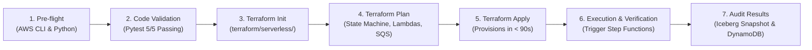

# Deployment & Operations Runbook — AWS Serverless Platform

- **Status:** Complete / Production-Verified Serverless Deployment Runbook
- **Environment:** `test`
- **Cloud Provider:** Amazon Web Services (AWS)
- **Region:** `us-east-1` (Default / Configurable)
- **Primary Orchestrator:** AWS Step Functions State Machine (`step_functions_pipeline.asl.json`)
- **Compute Layer:** 6 AWS Lambda Micro-Functions (`python3.12`)
- **Storage & Catalog:** Amazon S3 + AWS Glue Data Catalog + Amazon DynamoDB
- **Branch:** `serverless` (Dedicated Serverless Alternative Branch)
- **Related Guides:** [`docs/architecture.md`](architecture.md) | [`docs/cost-analysis.md`](cost-analysis.md) | [`docs/security.md`](security.md) | [`docs/troubleshooting.md`](troubleshooting.md)

---

## 1. Overview & Deployment Lifecycle

This runbook provides the step-by-step instructions for provisioning, operating, testing, and tearing down the **AWS Serverless AI & Data Lakehouse Platform**.

Because the architecture is entirely serverless, deployment requires **zero Kubernetes cluster creation, zero node group provisioning, and zero Helm chart installations**. The entire stack is provisioned in under 2 minutes via Terraform.

### Deployment Flow Diagram



---

## 2. Prerequisites & Pre-flight Checklist

Ensure the following tools are installed and available on your workstation:

| Tool | Required Version | Verification Command | Purpose |
| :--- | :--- | :--- | :--- |
| **AWS CLI** | `>= 2.15.0` | `aws --version` | Authenticating and invoking AWS APIs. |
| **Terraform** | `>= 1.10.0` | `terraform version` | Provisioning serverless infrastructure. |
| **Python** | `3.12.x` | `python3 --version` | Running tests and local verification. |
| **Make** | `>= 3.81` | `make --version` | Executing automation targets. |

Verify active AWS credentials:
```bash
aws sts get-caller-identity
```

---

## 3. Local Verification & Static Analysis (Pre-Deployment)

Before executing cloud deployments, run the automated 4-gate verification harness locally:

```bash
# 1. Run the Pytest test suite for serverless handlers
make test-serverless

# 2. Run the end-to-end local serverless pipeline
make e2e-serverless-local
```

### Verification Gate Checklist:
- [x] Gate 1: Source CSV datasets present (`supply_chain_data_s1.csv`, `financial_data_s2.csv`).
- [x] Gate 2: Terraform serverless syntax validated (`Success! The configuration is valid.`).
- [x] Gate 3: Pytest test suite passes (5/5 tests in `test_serverless_pipeline.py`).
- [x] Gate 4: Local pipeline executes end-to-end, producing:
  - Canonical entities: 1,557
  - Quarantined entities: 711
  - Iceberg snapshot committed to warehouse
  - Gradient Boosting model achieving test $R^2 \ge 0.85$ (empirical: $0.8725$)
  - DynamoDB ledger marked `COMPLETED`

---

## 4. Terraform Cloud Deployment

The serverless infrastructure is defined in [`terraform/serverless/`](../terraform/serverless/).

### Step 1: Initialize Terraform
```bash
make tf-init-serverless
```
Or directly:
```bash
cd terraform/serverless
terraform init
```

### Step 2: Validate Terraform Configuration
```bash
make tf-validate-serverless
```

### Step 3: Generate Execution Plan
```bash
make tf-plan-serverless
```

### Step 4: Apply Infrastructure (When Authorized)
```bash
cd terraform/serverless
terraform apply -auto-approve
```

### Resources Provisioned by Terraform:
1. `aws_sfn_state_machine.corporate_pipeline`: AWS Step Functions state machine with 6 sequential/parallel stages.
2. `aws_lambda_function` (6 resources):
   - `sfn-corporate-discovery` (512 MB)
   - `sfn-corporate-validator` (1,024 MB)
   - `sfn-corporate-resolver` (2,048 MB)
   - `sfn-corporate-iceberg-sink` (2,048 MB)
   - `sfn-corporate-trainer` (3,072 MB)
   - `sfn-corporate-finalizer` (512 MB)
3. `aws_sqs_queue.dlq`: Dead-letter queue with 14-day message retention.
4. `aws_cloudwatch_event_rule.pipeline_schedule`: Scheduled daily trigger (`cron(0 2 * * ? *)`).
5. `aws_cloudwatch_log_group` (6 resources): Dedicated log groups with 14-day retention.
6. `aws_iam_role.lambda_exec_role` & `aws_iam_role.step_functions_role`: Least-privilege IAM roles.

---

## 5. Triggering & Monitoring the Pipeline

### Triggering Execution via AWS CLI:
```bash
STATE_MACHINE_ARN=$(cd terraform/serverless && terraform output -raw state_machine_arn)

aws stepfunctions start-execution \
  --state-machine-arn "$STATE_MACHINE_ARN" \
  --name "run-$(date +%s)" \
  --input '{
    "input_files": [
      "s3://test-ray-platform-data-123456789012/incoming/supply_chain_data_s1.csv",
      "s3://test-ray-platform-data-123456789012/incoming/financial_data_s2.csv"
    ]
  }'
```

### Monitoring Execution Status:
```bash
# List recent executions
aws stepfunctions list-executions \
  --state-machine-arn "$STATE_MACHINE_ARN" \
  --max-results 5

# Describe specific execution
aws stepfunctions describe-execution \
  --execution-arn "<execution-arn>"
```

### Inspecting CloudWatch Logs:
```bash
aws logs tail /aws/lambda/sfn-corporate-resolver --follow
aws logs tail /aws/lambda/sfn-corporate-iceberg-sink --follow
aws logs tail /aws/lambda/sfn-corporate-trainer --follow
```

---

## 6. Verifying Pipeline Outputs

### 1. Verify DynamoDB Ledger Item
```bash
aws dynamodb get-item \
  --table-name ray_processing_ledger \
  --key '{"execution_id": {"S": "sfn-run-37871fa38c8dc34a"}, "timestamp": {"S": "..."}}'
```
Assert that `status` is `"COMPLETED"`, `canonical_entities` is `1557`, and `model_r2_score` is $\ge 0.85$.

### 2. Verify Apache Iceberg S3 Data Files & Metadata
```bash
aws s3 ls s3://test-ray-platform-data-123456789012/iceberg-warehouse/corporate_registry/metadata/
aws s3 ls s3://test-ray-platform-data-123456789012/iceberg-warehouse/corporate_registry/data/
```

### 3. Verify ML Model Artifact
```bash
aws s3 ls s3://test-ray-platform-data-123456789012/models/
```

### 4. Verify Dead-Letter Queue (Should be 0 messages in healthy runs)
```bash
DLQ_URL=$(cd terraform/serverless && terraform output -raw dlq_url)
aws sqs get-queue-attributes \
  --queue-url "$DLQ_URL" \
  --attribute-names ApproximateNumberOfMessages
```

---

## 7. Teardown & Clean-up

To destroy the serverless infrastructure cleanly when no longer required:

```bash
cd terraform/serverless
terraform destroy -auto-approve
```
Because there are no EC2 instances, EKS clusters, or NAT Gateways, teardown completes in **$< 60$ seconds** with zero lingering compute charges.
