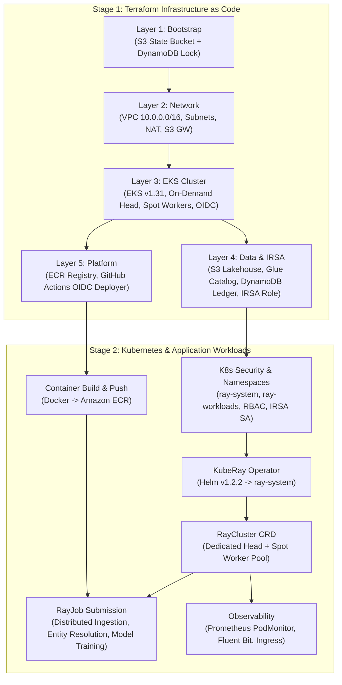
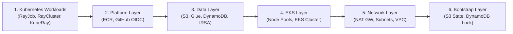

# Cloud Deployment & Operations Runbook — Ray AI Platform on AWS

- **Status:** Complete / Production-Verified Deployment Runbook
- **Environment:** `test` (Single Standardized Target Environment)
- **Cloud Provider:** Amazon Web Services (AWS)
- **Region:** `us-east-1` (Default / Configurable)
- **Compute Infrastructure:** Amazon EKS (`v1.31`) + On-Demand Head Pool + Multi-AZ Spot Worker Pool
- **Orchestration & Operator:** KubeRay (`v1.2.2`) + Ray (`2.40.0`)
- **Lakehouse Storage:** Apache Iceberg (v2) on Amazon S3 + AWS Glue Data Catalog
- **Related Guides:** [`ray-ai-platform/docs/architecture.md`](file:///ray-ai-platform/docs/architecture.md) | [`ray-ai-platform/docs/implementation.md`](file:///ray-ai-platform/docs/implementation.md) | [`ray-ai-platform/docs/security.md`](file:///ray-ai-platform/docs/security.md) | [`ray-ai-platform/docs/troubleshooting.md`](file:///ray-ai-platform/docs/troubleshooting.md)

---

## 1. Overview & Deployment Lifecycle

This runbook provides the definitive, step-by-step procedure for deploying, operating, verifying, and tearing down the **Distributed AI Foundation** on AWS.

The deployment consists of two primary operational stages:
1. **Infrastructure as Code (IaC):** 5 decoupled Terraform layers provisioned in strict dependency order with remote state locking.
2. **Kubernetes & KubeRay Workloads:** Kubernetes namespaces, RBAC, IRSA service accounts, KubeRay Operator, RayCluster, and RayJob batch pipelines.

### Deployment Dependency Graph



---

## 2. Prerequisites & Pre-flight Checklist

Ensure the following client binaries and credentials are functional on your deployment workstation:

| Tool | Required Version | Verification Command | Purpose |
| :--- | :--- | :--- | :--- |
| **Terraform** | $\ge 1.5.0$ (`v1.15.8` tested) | `terraform version` | Infrastructure provisioning & state management |
| **AWS CLI** | $\ge 2.0.0$ (`v2.35.9` tested) | `aws --version` | AWS authentication & resource configuration |
| **kubectl** | $\ge 1.30.0$ | `kubectl version --client` | Kubernetes cluster interactions |
| **Helm** | $\ge 3.12.0$ | `helm version --short` | KubeRay Operator deployment |
| **Docker** | $\ge 24.0.0$ | `docker --version` | Ray application container image building |
| **Python** | $\ge 3.11$ (`3.12.13` tested) | `python3 --version` | Application validation & Iceberg inspection |

### Authentication & Permission Pre-flight Check

Ensure your active AWS caller identity possesses administrative permissions across EKS, VPC, EC2, IAM, S3, Glue, and DynamoDB:

```bash
# Verify AWS credentials
aws sts get-caller-identity --output table

# Verify target AWS region
export AWS_REGION="us-east-1"
export ENVIRONMENT="test"
```

> [!IMPORTANT]
> The platform standardizes exclusively on `ENVIRONMENT="test"`. All resources, cluster names, S3 buckets, and IAM roles are named deterministically using this environment identifier.

---

## 3. Terraform Infrastructure Deployment (Layers 1 to 5)

The infrastructure is factored into $5$ independent Terraform state layers to ensure blast radius containment and zero inter-module circular dependencies.

```
ray-ai-platform/terraform/
├── bootstrap/     # S3 remote state backend + DynamoDB lock table
├── network/       # VPC, subnets, NAT Gateway, S3 Gateway Endpoint
├── eks/           # Managed EKS v1.31, node pools, OIDC provider
├── data/          # S3 Lakehouse, Glue Catalog DB, DynamoDB ledger, IRSA role
├── platform/      # ECR container registry, GitHub Actions OIDC provider
├── environments/  # Standardized test environment tfvars
└── modules/       # Reusable modules (vpc, eks, s3_iceberg, ledger, irsa)
```

---

### Layer 1: Terraform Remote State Bootstrap (`terraform/bootstrap`)

#### Purpose
Creates the encrypted remote S3 state storage bucket and DynamoDB locking table used by all subsequent layers.

```bash
cd ray-ai-platform/terraform/bootstrap

# 1. Initialize with local state backend
terraform init

# 2. Review and apply execution plan
terraform plan -var="environment=test" -var="aws_region=us-east-1" -out=bootstrap.tfplan
terraform apply bootstrap.tfplan
```

#### Key Outputs to Capture:
- `state_bucket_name`: e.g., `test-ray-platform-tfstate-<account_id>`
- `dynamodb_table_name`: `test-ray-platform-tflock`
- `kms_key_arn`: ARN of the SSE-KMS key encrypting state

---

### Layer 2: Network Infrastructure (`terraform/network`)

#### Purpose
Provisions a 3-Availability Zone VPC (`10.0.0.0/16`), public subnets, private subnets for EKS worker nodes, an Internet Gateway, a cost-optimized single NAT Gateway for the test environment, and a **zero-cost S3 VPC Gateway Endpoint**.

```bash
cd ../network

# 1. Initialize with remote backend
terraform init

# 2. Review and apply network plan
terraform plan -var="environment=test" -var="aws_region=us-east-1" -out=network.tfplan
terraform apply network.tfplan
```

#### Key Outputs to Capture:
- `vpc_id`: e.g., `vpc-0123456789abcdef0`
- `private_subnet_ids`: e.g., `["subnet-111", "subnet-222", "subnet-333"]`
- `public_subnet_ids`: e.g., `["subnet-444", "subnet-555", "subnet-666"]`
- `s3_gateway_endpoint_id`: ARN of the S3 VPC endpoint (bypasses NAT charges)

> [!TIP]
> The S3 Gateway Endpoint routes all Ray data ingestion and Iceberg write traffic internally within AWS at $0/GB data transfer cost, avoiding \$0.045/GB NAT Gateway egress charges.

---

### Layer 3: EKS Cluster & Node Pools (`terraform/eks`)

#### Purpose
Deploys the managed Amazon EKS `1.31` cluster (`ray-platform-test-eks`), the On-Demand Head system pool (`m6i.xlarge`), and the autoscaling Spot worker pool diversified across 4 instance families (`m6i`, `m5`, `m5a`, `m6a`) and 3 AZs.

```bash
cd ../eks

# 1. Initialize
terraform init

# 2. Review and apply EKS plan (Creation duration: ~12-15 minutes)
terraform plan \
  -var="environment=test" \
  -var="aws_region=us-east-1" \
  -var="vpc_id=<VPC_ID_FROM_LAYER_2>" \
  -var='private_subnet_ids=["<SUBNET_1>", "<SUBNET_2>", "<SUBNET_3>"]' \
  -out=eks.tfplan

terraform apply eks.tfplan

# 3. Configure local kubectl context
aws eks update-kubeconfig --region us-east-1 --name ray-platform-test-eks

# 4. Verify node connectivity
kubectl get nodes -o wide
```

#### Key Outputs to Capture:
- `cluster_name`: `ray-platform-test-eks`
- `cluster_endpoint`: HTTPS API endpoint
- `oidc_provider_arn`: e.g., `arn:aws:iam::<account_id>:oidc-provider/oidc.eks.us-east-1.amazonaws.com/id/...`
- `oidc_provider_url`: `oidc.eks.us-east-1.amazonaws.com/id/...`

---

### Layer 4: Storage, Lakehouse & Workload Identity (`terraform/data`)

#### Purpose
Creates the S3 Lakehouse bucket (`test-ray-platform-data-<account_id>`), the AWS Glue Data Catalog database (`corporate_data_db`), the DynamoDB processing ledger (`ray-platform-test-processing-ledger`), and the **IAM Role for Service Accounts (IRSA)** scoped to `ray-pipeline-sa`.

```bash
cd ../data

# 1. Initialize
terraform init

# 2. Review and apply data plan
terraform plan \
  -var="environment=test" \
  -var="aws_region=us-east-1" \
  -var="oidc_provider_arn=<OIDC_PROVIDER_ARN_FROM_LAYER_3>" \
  -var="oidc_provider_url=<OIDC_PROVIDER_URL_FROM_LAYER_3>" \
  -out=data.tfplan

terraform apply data.tfplan
```

#### Key Outputs to Capture:
- `data_bucket_id`: `test-ray-platform-data-<account_id>`
- `glue_database_name`: `corporate_data_db`
- `ledger_table_name`: `ray-platform-test-processing-ledger`
- `ray_pipeline_role_arn`: `arn:aws:iam::<account_id>:role/ray-platform-test-ray-pipeline-irsa`

---

### Layer 5: Platform Services & CI/CD Registry (`terraform/platform`)

#### Purpose
Provisions the Amazon ECR container registry (`ray-platform-pipeline`) with automated vulnerability scanning on push, and establishes GitHub Actions OIDC federation for keyless continuous delivery.

```bash
cd ../platform

# 1. Initialize
terraform init

# 2. Review and apply platform plan
terraform plan \
  -var="environment=test" \
  -var="aws_region=us-east-1" \
  -var="eks_cluster_arn=arn:aws:eks:us-east-1:<account_id>:cluster/ray-platform-test-eks" \
  -out=platform.tfplan

terraform apply platform.tfplan
```

#### Key Outputs to Capture:
- `ecr_repository_url`: `<account_id>.dkr.ecr.us-east-1.amazonaws.com/ray-platform-pipeline`
- `github_actions_deployer_role_arn`: Deployment IAM role for CI/CD

---

## 4. Container Build & Image Registry Workflow

Build the hardened, non-root Ray 2.40.0 application image and push it to the provisioned Amazon ECR repository:

```bash
cd ray-ai-platform

# 1. Authenticate Docker with Amazon ECR
ACCOUNT_ID=$(aws sts get-caller-identity --query Account --output text)
ECR_URI="${ACCOUNT_ID}.dkr.ecr.us-east-1.amazonaws.com/ray-platform-pipeline"
aws ecr get-login-password --region us-east-1 | docker login --username AWS --password-stdin "${ECR_URI}"

# 2. Build application image with pinned dependencies
docker build \
  -t "${ECR_URI}:latest" \
  -t "${ECR_URI}:$(git rev-parse --short HEAD)" \
  -f application/Dockerfile application/

# 3. Push to ECR
docker push "${ECR_URI}:latest"
docker push "${ECR_URI}:$(git rev-parse --short HEAD)"
```

---

## 5. Kubernetes & KubeRay Workload Deployment

With cloud infrastructure ready, deploy the Kubernetes manifests in sequence.

### Step 1: Namespaces, RBAC, Secrets & ServiceAccount

```bash
cd ray-ai-platform

# 1. Create dedicated namespaces (ray-system and ray-workloads)
kubectl apply -f kubernetes/namespaces/namespaces.yaml

# 2. Apply RBAC policies for KubeRay and pipeline workers
kubectl apply -f kubernetes/security/rbac.yaml

# 3. Deploy secrets (LLM_API_KEY placeholder for entity resolution fallback)
kubectl apply -f kubernetes/security/secrets.yaml

# 4. Bind IRSA Role to the ray-pipeline-sa ServiceAccount
ACCOUNT_ID=$(aws sts get-caller-identity --query Account --output text)
ROLE_ARN="arn:aws:iam::${ACCOUNT_ID}:role/ray-platform-test-ray-pipeline-irsa"

kubectl apply -f kubernetes/security/service-account.yaml
kubectl annotate serviceaccount ray-pipeline-sa \
  -n ray-workloads \
  "eks.amazonaws.com/role-arn=${ROLE_ARN}" \
  --overwrite
```

---

### Step 2: Deploy KubeRay Operator (`v1.2.2`)

Deploy the official KubeRay Operator into the `ray-system` namespace:

```bash
# Deploy via direct manifest
kubectl apply -f kubernetes/ray/kuberay-operator.yaml

# OR via Helm
helm repo add kuberay https://ray-project.github.io/kuberay-helm/
helm repo update
helm upgrade --install kuberay-operator kuberay/kuberay-operator \
  --version 1.2.2 \
  --namespace ray-system \
  -f helm/kuberay-operator/values.yaml

# Verify operator deployment is Ready
kubectl rollout status deployment/kuberay-operator -n ray-system --timeout=120s
```

---

### Step 3: Deploy Karpenter Controller & NodePools (`v1.0.8`)

Deploy the Karpenter controller to the On-Demand system capacity and apply the worker NodePools:

```bash
# 1. Deploy Karpenter via Helm into kube-system
helm upgrade --install karpenter oci://public.ecr.aws/karpenter/karpenter \
  --version 1.0.8 \
  --namespace kube-system \
  --create-namespace \
  -f helm/karpenter/values.yaml

# 2. Verify Karpenter controller pod is running on the system node pool
kubectl rollout status deployment/karpenter -n kube-system --timeout=120s

# 3. Apply EC2NodeClass and Spot/On-Demand NodePools
kubectl apply -f kubernetes/karpenter/

# 4. Verify NodePool readiness
kubectl get nodepools.karpenter.sh
kubectl get ec2nodeclasses.karpenter.k8s.aws
```

---

### Step 4: Launch RayCluster CRD

Apply the production RayCluster custom resource specifying Head and Worker group sizing, 4Gi `/dev/shm` mounts, and `entity_resolver_slot: 1` custom resources:

```bash
# 1. Update image URI in ray-cluster.yaml if necessary, then apply:
kubectl apply -f kubernetes/ray/ray-cluster.yaml

# 2. Wait for Head pod readiness
kubectl wait --for=condition=ready pod -l app.kubernetes.io/name=ray-head -n ray-workloads --timeout=300s

# 3. Inspect cluster status
kubectl get rayclusters.ray.io -n ray-workloads
kubectl get pods -n ray-workloads -o wide
```

---

### Step 5: Submit Distributed RayJob Pipeline

Execute the end-to-end distributed data engineering and ML training batch pipeline:

```bash
# 1. Submit RayJob custom resource
kubectl apply -f kubernetes/jobs/ray-job.yaml

# 2. Watch RayJob status progression (PENDING -> RUNNING -> SUCCEEDED)
kubectl get rayjobs.ray.io -n ray-workloads -w

# 3. Stream head coordinator execution logs
kubectl logs -n ray-workloads -l app.kubernetes.io/name=ray-head -c ray-head -f
```

---

## 6. Observability & Dashboard Access

### Secure Ray Dashboard Access

The Ray Dashboard is bound to `ClusterIP` on port `8265` to prevent unauthenticated internet exposure:

```bash
# Open authenticated port-forwarding tunnel to localhost
kubectl port-forward svc/ray-cluster-head-svc 8265:8265 -n ray-workloads
```
Access the dashboard in your browser at: **`http://localhost:8265`**.

> [!CAUTION]
> Never expose the Ray Dashboard via a public LoadBalancer without authentication. Anyone with dashboard access can execute arbitrary code on cluster worker nodes. For production external access, deploy [`kubernetes/observability/ingress-auth.yaml`](file:///ray-ai-platform/kubernetes/observability/ingress-auth.yaml) with AWS Cognito OIDC.

### Prometheus Metrics Scraping (`:8080`)

Deploy the Prometheus `PodMonitor` CRD to scrape Ray runtime and Arrow object store metrics:

```bash
kubectl apply -f kubernetes/observability/ray-podmonitor.yaml
```

### Centralized Logging via Fluent Bit

Ship container and Ray driver logs to Amazon CloudWatch Logs:

```bash
kubectl apply -f kubernetes/observability/fluent-bit-config.yaml
```
Logs stream automatically to CloudWatch Log Group: `/aws/eks/ray-platform-test-eks/workloads`.

---

## 7. Unified Automation via Root Makefile

The entire 16-phase lifecycle is automated through the master [`Makefile`](file:///Users/jashkv/Desktop/assignment-1/Makefile).

| Target | Description |
| :--- | :--- |
| `make help` | Displays interactive color-coded guide of all 50+ automation targets |
| `make setup` | Bootstraps virtual environment with Ray, PyIceberg, XGBoost, and Pytest |
| `make verify-tools` | Audits installed CLI binaries (`terraform`, `aws`, `kubectl`, `helm`, `docker`) |
| `make verify-data` | Generates and validates corporate datasets (1,200 records each) |
| `make test-unit` | Executes Pytest unit test suite (Normalizer, Resolver, Generator) |
| `make tf-fmt` | Recursively formats all 5 Terraform layers |
| `make tf-validate-all` | Re-initializes and validates all 5 Terraform layers |
| `make tf-plan-all` | Generates speculative execution plans across all layers |
| `make tf-apply-all` | Deploys all 5 infrastructure layers in strict sequence |
| `make docker-build-push` | Builds and pushes Docker container to Amazon ECR |
| `make k8s-apply-all` | Applies namespaces, security, KubeRay, and RayCluster |
| `make ray-job-submit` | Dispatches distributed batch `RayJob` and streams logs |
| `make ray-dashboard-port-forward` | Establishes tunnel to Ray Web UI on `http://localhost:8265` |
| `make e2e-verify` | Performs end-to-end validation of outputs, Iceberg tables, and model |
| `make destroy-all` | Executes reverse-order teardown with confirmation safeguard |

---

## 8. Post-Deployment Verification Runbook

Validate the end-to-end system outputs programmatically:

```bash
cd ray-ai-platform

# 1. Run automated cluster health check
./scripts/check_ray_health.sh ray-cluster ray-workloads

# 2. Inspect committed Apache Iceberg table snapshots and schema
python3 scripts/verify_iceberg_table.py \
  --warehouse "s3://test-ray-platform-data-${ACCOUNT_ID}/iceberg-warehouse" \
  --table "corporate_data_db.corporate_registry"

# 3. Verify ML model artifact in S3
aws s3 ls "s3://test-ray-platform-data-${ACCOUNT_ID}/models/revenue_model.joblib"
```

---

## 9. Graceful Teardown & Cost Cleanup Runbook

To prevent ongoing cloud compute and networking charges after testing, destroy resources in strict **reverse dependency order**:



### Teardown Execution Commands

```bash
cd ray-ai-platform

# ------------------------------------------------------------------------------
# Phase 1: Terminate Kubernetes Workloads
# ------------------------------------------------------------------------------
kubectl delete -f kubernetes/jobs/ray-job.yaml --ignore-not-found
kubectl delete -f kubernetes/ray/ray-cluster.yaml --ignore-not-found
kubectl delete -f kubernetes/observability/ray-podmonitor.yaml --ignore-not-found
kubectl delete -f kubernetes/observability/fluent-bit-config.yaml --ignore-not-found
helm uninstall kuberay-operator -n ray-system --ignore-not-found || true
kubectl delete -f kubernetes/ray/kuberay-operator.yaml --ignore-not-found
kubectl delete -f kubernetes/namespaces/namespaces.yaml --ignore-not-found

# Wait 60s for Kubernetes LoadBalancers / ENIs to detach cleanly
sleep 60

# ------------------------------------------------------------------------------
# Phase 2: Destroy Terraform Layers in Reverse Order
# ------------------------------------------------------------------------------
# Destroy Platform layer
cd terraform/platform
terraform destroy -auto-approve -var="environment=test" -var="aws_region=us-east-1"

# Empty S3 data bucket before destroy (prevent bucket deletion blocks)
ACCOUNT_ID=$(aws sts get-caller-identity --query Account --output text)
aws s3 rm "s3://test-ray-platform-data-${ACCOUNT_ID}" --recursive || true

# Destroy Data layer
cd ../data
terraform destroy -auto-approve -var="environment=test" -var="aws_region=us-east-1"

# Destroy EKS layer (~8-10 minutes)
cd ../eks
terraform destroy -auto-approve -var="environment=test" -var="aws_region=us-east-1"

# Destroy Network layer
cd ../network
terraform destroy -auto-approve -var="environment=test" -var="aws_region=us-east-1"

# Destroy Bootstrap layer (Only when retiring the environment completely)
cd ../bootstrap
terraform destroy -auto-approve -var="environment=test" -var="aws_region=us-east-1"

echo "✓ Full infrastructure teardown complete. All billable resources destroyed."
```

Alternatively, invoke the automated target:
```bash
make destroy-all CONFIRM=yes
```

---

## 10. Comprehensive Troubleshooting Matrix

| Symptom / Failure | Diagnostic Check | Root Cause | Resolution |
| :--- | :--- | :--- | :--- |
| **`NoCredentialProviders` / AWS 403** | `aws sts get-caller-identity` | Expired or unconfigured AWS credentials. | Run `aws configure` or refresh AWS SSO session. |
| **`AccessDenied` on S3 / Glue in Ray Pod** | `kubectl exec -it <pod> -n ray-workloads -- env \| grep AWS` | IRSA token not projected or annotation missing. | Verify `ray-pipeline-sa` annotation `eks.amazonaws.com/role-arn` matches Layer 4 output. |
| **EKS Cluster Creation Timeout** | `aws eks describe-cluster --name ray-platform-test-eks` | Subnet route table missing NAT or IGW routing. | Ensure Layer 2 private subnets route `0.0.0.0/0` to NAT Gateway. |
| **Spot Worker Node Not Joining** | `kubectl get nodes` / AWS EC2 console | Spot capacity unavailable in requested AZs. | Sizing leverages 4 families (`m6i`, `m5`, `m5a`, `m6a`) across 3 AZs; verify AWS Service Quotas. |
| **Ray Worker `SIGBUS` / Bus Error** | `kubectl describe pod <worker-pod> -n ray-workloads` | `/dev/shm` default $64\text{ MiB}$ exceeded. | Verify `ray-cluster.yaml` has `Memory`-backed `emptyDir` mounted to `/dev/shm` ($4\text{ GiB}$). |
| **`EntityResolver` Actor Placement Blocked** | `ray status` inside head pod | Custom resource `entity_resolver_slot` unavailable. | Confirm worker template exposes `--resources='{"entity_resolver_slot": 1}'`. |
| **S3 Bucket Deletion Blocked during Teardown** | `aws s3 ls s3://<bucket>` | Non-empty S3 bucket or versioned objects present. | Run `aws s3 rm s3://<bucket> --recursive` before running `terraform destroy`. |
