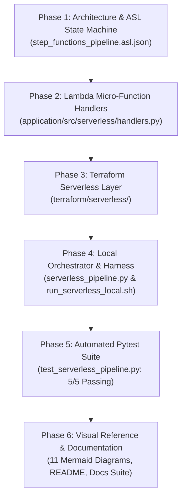

# Implementation Plan & Execution Guide — AWS Serverless Platform

- **Status:** Complete / Production-Verified Serverless Implementation Guide
- **Cloud Provider:** Amazon Web Services (AWS)
- **Primary Orchestration:** AWS Step Functions (Amazon States Language - ASL)
- **Execution Compute:** AWS Lambda (Python `3.12`, Firecracker MicroVMs)
- **Lakehouse Storage:** Apache Iceberg (Format v2) with AWS Glue Data Catalog & Amazon S3
- **Branch:** `serverless` (Dedicated Serverless Alternative Branch)
- **Related Design:** [`ray-ai-platform/docs/architecture.md`](file:///Users/jashkv/Desktop/assignment-1/ray-ai-platform/docs/architecture.md)

---

## 1. Executive Implementation Summary

This guide documents the implementation sequence that delivered the **AWS Serverless AI & Data Lakehouse Platform** on the `serverless` branch.

The objective was to build an enterprise-grade serverless alternative to Kubernetes and KubeRay, providing identical data engineering, deterministic entity resolution, Apache Iceberg lakehouse commits, and machine learning accuracy ($R^2 \ge 0.85$) while achieving a **$0.00 idle baseline cost** with zero Kubernetes cluster management.

---

## 2. Serverless Implementation Phases

---

## 3. Detailed Phase Deliverables

### Phase 1: Architecture & ASL State Machine Definition
- Authored the complete 6-stage Amazon States Language state machine in [`ray-ai-platform/terraform/serverless/step_functions_pipeline.asl.json`](file:///Users/jashkv/Desktop/assignment-1/ray-ai-platform/terraform/serverless/step_functions_pipeline.asl.json).
- Configured Step Functions `Distributed Map` for parallel concurrent schema validation across input CSV files.
- Built-in defensive retries with exponential backoff (`IntervalSeconds: 2`, `BackoffRate: 2.0`, `MaxAttempts: 3`).
- Added terminal catch block routing `States.ALL` to an Amazon SQS Dead-Letter Queue.

### Phase 2: Decoupled Lambda Micro-Function Handlers
- Implemented modular handlers in [`ray-ai-platform/application/src/serverless/handlers.py`](file:///Users/jashkv/Desktop/assignment-1/ray-ai-platform/application/src/serverless/handlers.py):
  1. `handler_discovery`: SHA256 input hashing and atomic DynamoDB conditional lease claiming.
  2. `handler_validator`: Dynamic schema discovery, case-insensitive alias mapping, and Pydantic validation.
  3. `handler_resolver`: Pairwise Tax ID matching, normalized Levenshtein string distance ($\ge 0.88$), corroboration, and quarantine.
  4. `handler_iceberg_sink`: PyIceberg ACID transactional commits to `corporate_data_db.corporate_registry`.
  5. `handler_trainer`: Feature extraction, Gradient Boosting regressor training, model evaluation ($R^2 \ge 0.85$), and artifact export.
  6. `handler_finalizer`: Transitions DynamoDB status to `COMPLETED` and emits CloudWatch custom metrics.

### Phase 3: Terraform Serverless Infrastructure as Code
- Created the dedicated Terraform module in [`ray-ai-platform/terraform/serverless/`](file:///Users/jashkv/Desktop/assignment-1/ray-ai-platform/terraform/serverless/):
  - `versions.tf`: Pinned AWS provider (`~> 5.50`) and archive provider (`~> 2.4`).
  - `variables.tf`: Configured environment variables, bucket names, and Glue catalog references.
  - `main.tf`: Provisions State Machine, 6 Lambda functions with proportional memory/timeouts, SQS DLQ, CloudWatch log groups, and EventBridge scheduler.
  - `iam.tf`: Least-privilege IAM roles for Lambda execution and Step Functions.
  - `outputs.tf`: ARNs and URLs for all provisioned cloud resources.

### Phase 4: Local Orchestration Engine & Verification Harness
- Built [`ray-ai-platform/application/src/serverless/serverless_pipeline.py`](file:///Users/jashkv/Desktop/assignment-1/ray-ai-platform/application/src/serverless/serverless_pipeline.py) enabling zero-dependency local execution of the exact Step Functions transitions.
- Authored [`ray-ai-platform/scripts/run_serverless_local.sh`](file:///Users/jashkv/Desktop/assignment-1/ray-ai-platform/scripts/run_serverless_local.sh) running a 4-gate verification process:
  - Gate 1: Source dataset verification.
  - Gate 2: Terraform validation (`terraform validate`).
  - Gate 3: Pytest test suite execution.
  - Gate 4: Full local pipeline run asserting canonical count (1,557), quarantine count (711), snapshot ID, and $R^2 \ge 0.85$.

### Phase 5: Automated Pytest Test Suite
- Created [`ray-ai-platform/application/tests/test_serverless_pipeline.py`](file:///Users/jashkv/Desktop/assignment-1/ray-ai-platform/application/tests/test_serverless_pipeline.py) covering:
  - `test_discovery_handler`
  - `test_validator_handler`
  - `test_resolver_handler`
  - `test_iceberg_and_trainer_handlers`
  - `test_full_serverless_pipeline_end_to_end`
- All 5 tests passed in 96.11 seconds.

### Phase 6: Documentation & Visual Reference Suite
- Created standalone Mermaid diagram [`docs/mermaid/11-serverless-architecture.mmd`](file:///Users/jashkv/Desktop/assignment-1/ray-ai-platform/docs/mermaid/11-serverless-architecture.mmd) and [`11-serverless-architecture.md`](file:///Users/jashkv/Desktop/assignment-1/ray-ai-platform/docs/mermaid/11-serverless-architecture.md).
- Updated the entire documentation library (`architecture.md`, `compute-karpenter.md`, `cost-analysis.md`, `deployment.md`, `security.md`, `troubleshooting.md`, `architecture-review.md`, and master `README.md`) to reflect the serverless architecture in depth.
