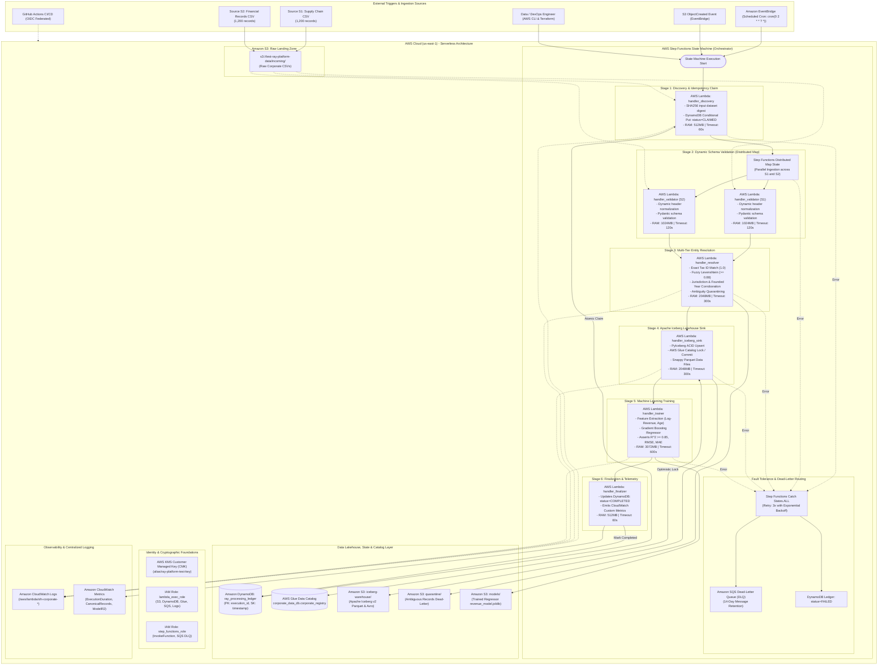

# 01 — Complete Platform Architecture (Serverless Alternative)

This document provides the high-level architecture overview of the **AWS Serverless AI & Data Lakehouse Platform** on branch `serverless`.

---

## 1. Architectural Diagram

---

## 2. Component Mapping & Functional Summary

| Layer | AWS Service | Primary Functionality |
| :--- | :--- | :--- |
| **Orchestration** | AWS Step Functions | Coordinates the 6-stage pipeline using Amazon States Language (ASL) with Distributed Map and automatic retries. |
| **Compute** | AWS Lambda | 6 modular Python 3.12 functions running in isolated Firecracker microVMs. |
| **State & Idempotency**| Amazon DynamoDB | Atomic conditional lease claiming (`attribute_not_exists`) and execution state tracking. |
| **Lakehouse Storage** | Apache Iceberg on Amazon S3 | Snappy Parquet files with ACID metadata tree (v2). |
| **Lakehouse Catalog** | AWS Glue Data Catalog | Optimistic Concurrency Control (OCC) table lock and snapshot pointer management. |
| **Dead-Letter Recovery**| Amazon SQS DLQ | Captures terminal execution errors with 14-day retention. |
| **Anomaly Isolation** | Amazon S3 Quarantine | Diverts ambiguous entities ($0.65 - 0.87$ score) away from the production registry. |
| **Observability** | Amazon CloudWatch | Centralized structured JSON logging and custom performance metrics. |
