# 02 — Network Isolation & Zero-Trust Architecture

This document details the **Zero-Trust Network Isolation Architecture** implemented across the AWS VPC (`10.0.0.0/16`) hosting the Ray AI Platform.

---

## Network Architecture Diagram

```mermaid
flowchart TD
    %% Zero Trust Network Architecture & Isolation Topology
    subgraph InternetZone["Public Internet (External)"]
        CLIENT["Authenticated Developer / CI Runner"]
    end

    subgraph AWS_Cloud["AWS Cloud (us-east-1)"]
        IGW["Internet Gateway (IGW)"]

        subgraph VPC["VPC: 10.0.0.0/16 (Isolated Network Boundary)"]
            
            subgraph PublicSubnets["Tier 1: Public Subnets (10.0.0.0/20, 10.0.16.0/20, 10.0.32.0/20)"]
                NAT_A["NAT Gateway (us-east-1a)"]
                NAT_B["NAT Gateway (us-east-1b)"]
                ALB_INGRESS["Private/Internal ALB Ingress Controller\n(Port 443 with TLS 1.3 Termination)"]
            end

            subgraph PrivateComputeSubnets["Tier 2: Private Compute Subnets (10.0.128.0/20, 10.0.144.0/20, 10.0.160.0/20)"]
                direction TB
                
                subgraph SG_ControlPlane["Security Group: EKS Control Plane"]
                    EKS_ENI["EKS Managed ENIs\n- Private API Server Endpoint (:443)\n- No Public Route"]
                end

                subgraph SG_SystemNodes["Security Group: System Node Group"]
                    SYSTEM_NODE["System EC2 Instances (m5.large)\n- KubeRay Operator\n- Karpenter Controller\n- CoreDNS (:53)\n- Prometheus (:9090)"]
                end

                subgraph SG_KarpenterNodes["Security Group: Karpenter Worker Fleet (karpenter.sh/discovery)"]
                    HEAD_POD["Ray Head Pod\n- GCS: 6379\n- Client: 10001\n- Dashboard: 8265\n- Metrics: 8080"]
                    WORKER_PODS["Ray Worker Pods\n- Intra-Ray: 10000-19999\n- Zero Inbound from Internet\n- IMDSv2 Hop Limit = 1"]
                end

                subgraph K8s_Network_Policy["Kubernetes NetworkPolicy Enforcement (Calico / VPC CNI)"]
                    NP_INGRESS["Default Deny All Ingress\nAllow Only Head <--> Worker on Ray Ports"]
                    NP_EGRESS["Restricted Egress\nAllow Only VPC CIDR + AWS PrivateLink Endpoints + DNS:53"]
                end
            end

            subgraph IsolatedDataSubnets["Tier 3: Isolated Data Subnets (10.0.192.0/20, 10.0.208.0/20, 10.0.224.0/20)"]
                DATA_ENIS["Isolated ENIs (No Default Route / No NAT Access)"]
            end

            subgraph PrivateLinkEndpoints["AWS PrivateLink & Gateway VPC Endpoints (Zero Internet Egress)"]
                direction LR
                VPCE_S3_GW["S3 Gateway Endpoint\n(Prefix List: pl-63a5400a)\n(Bucket Policy Restricted)"]
                VPCE_DDB_GW["DynamoDB Gateway Endpoint\n(Prefix List: pl-6ba54002)\n(Table Policy Restricted)"]
                VPCE_ECR_API["ECR API Interface Endpoint (:443)"]
                VPCE_ECR_DKR["ECR DKR Interface Endpoint (:443)"]
                VPCE_STS["STS Interface Endpoint (:443)"]
                VPCE_CW["CloudWatch Logs Endpoint (:443)"]
                VPCE_SQS["SQS Interface Endpoint (:443)"]
                VPCE_KMS["KMS Interface Endpoint (:443)"]
            end
        end

        subgraph AWSServices["AWS Managed Services (Private Backbone Access Only)"]
            S3["Amazon S3 Buckets (test-ray-platform-*)"]
            DDB["Amazon DynamoDB (ray_processing_ledger)"]
            ECR["Amazon ECR Registry"]
            CW["Amazon CloudWatch Logs"]
            STS["AWS Security Token Service (STS)"]
            SQS["Amazon SQS (Karpenter Interruption)"]
            KMS["AWS Key Management Service (KMS)"]
        end
    end

    %% Network Flow & Zero Trust Chaining
    CLIENT -->|"TLS VPN / Bastion (SSM Session Mgr)"| EKS_ENI
    IGW -.->|"Egress Only for Updates via NAT"| NAT_A
    NAT_A -.->|"No Ingress Allowed"| PrivateComputeSubnets

    %% Security Group Chaining
    EKS_ENI <-->|"Mutual TLS Port 10250 (Kubelet)"| SYSTEM_NODE
    EKS_ENI <-->|"Mutual TLS Port 10250 (Kubelet)"| HEAD_POD
    HEAD_POD <-->|"RPC Ports: 6379, 10001, 10000-19999"| WORKER_PODS

    %% PrivateLink Traffic (No NAT traversal)
    WORKER_PODS -->|"VPC Route (No NAT cost)"| VPCE_S3_GW
    WORKER_PODS -->|"VPC Route (No NAT cost)"| VPCE_DDB_GW
    WORKER_PODS -->|"Private ENI (Port 443)"| VPCE_ECR_API
    WORKER_PODS -->|"Private ENI (Port 443)"| VPCE_ECR_DKR
    WORKER_PODS -->|"Private ENI (Port 443)"| VPCE_STS
    WORKER_PODS -->|"Private ENI (Port 443)"| VPCE_CW
    WORKER_PODS -->|"Private ENI (Port 443)"| VPCE_SQS
    WORKER_PODS -->|"Private ENI (Port 443)"| VPCE_KMS

    VPCE_S3_GW --> S3
    VPCE_DDB_GW --> DDB
    VPCE_ECR_API --> ECR
    VPCE_ECR_DKR --> ECR
    VPCE_STS --> STS
    VPCE_CW --> CW
    VPCE_SQS --> SQS
    VPCE_KMS --> KMS
```

---

## Core Zero-Trust Network Controls

### 1. Three-Tier Subnet Segmentation
- **Public Subnets (`10.0.0.0/20`, `10.0.16.0/20`, `10.0.32.0/20`):** Reserved strictly for Multi-AZ AWS NAT Gateways and private internal load balancers. Zero application workloads or database instances reside here.
- **Private Compute Subnets (`10.0.128.0/20`, `10.0.144.0/20`, `10.0.160.0/20`):** Hosts EKS cluster ENIs, System Node Group instances, and dynamic Karpenter EC2 Spot/On-Demand worker nodes. Route tables direct outbound internet traffic through NAT Gateways for external package updates only.
- **Isolated Data Subnets (`10.0.192.0/20`, `10.0.208.0/20`, `10.0.224.0/20`):** Fully isolated with no route to internet gateways or NAT gateways.

### 2. PrivateLink & VPC Endpoints (AWS Backbone Traffic)
All interactions with AWS foundational services remain entirely within the AWS global private network using VPC Endpoints, bypassing the public internet and eliminating NAT data processing fees:
- **S3 & DynamoDB Gateway Endpoints:** Routed directly at VPC route tables with endpoint policies restricting access exclusively to `arn:aws:s3:::test-ray-platform-*` and `arn:aws:dynamodb:*:*:table/ray_processing_ledger`.
- **Interface Endpoints (AWS PrivateLink):** Dedicated Elastic Network Interfaces (ENIs) for `ecr.api`, `ecr.dkr`, `logs` (CloudWatch), `sts`, `sqs`, and `kms`.

### 3. IMDSv2 Strict Hop Limit
Every node provisioned via Karpenter enforces:
- `httpTokens = "required"` (enforces session token retrieval via `PUT`).
- `httpPutResponseHopLimit = 1` (prevents pods running in bridge or overlay network modes from accessing the host instance metadata service and hijacking node IAM roles).

### 4. Kubernetes NetworkPolicy Rules
- **Default Deny All Ingress:** By default, no pod in the `ray-system` namespace accepts inbound traffic.
- **Intra-Cluster Whitelisting:** Ray worker pods allow inbound TCP traffic only from the Ray Head pod and sibling workers on Ray ports (`6379`, `10001`, `8265`, `8080`, and ephemeral RPC ports `10000-19999`).
