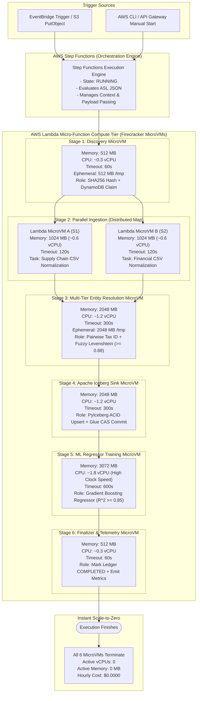

# 03 — Compute Architecture & Concurrency Tiering (Serverless Alternative)

This document provides the compute sizing, concurrency model, and microVM lifecycle for the **AWS Serverless Platform**.

---

## 1. Architectural Diagram

---

## 2. Compute Allocation & Sizing Specifications

| Stage | Lambda Function | Memory | Sized vCPU | Max Timeout | Ephemeral Storage | Compute Category |
| :--- | :--- | :---: | :---: | :---: | :---: | :--- |
| **Stage 1** | `sfn-corporate-discovery` | 512 MB | ~0.3 vCPU | 60s | 512 MB | I/O Bound (SHA256, DDB Claim) |
| **Stage 2** | `sfn-corporate-validator` | 1,024 MB | ~0.6 vCPU | 120s | 1,024 MB | Mixed I/O & Parsing (CSV Ingest) |
| **Stage 3** | `sfn-corporate-resolver` | 2,048 MB | ~1.2 vCPU | 300s | 2,048 MB | Memory & CPU Intensive (Levenshtein) |
| **Stage 4** | `sfn-corporate-iceberg-sink` | 2,048 MB | ~1.2 vCPU | 300s | 2,048 MB | Memory & Parquet I/O (Iceberg commit) |
| **Stage 5** | `sfn-corporate-trainer` | 3,072 MB | ~1.8 vCPU | 600s | 2,048 MB | High Compute (Gradient Boosting ML) |
| **Stage 6** | `sfn-corporate-finalizer` | 512 MB | ~0.3 vCPU | 60s | 512 MB | I/O Bound (DDB Update, Metrics) |

---

## 3. Scale-to-Zero Efficiency

Unlike Kubernetes worker nodes that continue drawing power and incurring billing while waiting for scale-down timers (e.g. 10 minutes), AWS Lambda microVMs terminate the exact millisecond the return statement executes. Idle cost between runs is strictly **$0.0000**.
