# 04 — End-to-End Pipeline & Data Processing Flow (Serverless Alternative)

This document details the exact 6-stage end-to-end data processing lifecycle of the **AWS Serverless Platform**.

---

## 1. Architectural Diagram

```mermaid
flowchart TD
    %% Serverless Pipeline Data Processing Flow
    subgraph RawData["Raw Ingestion Datasets (2,400 Total Rows)"]
        S1["supply_chain_data_s1.csv\n(1,200 records - Heterogeneous Columns)"]
        S2["financial_data_s2.csv\n(1,200 records - Heterogeneous Columns)"]
    end

    subgraph Step1["Stage 1: Discovery & Idempotency Check"]
        CALC_HASH["Compute SHA256(S1_URI + S2_URI)\nGenerate ExecutionID: sfn-run-<sha256[:16]>"]
        DDB_CLAIM{"DynamoDB PutItem\nCondition: attribute_not_exists(execution_id)"}
        EXISTS["Duplicate Execution Detected\n-> Exit Gracefully with Cached Status"]
        CLAIMED["Ledger Initialized: status=CLAIMED"]
    end

    subgraph Step2["Stage 2: Parallel Dynamic Schema Validation (Distributed Map)"]
        direction TB
        MAP_BRANCH["Step Functions Distributed Map (MaxConcurrency: 5)"]
        NORM_HEADERS["Case-Insensitive Column Alias Detection:\n['corporate_name', 'company_name'] -> entity_name\n['tax_identifier', 'ein'] -> tax_id\n['annual_revenue', 'revenue_usd'] -> annual_revenue"]
        CLEANSE["Type Coercion & Data Cleansing:\n- Strip currency symbols\n- Parse founded year\n- Uppercase ISO country code"]
        PYDANTIC["Validate Pydantic Model (CorporateRecordInput)"]
        VALID_RECS["Normalized In-Memory Records:\n- S1: 1,200 Valid\n- S2: 1,200 Valid"]
    end

    subgraph Step3["Stage 3: Multi-Tier Deterministic Entity Resolution"]
        COLLECT["Aggregate 2,400 Valid Ingested Records"]
        
        subgraph MatchingEngine["EntityResolverEngine Algorithm"]
            TIER1{"Tier 1: Exact Tax ID Match?\n(Confidence: 1.00)"}
            TIER2{"Tier 2: Normalized Levenshtein >= 0.88\n+ Country Match + |Year Diff| <= 1?\n(Confidence: 0.92)"}
            AMBIG{"Ambiguity Threshold?\n(0.65 <= Similarity < 0.88)"}
            NEW_ENT["Distinct Entity Created\n(UUIDv5 Canonical ID: COMP-XXXXXXXX)"]
        end

        CANONICAL["1,557 Canonical Merged Entities\n(Enriched with Corroborated Fields)"]
        QUARANTINE["711 Ambiguous Records\n-> Divert to s3://.../quarantine/"]
    end

    subgraph Step4["Stage 4: Apache Iceberg Lakehouse Persistence"]
        PYICEBERG["PyIceberg Arrow Table Construction"]
        WRITE_PARQUET["Write Snappy-Compressed Parquet Data Files"]
        COMMIT_SNAPSHOT["Atomic CAS Commit to AWS Glue Catalog\n- Snapshot ID: e.g. 356891083480308578\n- ACID Transaction Guarantees"]
    end

    subgraph Step5["Stage 5: Gradient Boosting Regressor Training"]
        EXTRACT_FEATURES["Feature Engineering:\n- Age = CurrentYear - FoundedYear\n- Employee Count\n- Resolution Confidence Score\n- Target: log1p(annual_revenue)"]
        TRAIN_EVAL["Train GradientBoostingRegressor (100 Trees, LR: 0.1)\nEvaluate 80/20 Train/Test Split"]
        ASSERT_R2{"Test R^2 >= 0.85?\n(Achieved: 0.8725)"}
        SAVE_MODEL["Serialize revenue_model.joblib & metrics.json to S3"]
    end

    subgraph Step6["Stage 6: Finalization & Audit Telemetry"]
        UPDATE_DDB["Update DynamoDB Ledger:\n- status = COMPLETED\n- canonical_entities = 1557\n- iceberg_snapshot_id = 356891083480308578\n- model_r2_score = 0.8725"]
        EMIT_CW["Emit Custom CloudWatch Metrics & JSON Summary"]
    end

    S1 --> CALC_HASH
    S2 --> CALC_HASH
    CALC_HASH --> DDB_CLAIM
    DDB_CLAIM -->|Already Exists| EXISTS
    DDB_CLAIM -->|New Lease| CLAIMED
    CLAIMED --> MAP_BRANCH

    MAP_BRANCH --> NORM_HEADERS
    NORM_HEADERS --> CLEANSE
    CLEANSE --> PYDANTIC
    PYDANTIC --> VALID_RECS
    VALID_RECS --> COLLECT

    COLLECT --> TIER1
    TIER1 -->|Match| CANONICAL
    TIER1 -->|No Match| TIER2
    TIER2 -->|Match| CANONICAL
    TIER2 -->|No Match| AMBIG
    AMBIG -->|Ambiguous| QUARANTINE
    AMBIG -->|No Similarity| NEW_ENT
    NEW_ENT --> CANONICAL

    CANONICAL --> PYICEBERG
    PYICEBERG --> WRITE_PARQUET
    WRITE_PARQUET --> COMMIT_SNAPSHOT
    COMMIT_SNAPSHOT --> EXTRACT_FEATURES

    EXTRACT_FEATURES --> TRAIN_EVAL
    TRAIN_EVAL --> ASSERT_R2
    ASSERT_R2 -->|Pass| SAVE_MODEL
    SAVE_MODEL --> UPDATE_DDB
    UPDATE_DDB --> EMIT_CW
```

---

## 2. Quantitative Verification Metrics

- **Total Ingested Records:** 2,400 rows (S1: 1,200, S2: 1,200).
- **Malformed / Rejected Records:** 0 rows.
- **Canonical Unique Corporate Entities:** **1,557 entities**.
- **Quarantined Ambiguities:** **711 records** safely isolated in `s3://.../quarantine/`.
- **Apache Iceberg Table Commit:** Snapshot created via PyIceberg + Glue Catalog.
- **ML Regressor Model Test $R^2$:** **$0.8725$** (exceeds $0.85$ requirement).
- **Ledger Status:** `COMPLETED`.
