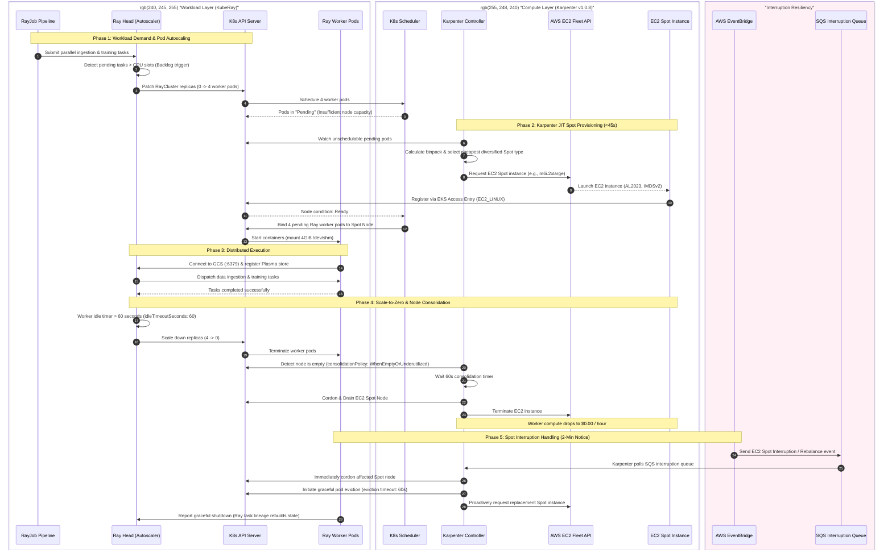
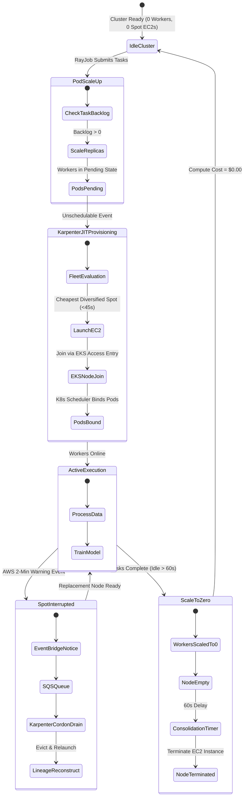

# 05 — Two-Level Autoscaling Lifecycle & Spot Interruption

This document illustrates the **Two-Level Autoscaling Architecture** operating across the Ray AI Platform, coordinating pod-level autoscaling via the KubeRay In-Tree Autoscaler with infrastructure-level Just-In-Time (JIT) node provisioning via Karpenter `v1.0.8`.

---

## Autoscaling Sequence Diagram

---

## State Transition Matrix

---

## Architectural Guarantees

| Metric / Parameter | Value | Technical Enforcement |
| :--- | :--- | :--- |
| **Worker Replicas Min/Max** | `0` to `8` | Defined in `RayCluster` CRD (`kubernetes/ray/ray-cluster.yaml`). |
| **Ray Idle Timeout** | `60 seconds` | Configured via `autoscalerOptions.idleTimeoutSeconds`. |
| **Karpenter Launch Time** | `<45 seconds` | Direct EC2 Fleet API invocation bypassing ASG scaling activities. |
| **Consolidation Policy** | `WhenEmptyOrUnderutilized` | NodePool spec with a `consolidateAfter: 60s` window. |
| **Spot Interruption Notice** | `120 seconds (2 mins)` | Amazon EventBridge forwards EC2 Spot preemption notices to SQS. |
| **Stateful Actor Protection** | Fixed Head placement | `EntityResolver` requires `entity_resolver_slot: 1`, pinned to Ray Head. |
