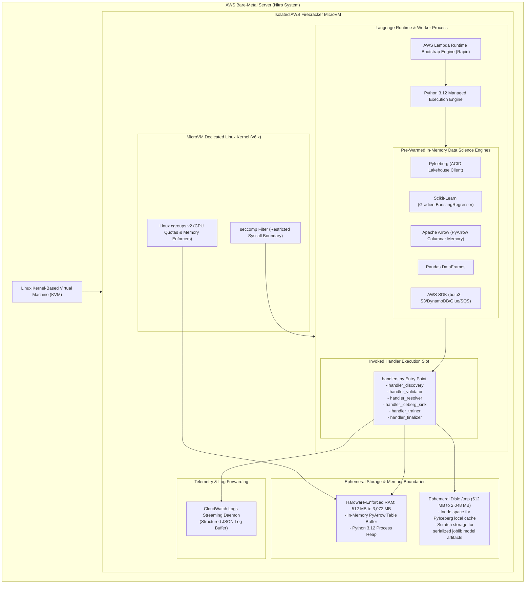

# 06 — Lambda Execution Environment & MicroVM Topology (Serverless Alternative)

This document details the internal architecture, hardware isolation, memory allocation, and runtime topology of an **AWS Lambda Micro-Function Execution Environment**.

---

## 1. Architectural Diagram

---

## 2. Technical Topology Breakdown

1. **Firecracker MicroVM Virtualization:**
   Unlike Docker containers that share the host Linux kernel, each AWS Lambda function executes inside an isolated microVM powered by the open-source **Firecracker** hypervisor.
2. **Ephemeral Disk (`/tmp`):**
   Configured with up to 2,048 MB of fast NVMe scratch storage, providing local caching for PyIceberg table metadata and model serialization.
3. **Hardware Memory Limits:**
   Linux `cgroups v2` strictly enforce memory ceilings (up to 3,072 MB in `handler_trainer`).
4. **Structured Telemetry Streaming:**
   The AWS Lambda Rapid initialization engine pipes logs directly to CloudWatch without requiring background DaemonSets like Fluent Bit.
