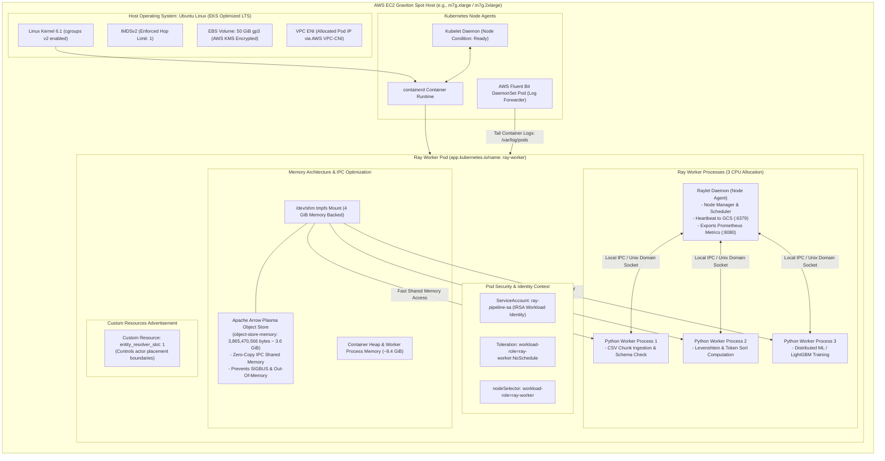

# 06 — Ray Worker Node & Pod Internal Topology

This document details the internal anatomy of a Karpenter-provisioned **Ray Worker EC2 Spot Instance** and its contained **Ray Worker Pod**, highlighting memory management, shared IPC, and process scheduling.

---

## Worker Node Anatomy Diagram

---

## Memory & IPC Deep-Dive

### Why Sizing `/dev/shm` at 4 GiB is Essential
Standard Kubernetes/Docker container runtimes default `/dev/shm` to a mere **64 MiB**. 

Ray utilizes Apache Arrow Plasma, an in-memory object store that maps Arrow tabular record batches directly into `/dev/shm`. Multiple worker processes on the same host can read dataset partitions simultaneously without copy operations (Zero-Copy Deserialization).

If `/dev/shm` is left at the default 64 MiB:
1. Any multi-megabyte Arrow Table allocation exceeds the tmpfs threshold.
2. The Linux kernel immediately issues a `SIGBUS` (Bus Error) signal to the worker process.
3. The process crashes immediately without a Python traceback, destabilizing the distributed pipeline.

To prevent this:
- An `emptyDir` with `medium: Memory` and `sizeLimit: 4Gi` is mounted at `/dev/shm`.
- Ray's `object-store-memory` parameter is explicitly capped at `3865470566` bytes (~3.6 GiB), leaving a 400 MiB safety buffer within tmpfs.
- The remaining container memory (~8.4 GiB out of 12 GiB) is dedicated to Python runtime heaps, data structures, and LightGBM model training buffers.

### Resource Allocation Summary

| Resource | Request | Limit | Component / Purpose |
| :--- | :--- | :--- | :--- |
| **CPU** | `3000m` (3 Cores) | `3000m` (3 Cores) | 1 core per Python worker process; prevents CPU throttling. |
| **Memory** | `12 GiB` | `12 GiB` | 3.6 GiB Plasma Object Store + 8.4 GiB Heap / OS cache. |
| **Shared Memory (`/dev/shm`)** | `4 GiB` | `4 GiB` | tmpfs mount backed by host RAM for Apache Arrow IPC. |
| **Root Volume** | `50 GiB` | `50 GiB` | gp3 encrypted with AWS KMS; container layer caching & spooling. |
| **Network** | Dedicated Pod IP | Line rate | AWS VPC-CNI assigns direct VPC IP from private subnet. |
