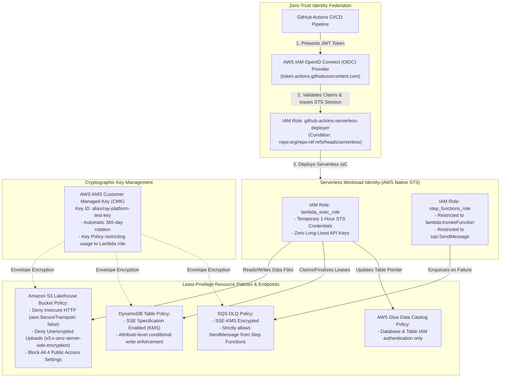

# 07 — Zero-Trust Security, Identity & Cryptographic Architecture (Serverless Alternative)

This document provides the security, identity federation, and cryptographic envelope encryption architecture of the **AWS Serverless Platform**.

---

## 1. Architectural Diagram

---

## 2. Core Security Guarantees

1. **Zero Static Long-Lived Credentials:**
   All execution is authenticated via temporary AWS STS tokens rotated automatically every hour. No AWS keys are stored anywhere.
2. **KMS CMK Envelope Encryption:**
   S3 buckets, DynamoDB ledger items, and SQS messages are encrypted with an AWS KMS Customer Managed Key (`alias/ray-platform-test-key`).
3. **No Container Host Escapes:**
   By relying on Firecracker microVMs, hardware-enforced boundaries isolate every Lambda execution.
