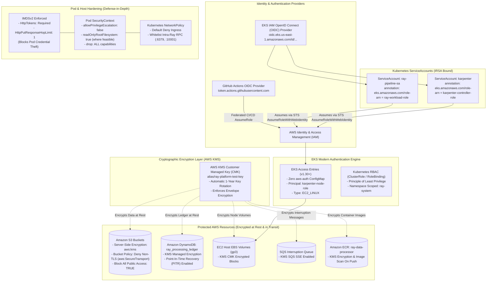

# 07 — Zero-Trust Security, Identity & Cryptographic Architecture

This document presents the **Zero-Trust Security, Identity Federation, and Encryption Architecture** protecting compute workloads, persistent storage, and access boundaries.

---

## Security Architecture Diagram

---

## Security Pillars

1. **Workload Identity (IRSA):** Pods obtain short-lived AWS STS credentials via IAM OpenID Connect federation. No permanent AWS access keys or secrets exist in Git, configuration files, or container layers.
2. **KMS Envelope Encryption:** A dedicated Customer Managed Key (CMK) with annual rotation encrypts all data at rest across S3 buckets, DynamoDB ledgers, Karpenter node EBS root disks, and SQS interruption queues.
3. **Transit Encryption Enforcement:** All S3 bucket policies reject any HTTP requests that do not specify `aws:SecureTransport: true` (TLS 1.2+ mandatory).
4. **Zero Legacy `aws-auth`:** Karpenter Spot nodes register via AWS EKS Access Entries (`EC2_LINUX`), isolating node authentication from user permissions.
5. **IMDSv2 Defense:** Node metadata responses require session tokens and are restricted to a hop limit of `1`, barring pods from querying the EC2 instance identity metadata service.
