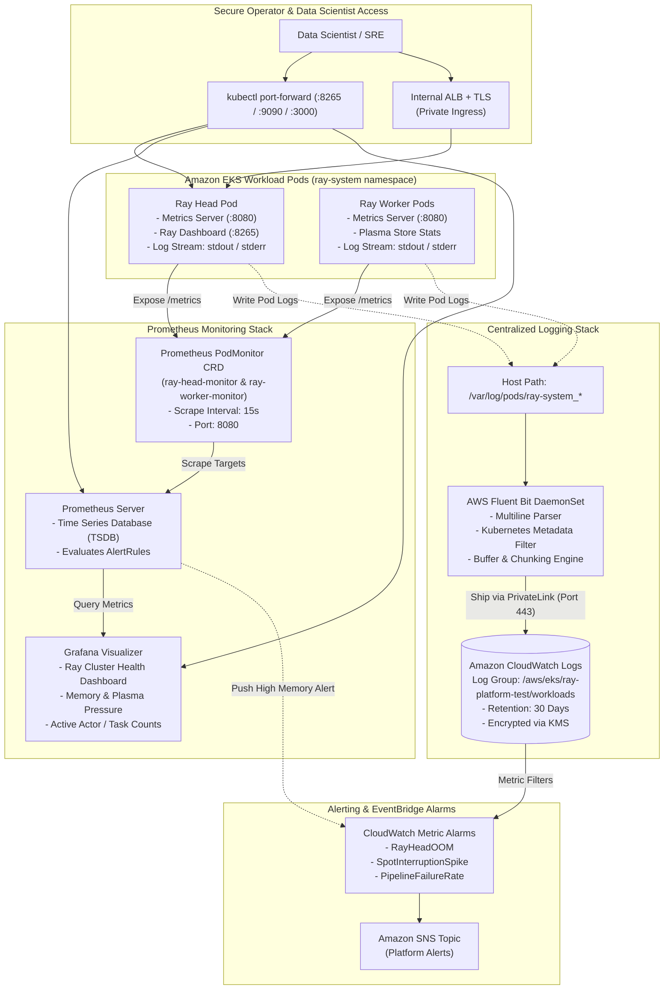

# 08 — Observability, Metrics & Centralized Logging Architecture

This document outlines the **Observability, Metrics Collection, and Centralized Logging Pipeline** for the Ray AI Platform on AWS EKS.

---

## Observability Architecture Diagram

---

## Observability Capabilities

### 1. Prometheus Metrics via `PodMonitor`
- Ray natively exposes OpenMetrics on port `:8080`.
- The Prometheus Operator discovers Head and Worker pods automatically via `PodMonitor` CRDs (`ray-podmonitor.yaml`).
- Key metrics tracked include:
  - `ray_node_cpu_utilization`: Core consumption per node.
  - `ray_object_store_memory`: Plasma shared memory occupancy in bytes.
  - `ray_tasks_state`: Real-time queue count of tasks (`RUNNING`, `PENDING_NODE_ASSIGNMENT`).
  - `ray_actors_state`: Health and restart count of the stateful `EntityResolver` actor.

### 2. High-Throughput Centralized Logging
- The AWS Fluent Bit DaemonSet mounts `/var/log/pods` from the host.
- It parses container stdout/stderr, adds Kubernetes namespace/pod metadata, and securely ships log chunks over AWS PrivateLink directly to CloudWatch Logs (`/aws/eks/ray-platform-test/workloads`).
- This eliminates container logging disk exhaustion on Spot nodes.

### 3. Secure Dashboard Access
Access to the Ray Dashboard (port `:8265`) is strictly constrained to private routes:
- Internal access via `kubectl port-forward svc/ray-cluster-kuberay-head-svc 8265:8265`.
- Or private ingress through an internal Application Load Balancer terminating TLS 1.3 within the private VPC boundary.
