# 08 — Observability, Metrics & Centralized Logging Architecture (Serverless Alternative)

This document provides the observability, structured logging, CloudWatch metrics, and distributed tracing architecture of the **AWS Serverless Platform**.

---

## 1. Architectural Diagram

```mermaid
flowchart TD
    %% Serverless Observability, Metrics & Centralized Logging Architecture
    subgraph ExecutionPlane["Serverless Workload Execution"]
        SFN["AWS Step Functions State Machine\n(Detailed Execution History & Step Transitions)"]
        L1["Lambda: Discovery (512MB)"]
        L2["Lambda: Validator (1024MB)"]
        L3["Lambda: Resolver (2048MB)"]
        L4["Lambda: Iceberg Sink (2048MB)"]
        L5["Lambda: ML Trainer (3072MB)"]
        L6["Lambda: Finalizer (512MB)"]
        DLQ["Amazon SQS Dead-Letter Queue (DLQ)"]
    end

    subgraph CentralizedTelemetry["Amazon CloudWatch Observability Suite"]
        direction TB

        subgraph LogStreams["Structured JSON Log Groups (14-Day Retention)"]
            CW_L1["/aws/lambda/sfn-corporate-discovery"]
            CW_L2["/aws/lambda/sfn-corporate-validator"]
            CW_L3["/aws/lambda/sfn-corporate-resolver"]
            CW_L4["/aws/lambda/sfn-corporate-iceberg-sink"]
            CW_L5["/aws/lambda/sfn-corporate-trainer"]
            CW_L6["/aws/lambda/sfn-corporate-finalizer"]
        end

        subgraph CustomMetrics["CloudWatch Custom Metrics Namespace: CorporatePlatform"]
            M_DUR["Metric: PipelineExecutionDuration (Seconds)"]
            M_CAN["Metric: CanonicalEntitiesCount (1557)"]
            M_QUAR["Metric: QuarantinedEntitiesCount (711)"]
            M_R2["Metric: ModelR2Score (0.8725)"]
            M_SNAP["Metric: IcebergSnapshotID"]
        end

        subgraph Alarms["Operational Alarms & DLQ Alerts"]
            ALARM_DLQ["CloudWatch Alarm: SQS_DLQ_Messages_Present\nThreshold: VisibleMessages > 0"]
            ALARM_FAIL["CloudWatch Alarm: StepFunctions_Execution_Failed\nThreshold: FailedExecutions >= 1"]
        end

        subgraph XRay["AWS X-Ray Distributed Tracing"]
            TRACE["End-to-End Execution Trace Map:\nStep Functions -> Lambda Invocations -> S3/DynamoDB SDK Calls"]
        end
    end

    subgraph Dashboards["Platform Operator Visualization"]
        CW_DASH["CloudWatch Executive Dashboard:\n- End-to-end pipeline duration trends\n- Entity deduplication yield over time\n- Revenue ML model test R^2 scores"]
        SNS_ALERT["Amazon SNS Notification\n(Alerts On-Call Platform Engineer)"]
    end

    L1 --> CW_L1
    L2 --> CW_L2
    L3 --> CW_L3
    L4 --> CW_L4
    L5 --> CW_L5
    L6 --> CW_L6

    L6 --> M_DUR
    L6 --> M_CAN
    L6 --> M_QUAR
    L6 --> M_R2
    L6 --> M_SNAP

    SFN -.-> TRACE
    L1 -.-> TRACE
    L3 -.-> TRACE
    L5 -.-> TRACE

    DLQ --> ALARM_DLQ
    SFN --> ALARM_FAIL

    ALARM_DLQ --> SNS_ALERT
    ALARM_FAIL --> SNS_ALERT
    CustomMetrics --> CW_DASH
```

---

## 2. Telemetry & Monitoring Guardrails

1. **Structured JSON Logs:**
   Every Lambda handler formats log output in standardized JSON containing `execution_id`, `stage`, `timestamp`, and metric fields.
2. **Automated Expiration:**
   All 6 CloudWatch Log Groups configure `retention_in_days = 14`, preventing unbounded log growth.
3. **Dead-Letter Alarm:**
   CloudWatch Alarm immediately notifies operators if messages accumulate in the Amazon SQS DLQ.
4. **Custom Metric Publication:**
   `handler_finalizer` publishes `ModelR2Score`, `CanonicalEntitiesCount`, and `PipelineDuration` to the `CorporatePlatform` CloudWatch namespace.
