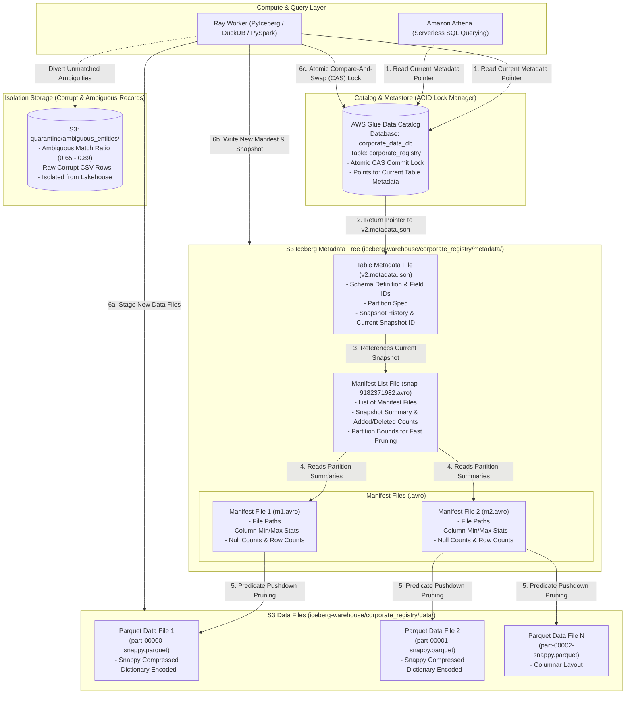

# 09 — Apache Iceberg ACID Lakehouse Storage Architecture

This document describes the **Apache Iceberg Format v2 Transactional Storage Architecture**, detailing its hierarchical metadata tree, ACID commit mechanics, and AWS Glue integration.

---

## Iceberg Architecture Diagram

---

## Transactional Guarantees & Features

### 1. Atomic Compare-And-Swap (CAS) Commits
- All write operations staged by Ray workers write immutable Parquet data files to `iceberg-warehouse/`.
- Once data and manifest avro trees are staged in S3, the commit is executed via an atomic CAS update on AWS Glue Data Catalog table parameter `metadata_location`.
- If a concurrent write commits first, the transaction performs an Optimistic Concurrency Control (OCC) retry, guaranteeing zero partial writes or phantom reads.

### 2. Snapshot Isolation & Time-Travel
- Every commit creates a distinct immutable snapshot ID (`snap-XXXXXXXXXX.avro`).
- Downstream query engines (Athena, DuckDB, Trino) can query historical state deterministically via `VERSION AS OF <snapshot_id>` or `TIMESTAMP AS OF <datetime>`.

### 3. Schema Evolution Without Table Rewrites
- Iceberg tracks columns by explicit numeric IDs, not column names or positions.
- New schema fields discovered in subsequent ingestion runs can be added, renamed, or reordered without rewriting existing Parquet data files.

### 4. Dead-Letter Quarantine
- Ambiguous entity matches ($0.65 \le \text{confidence} < 0.90$) and corrupt rows are diverted directly to `s3://test-ray-platform-data-*/quarantine/`.
- This ensures the production Iceberg table contains exclusively high-integrity, canonical records.
