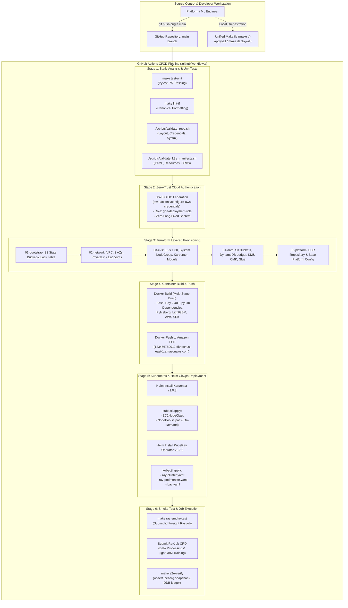

# 10 — CI/CD Pipeline, GitOps & Infrastructure Lifecycle

This document describes the **Automated CI/CD Deployment Lifecycle**, detailing the testing gates, Terraform layering, container build, Helm orchestration, and end-to-end verification.

---

## CI/CD Pipeline Diagram

---

## Deployment Stage Descriptions

| Stage | Command / Trigger | Actions & Validations |
| :--- | :--- | :--- |
| **1. Static Analysis & Unit Tests** | Automated on PR / push | Runs `pytest`, `terraform fmt -check`, bash manifest validation, and zero-credential leak pre-checks. |
| **2. Zero-Trust OIDC Auth** | `aws-actions/configure-aws-credentials` | Obtains short-lived AWS STS token via GitHub Actions OIDC federation. No static keys stored in GitHub Secrets. |
| **3. Terraform Layered Apply** | `make tf-apply-all` | Applies the 5 decoupled layers in order: `bootstrap` $\to$ `network` $\to$ `eks` $\to$ `data` $\to$ `platform`. |
| **4. Container Image Build** | `make docker-build-push` | Builds multi-stage Docker container with pinned Ray, PyIceberg, and ML runtimes; pushes to AWS ECR. |
| **5. Helm & Kubernetes Deploy** | `make deploy-all` | Installs Karpenter `v1.0.8`, registers `EC2NodeClass` and `NodePool`, deploys KubeRay Operator `v1.2.2`, and launches the `RayCluster`. |
| **6. End-to-End Verification** | `make e2e-verify` | Submits Ray smoke job, tests dynamic autoscaling to Spot instances, validates Iceberg snapshot write, and confirms DynamoDB ledger completion. |
