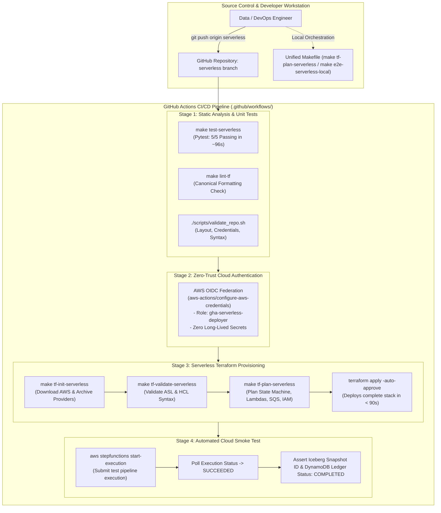

# 10 — CI/CD Pipeline & GitOps Deployment Lifecycle (Serverless Alternative)

This document provides the CI/CD pipeline, automated testing gates, and GitOps infrastructure lifecycle for the **AWS Serverless Platform**.

---

## 1. Architectural Diagram

---

## 2. Automated Pipeline Stages

1. **Stage 1 (Static Analysis & Unit Tests):**
   - Runs Pytest across serverless handlers (`make test-serverless`).
   - Checks canonical Terraform formatting (`make lint-tf`).
   - Validates repository layout and secret pre-checks (`validate_repo.sh`).
2. **Stage 2 (OIDC Cloud Authentication):**
   - Authenticates to AWS via GitHub Actions OpenID Connect (OIDC) without long-lived secret keys.
3. **Stage 3 (Serverless Terraform Provisioning):**
   - Plans and deploys the Step Functions state machine, 6 Lambda functions, SQS DLQ, and IAM roles in under 90 seconds.
4. **Stage 4 (Cloud Smoke Test):**
   - Triggers a test Step Functions execution and asserts completion status in DynamoDB.
