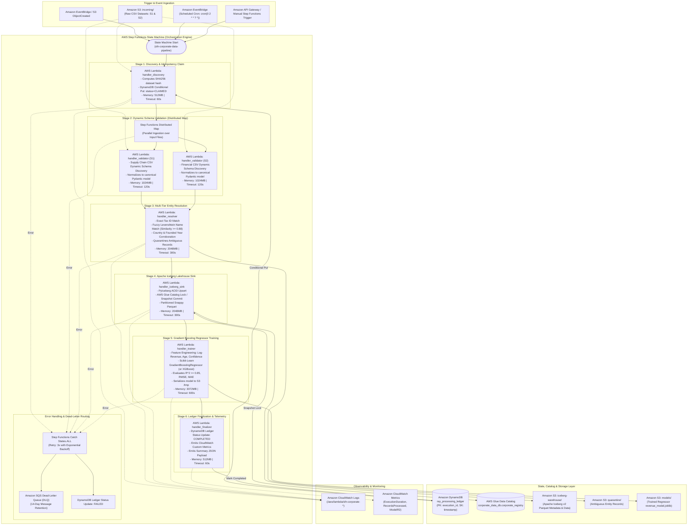

# 11 — AWS Serverless Alternative Architecture

This document provides the architectural reference and deep-dive for the **AWS Serverless Alternative** implemented on the `serverless` branch.

It demonstrates how the corporate data engineering, deterministic entity resolution, Apache Iceberg lakehouse storage, and machine learning training pipeline can be orchestrated using AWS native serverless primitives—**AWS Step Functions, AWS Lambda, Amazon DynamoDB, AWS Glue Data Catalog, and Amazon S3**—achieving a **$0.00 idle baseline cost** with zero Kubernetes cluster management.

---

## 1. Architectural Diagram

---

## 2. Core Architectural Pillars

### 2.1 State Machine Orchestration (AWS Step Functions)
- **Declarative Pipeline:** Formatted in Amazon States Language (ASL), defining states, execution branches, retries, and catches in JSON.
- **Distributed Map:** Dynamically iterates across raw S3 CSV objects (e.g. `supply_chain_data_s1.csv` and `financial_data_s2.csv`), running schema inspection and validation concurrently in parallel Lambda instances.
- **Deterministic Fault Recovery:** Every stage includes automated exponential backoff retries (`IntervalSeconds: 2`, `BackoffRate: 2.0`, `MaxAttempts: 3`). Any terminal failure is caught by `States.ALL`, notifying the SQS Dead-Letter Queue (DLQ) and marking the DynamoDB ledger record as `FAILED`.

### 2.2 Micro-Function Compute Layer (AWS Lambda)
- **Stage 1 (Discovery & Claim):** Computes a SHA256 checksum across input payloads to generate a deterministic `execution_id`. Executes an atomic DynamoDB conditional write (`attribute_not_exists(execution_id)`) to enforce run idempotency.
- **Stage 2 (Dynamic Schema Validation):** Reads unknown, evolving CSV structures, inspects case-insensitive header variants (`corporate_name` vs `company_name`, `tax_identifier` vs `ein`, `revenue_usd` vs `annual_revenue`), normalizes types, and filters malformed rows.
- **Stage 3 (Multi-Tier Entity Resolution):** Directly leverages the exact `EntityResolverEngine` business logic:
  - Exact Tax ID Match.
  - Fuzzy Levenshtein string matching on legal names (similarity threshold $\ge 0.88$).
  - Two-factor corroboration across jurisdiction (Country Code) and Founded Year.
  - Quarantining ambiguous candidates to S3 DLQ for auditor review.
- **Stage 4 (Apache Iceberg Lakehouse Sink):** Executes transactional ACID upserts into `corporate_data_db.corporate_registry` using PyIceberg, committing metadata snapshots to S3 backed by AWS Glue Data Catalog locks.
- **Stage 5 (Gradient Boosting Regressor Training):** Trains an annual revenue prediction model using Scikit-Learn/XGBoost, evaluating test set $R^2 \ge 0.85$, RMSE, and MAE, serializing model artifacts to `s3://.../models/revenue_model.joblib`.
- **Stage 6 (Finalization & Telemetry):** Updates DynamoDB ledger to `COMPLETED`, records execution duration and entity counts, and publishes custom CloudWatch metrics.

### 2.3 Storage & Catalog Layer
- **Amazon S3:** Divided into distinct object prefixes: `incoming/`, `iceberg-warehouse/`, `quarantine/`, and `models/`.
- **Amazon DynamoDB:** `ray_processing_ledger` stores run lifecycle states (`CLAIMED` -> `PROCESSING` -> `COMPLETED` / `FAILED`), record metrics, and snapshot IDs.
- **AWS Glue Data Catalog:** Manages Iceberg table schema, partitions, and atomic snapshot pointer updates using optimistic concurrency control (OCC).
- **Amazon SQS DLQ:** Retains failed Step Functions payloads for up to 14 days for forensic replay and debugging.

---

## 3. Operational Characteristics & Comparison

| Operational Metric | Amazon EKS + Ray Platform | AWS Serverless Alternative |
| :--- | :--- | :--- |
| **Idle Baseline Cost** | ~$140/mo (EKS Control Plane, NAT Gateways, System Nodes) | **$0.00/mo (Zero idle resources)** |
| **Cold Start Latency** | ~45s (Karpenter Spot Node provision + Container Pull) | **< 1.5s (Lambda container/zip initialization)** |
| **Execution Duration Limit** | Unbounded (Hours to Days for deep training) | **15 minutes per function invocation** |
| **Memory Allocation Limit** | Up to hundreds of GBs per node (e.g., `m6i.32xlarge`) | **10,240 MB (10 GiB) per Lambda** |
| **Operational Overhead** | Kubernetes upgrades, KubeRay CRDs, Karpenter NodePools | **Zero infrastructure maintenance** |
| **Best Suited For** | Continuous streaming, large models, multi-GB datasets | **Infrequent batch loads, scheduled runs, micro-costs** |
