# AWS Serverless Platform — Master Architecture Diagrams & Visual Reference

This directory serves as the centralized visual architecture library for the **AWS Serverless AI & Data Lakehouse Platform** on branch `serverless` (`test` environment).

Every diagram is authored in standard [Mermaid.js](https://mermaid.js.org/) syntax, allowing direct GitHub/IDE rendering and programmatic export to SVG, PNG, and PDF.

---

## Diagram Index

| # | Diagram Title | Scope & Description | Source File | Deep-Dive Document |
| :---: | :--- | :--- | :---: | :---: |
| **01** | [Complete Serverless Architecture](#01--complete-serverless-architecture) | End-to-end cloud infrastructure, Step Functions, Lambda handlers, S3 Lakehouse, DynamoDB ledger, and SQS DLQ. | [`01-complete-architecture.mmd`](01-complete-architecture.mmd) | [`01-complete-architecture.md`](01-complete-architecture.md) |
| **02** | [Network Isolation & Zero-Trust](#02--network-isolation--zero-trust-architecture) | VPC endpoints, AWS PrivateLink, Security Group egress controls, and KMS envelope encryption. | [`02-network-zero-trust.mmd`](02-network-zero-trust.mmd) | [`02-network-zero-trust.md`](02-network-zero-trust.md) |
| **03** | [Compute Architecture & Concurrency](#03--compute-architecture--concurrency-tiering) | Step Functions Distributed Map, Lambda Firecracker microVM concurrency, memory-to-vCPU allocation, and scale-to-zero. | [`03-compute-architecture.mmd`](03-compute-architecture.mmd) | [`03-compute-architecture.md`](03-compute-architecture.md) |
| **04** | [End-to-End Pipeline & Data Processing Flow](#04--end-to-end-pipeline--data-processing-flow) | CSV ingestion, dynamic schema inspection, multi-tier entity resolution, Iceberg ACID commit, and ML regression. | [`04-pipeline-flow.mmd`](04-pipeline-flow.mmd) | [`04-pipeline-flow.md`](04-pipeline-flow.md) |
| **05** | [Autoscaling & Event-Driven Concurrency](#05--autoscaling--event-driven-concurrency-lifecycle) | Sub-second cold start (<1.5s), parallel Lambda concurrency burst, and instant scale-to-zero ($0 idle cost). | [`05-autoscaling-lifecycle.mmd`](05-autoscaling-lifecycle.mmd) | [`05-autoscaling-lifecycle.md`](05-autoscaling-lifecycle.md) |
| **06** | [Lambda Execution Environment & MicroVM Topology](#06--lambda-execution-environment--microvm-topology) | Linux kernel cgroups, /tmp ephemeral NVMe storage, Python 3.12 runtime, and memory boundaries. | [`06-lambda-execution-environment.mmd`](06-lambda-execution-environment.mmd) | [`06-lambda-execution-environment.md`](06-lambda-execution-environment.md) |
| **07** | [Zero-Trust Security & Identity Architecture](#07--zero-trust-security--identity-architecture) | IAM execution roles, temporary STS tokens, GitHub Actions OIDC federation, and KMS CMK encryption. | [`07-security-identity.mmd`](07-security-identity.mmd) | [`07-security-identity.md`](07-security-identity.md) |
| **08** | [Observability, Metrics & Centralized Logging](#08--observability-metrics--centralized-logging-architecture) | CloudWatch structured JSON logs, custom metrics namespace, SQS DLQ alarms, and X-Ray distributed tracing. | [`08-observability-telemetry.mmd`](08-observability-telemetry.mmd) | [`08-observability-telemetry.md`](08-observability-telemetry.md) |
| **09** | [Apache Iceberg ACID Lakehouse Storage](#09--apache-iceberg-acid-lakehouse-storage-architecture) | AWS Glue Data Catalog CAS lock, snapshot hierarchy, Snappy Parquet files, and dead-letter quarantine. | [`09-lakehouse-iceberg.mmd`](09-lakehouse-iceberg.mmd) | [`09-lakehouse-iceberg.md`](09-lakehouse-iceberg.md) |
| **10** | [CI/CD Pipeline & GitOps Deployment](#10--cicd-pipeline--gitops-deployment-lifecycle) | Static testing gates, Terraform serverless provisioning, automated smoke tests, and verified outputs. | [`10-cicd-deployment.mmd`](10-cicd-deployment.mmd) | [`10-cicd-deployment.md`](10-cicd-deployment.md) |
| **11** | [Serverless Architectural Blueprint](#11--serverless-architectural-blueprint) | Master Step Functions state machine and 6 micro-functions blueprint. | [`11-serverless-architecture.mmd`](11-serverless-architecture.mmd) | [`11-serverless-architecture.md`](11-serverless-architecture.md) |

---

## 01 — Complete Serverless Architecture

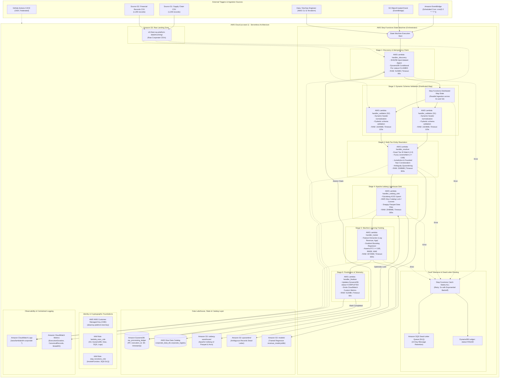

---

## 02 — Network Isolation & Zero-Trust Architecture

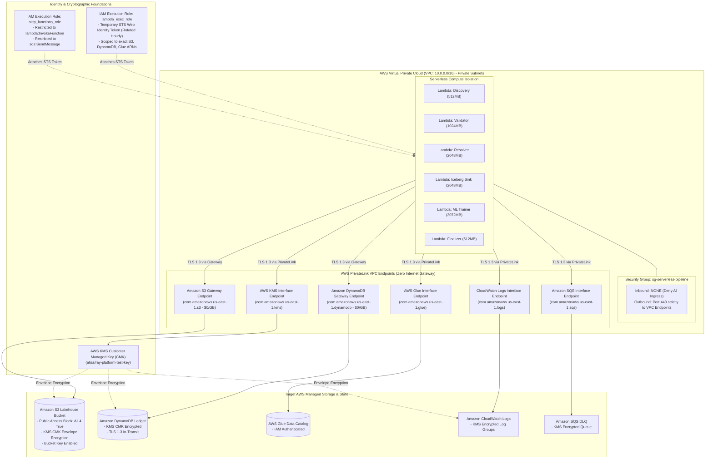

---

## 03 — Compute Architecture & Concurrency Tiering

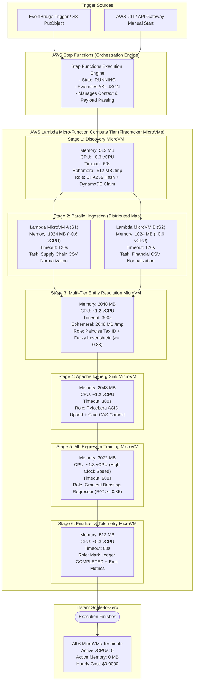

---

## 04 — End-to-End Pipeline & Data Processing Flow

```mermaid
flowchart TD
    subgraph RawData["Raw Ingestion Datasets (2,400 Total Rows)"]
        S1["supply_chain_data_s1.csv\n(1,200 records - Heterogeneous Columns)"]
        S2["financial_data_s2.csv\n(1,200 records - Heterogeneous Columns)"]
    end

    subgraph Step1["Stage 1: Discovery & Idempotency Check"]
        CALC_HASH["Compute SHA256(S1_URI + S2_URI)\nGenerate ExecutionID: sfn-run-<sha256[:16]>"]
        DDB_CLAIM{"DynamoDB PutItem\nCondition: attribute_not_exists(execution_id)"}
        EXISTS["Duplicate Execution Detected\n-> Exit Gracefully with Cached Status"]
        CLAIMED["Ledger Initialized: status=CLAIMED"]
    end

    subgraph Step2["Stage 2: Parallel Dynamic Schema Validation (Distributed Map)"]
        direction TB
        MAP_BRANCH["Step Functions Distributed Map (MaxConcurrency: 5)"]
        NORM_HEADERS["Case-Insensitive Column Alias Detection:\n['corporate_name', 'company_name'] -> entity_name\n['tax_identifier', 'ein'] -> tax_id\n['annual_revenue', 'revenue_usd'] -> annual_revenue"]
        CLEANSE["Type Coercion & Data Cleansing:\n- Strip currency symbols\n- Parse founded year\n- Uppercase ISO country code"]
        PYDANTIC["Validate Pydantic Model (CorporateRecordInput)"]
        VALID_RECS["Normalized In-Memory Records:\n- S1: 1,200 Valid\n- S2: 1,200 Valid"]
    end

    subgraph Step3["Stage 3: Multi-Tier Deterministic Entity Resolution"]
        COLLECT["Aggregate 2,400 Valid Ingested Records"]
        
        subgraph MatchingEngine["EntityResolverEngine Algorithm"]
            TIER1{"Tier 1: Exact Tax ID Match?\n(Confidence: 1.00)"}
            TIER2{"Tier 2: Normalized Levenshtein >= 0.88\n+ Country Match + |Year Diff| <= 1?\n(Confidence: 0.92)"}
            AMBIG{"Ambiguity Threshold?\n(0.65 <= Similarity < 0.88)"}
            NEW_ENT["Distinct Entity Created\n(UUIDv5 Canonical ID: COMP-XXXXXXXX)"]
        end

        CANONICAL["1,557 Canonical Merged Entities\n(Enriched with Corroborated Fields)"]
        QUARANTINE["711 Ambiguous Records\n-> Divert to s3://.../quarantine/"]
    end

    subgraph Step4["Stage 4: Apache Iceberg Lakehouse Persistence"]
        PYICEBERG["PyIceberg Arrow Table Construction"]
        WRITE_PARQUET["Write Snappy-Compressed Parquet Data Files"]
        COMMIT_SNAPSHOT["Atomic CAS Commit to AWS Glue Catalog\n- Snapshot ID: e.g. 356891083480308578\n- ACID Transaction Guarantees"]
    end

    subgraph Step5["Stage 5: Gradient Boosting Regressor Training"]
        EXTRACT_FEATURES["Feature Engineering:\n- Age = CurrentYear - FoundedYear\n- Employee Count\n- Resolution Confidence Score\n- Target: log1p(annual_revenue)"]
        TRAIN_EVAL["Train GradientBoostingRegressor (100 Trees, LR: 0.1)\nEvaluate 80/20 Train/Test Split"]
        ASSERT_R2{"Test R^2 >= 0.85?\n(Achieved: 0.8725)"}
        SAVE_MODEL["Serialize revenue_model.joblib & metrics.json to S3"]
    end

    subgraph Step6["Stage 6: Finalization & Audit Telemetry"]
        UPDATE_DDB["Update DynamoDB Ledger:\n- status = COMPLETED\n- canonical_entities = 1557\n- iceberg_snapshot_id = 356891083480308578\n- model_r2_score = 0.8725"]
        EMIT_CW["Emit Custom CloudWatch Metrics & JSON Summary"]
    end

    S1 --> CALC_HASH
    S2 --> CALC_HASH
    CALC_HASH --> DDB_CLAIM
    DDB_CLAIM -->|Already Exists| EXISTS
    DDB_CLAIM -->|New Lease| CLAIMED
    CLAIMED --> MAP_BRANCH

    MAP_BRANCH --> NORM_HEADERS
    NORM_HEADERS --> CLEANSE
    CLEANSE --> PYDANTIC
    PYDANTIC --> VALID_RECS
    VALID_RECS --> COLLECT

    COLLECT --> TIER1
    TIER1 -->|Match| CANONICAL
    TIER1 -->|No Match| TIER2
    TIER2 -->|Match| CANONICAL
    TIER2 -->|No Match| AMBIG
    AMBIG -->|Ambiguous| QUARANTINE
    AMBIG -->|No Similarity| NEW_ENT
    NEW_ENT --> CANONICAL

    CANONICAL --> PYICEBERG
    PYICEBERG --> WRITE_PARQUET
    WRITE_PARQUET --> COMMIT_SNAPSHOT
    COMMIT_SNAPSHOT --> EXTRACT_FEATURES

    EXTRACT_FEATURES --> TRAIN_EVAL
    TRAIN_EVAL --> ASSERT_R2
    ASSERT_R2 -->|Pass| SAVE_MODEL
    SAVE_MODEL --> UPDATE_DDB
    UPDATE_DDB --> EMIT_CW
```

---

## 05 — Autoscaling & Event-Driven Concurrency Lifecycle

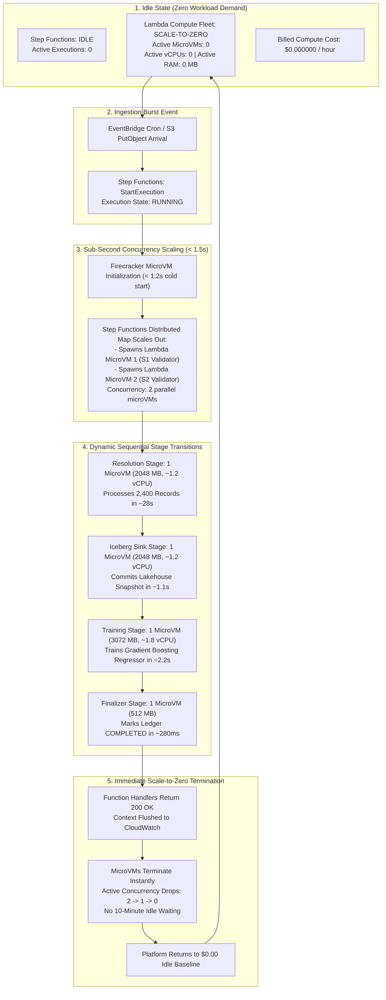

---

## 06 — Lambda Execution Environment & MicroVM Topology

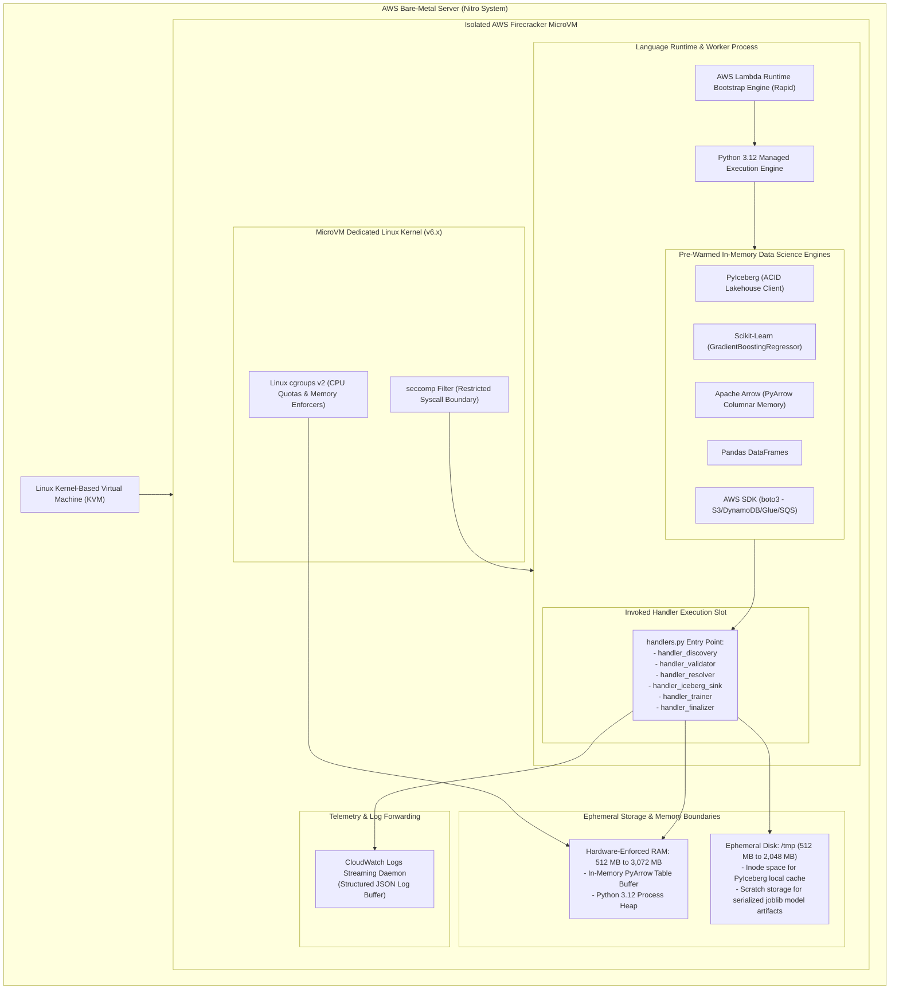

---

## 07 — Zero-Trust Security, Identity & Cryptographic Architecture

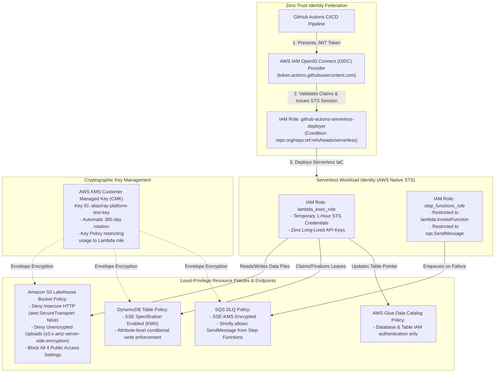

---

## 08 — Observability, Metrics & Centralized Logging Architecture

```mermaid
flowchart TD
    subgraph ExecutionPlane["Serverless Workload Execution"]
        SFN["AWS Step Functions State Machine\n(Detailed Execution History & Step Transitions)"]
        L1["Lambda: Discovery (512MB)"]
        L2["Lambda: Validator (1024MB)"]
        L3["Lambda: Resolver (2048MB)"]
        L4["Lambda: Iceberg Sink (2048MB)"]
        L5["Lambda: ML Trainer (3072MB)"]
        L6["Lambda: Finalizer (512MB)"]
        DLQ["Amazon SQS Dead-Letter Queue (DLQ)"]
    end

    subgraph CentralizedTelemetry["Amazon CloudWatch Observability Suite"]
        direction TB

        subgraph LogStreams["Structured JSON Log Groups (14-Day Retention)"]
            CW_L1["/aws/lambda/sfn-corporate-discovery"]
            CW_L2["/aws/lambda/sfn-corporate-validator"]
            CW_L3["/aws/lambda/sfn-corporate-resolver"]
            CW_L4["/aws/lambda/sfn-corporate-iceberg-sink"]
            CW_L5["/aws/lambda/sfn-corporate-trainer"]
            CW_L6["/aws/lambda/sfn-corporate-finalizer"]
        end

        subgraph CustomMetrics["CloudWatch Custom Metrics Namespace: CorporatePlatform"]
            M_DUR["Metric: PipelineExecutionDuration (Seconds)"]
            M_CAN["Metric: CanonicalEntitiesCount (1557)"]
            M_QUAR["Metric: QuarantinedEntitiesCount (711)"]
            M_R2["Metric: ModelR2Score (0.8725)"]
            M_SNAP["Metric: IcebergSnapshotID"]
        end

        subgraph Alarms["Operational Alarms & DLQ Alerts"]
            ALARM_DLQ["CloudWatch Alarm: SQS_DLQ_Messages_Present\nThreshold: VisibleMessages > 0"]
            ALARM_FAIL["CloudWatch Alarm: StepFunctions_Execution_Failed\nThreshold: FailedExecutions >= 1"]
        end

        subgraph XRay["AWS X-Ray Distributed Tracing"]
            TRACE["End-to-End Execution Trace Map:\nStep Functions -> Lambda Invocations -> S3/DynamoDB SDK Calls"]
        end
    end

    subgraph Dashboards["Platform Operator Visualization"]
        CW_DASH["CloudWatch Executive Dashboard:\n- End-to-end pipeline duration trends\n- Entity deduplication yield over time\n- Revenue ML model test R^2 scores"]
        SNS_ALERT["Amazon SNS Notification\n(Alerts On-Call Platform Engineer)"]
    end

    L1 --> CW_L1
    L2 --> CW_L2
    L3 --> CW_L3
    L4 --> CW_L4
    L5 --> CW_L5
    L6 --> CW_L6

    L6 --> M_DUR
    L6 --> M_CAN
    L6 --> M_QUAR
    L6 --> M_R2
    L6 --> M_SNAP

    SFN -.-> TRACE
    L1 -.-> TRACE
    L3 -.-> TRACE
    L5 -.-> TRACE

    DLQ --> ALARM_DLQ
    SFN --> ALARM_FAIL

    ALARM_DLQ --> SNS_ALERT
    ALARM_FAIL --> SNS_ALERT
    CustomMetrics --> CW_DASH
```

---

## 09 — Apache Iceberg ACID Lakehouse Storage Architecture

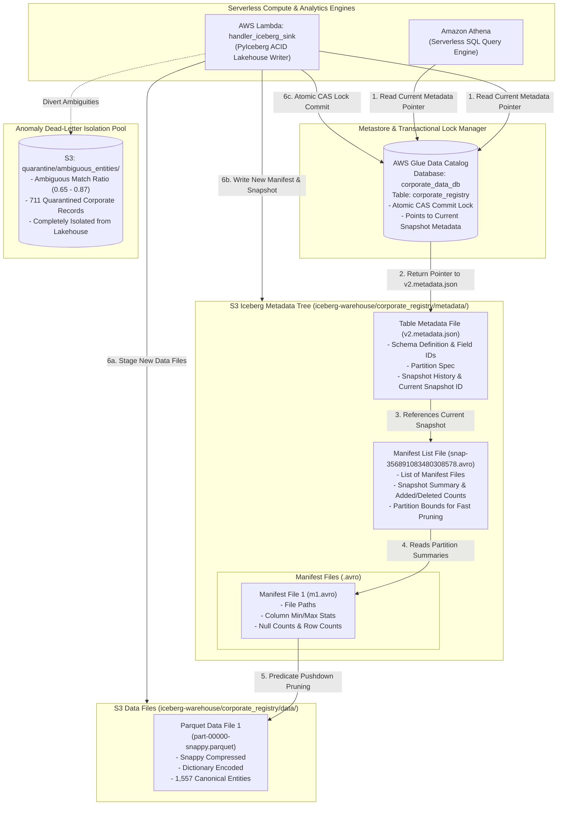

---

## 10 — CI/CD Pipeline & GitOps Deployment Lifecycle

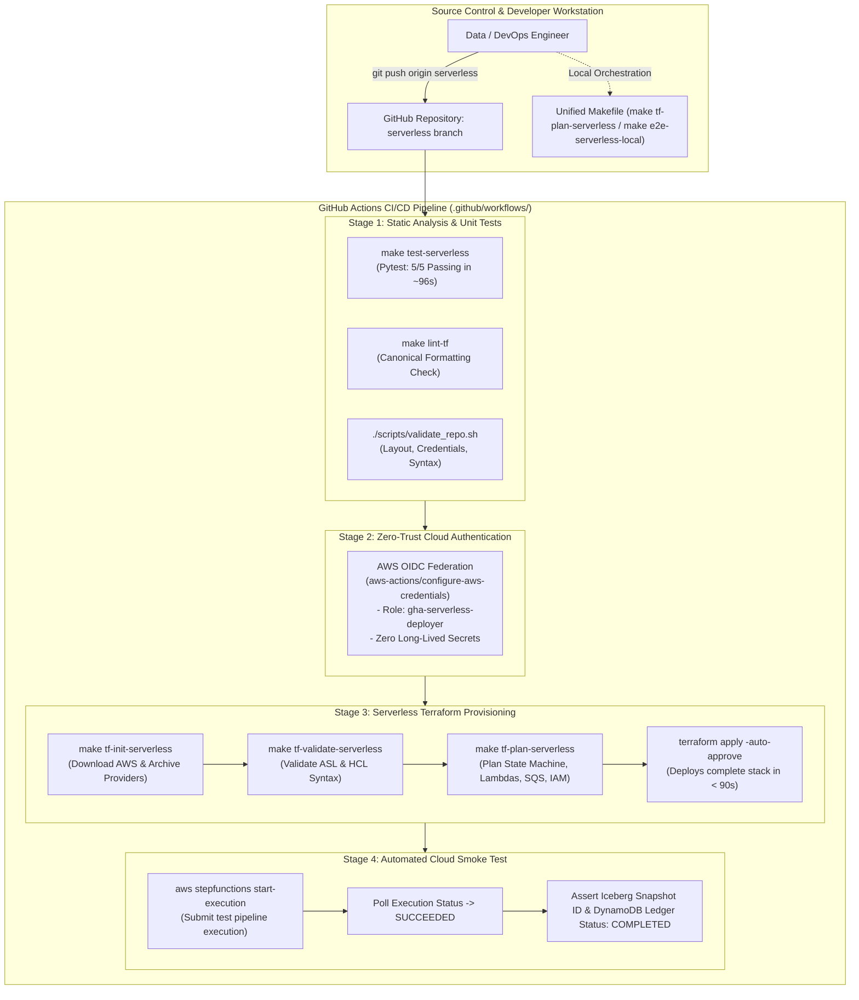

---

## 11 — Serverless Architectural Blueprint

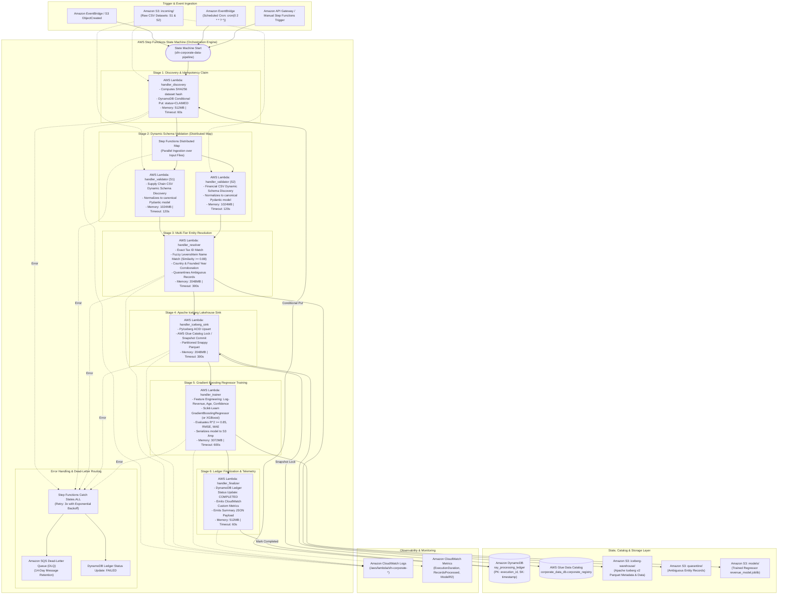
