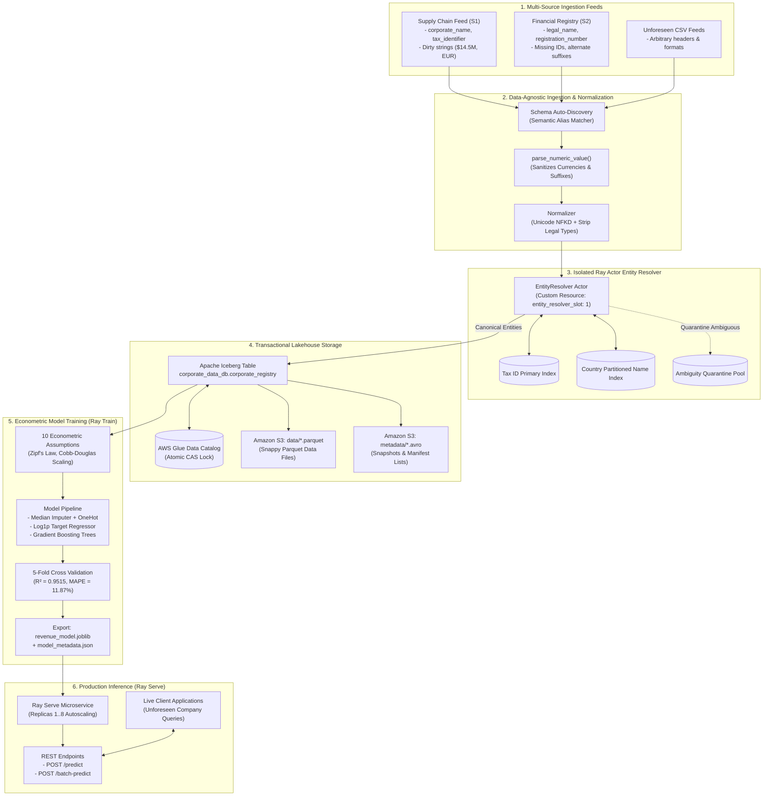
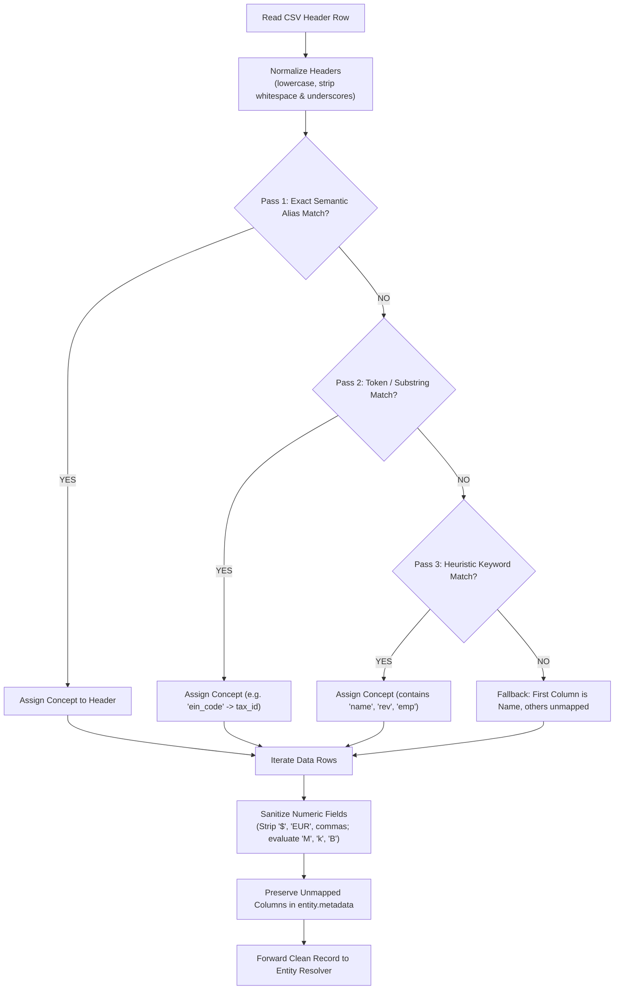
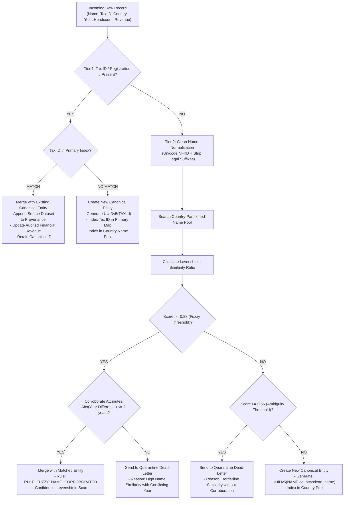
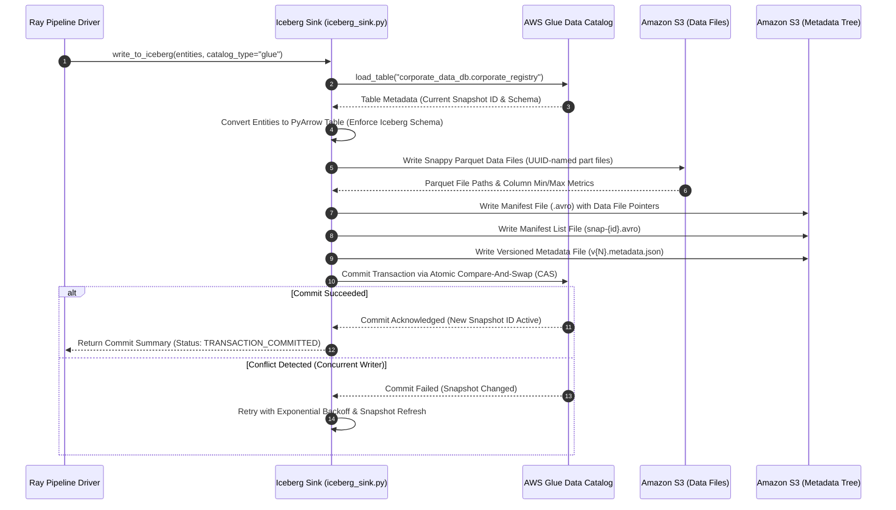
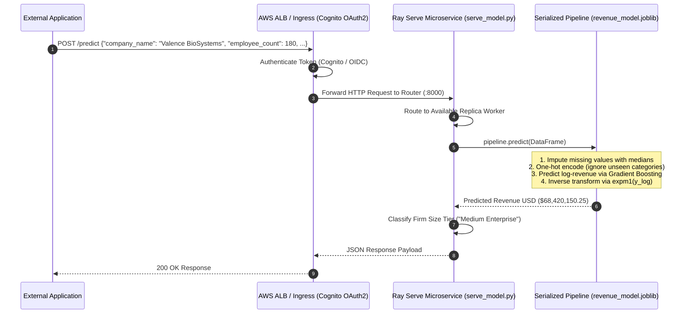
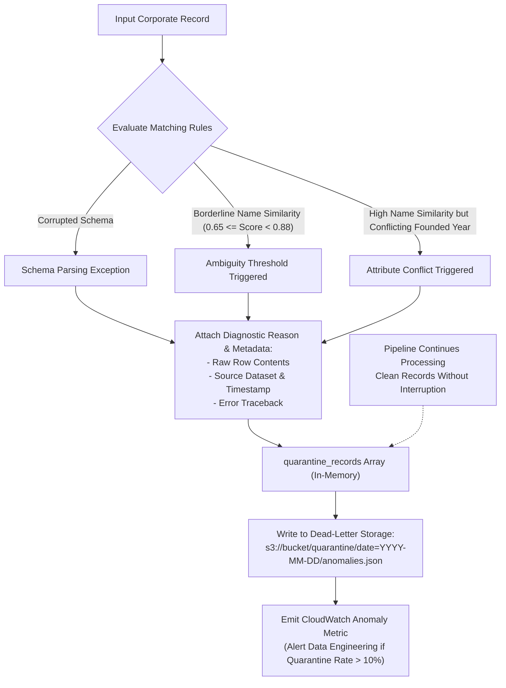

# Application Flow & Visual Architecture

This document contains visual workflow diagrams, sequence interactions, and decision trees for the **Distributed AI Foundation Application**.

---

## 1. End-to-End Application Data Lifecycle

---

## 2. Dynamic Schema Auto-Discovery Decision Flow

---

## 3. Multi-Tier Entity Resolution Decision Tree

---

## 4. Apache Iceberg Transactional Commit Sequence

---

## 5. Machine Learning Training & Econometric Modeling Pipeline

```mermaid
flowchart LR
    subgraph DataPrep["1. Feature Extraction & Econometric Grounding"]
        ENTITIES["Canonical Entities\n(from Iceberg Table)"] --> FILTER["Filter Valid Revenue\n(revenue > 0, headcount > 0)"]
        FILTER --> MATRIX["Feature Matrix\n- Headcount (Zipf Power-Law)\n- Founded Year & Company Age\n- Industry Sector (Productivity Multipliers)\n- Country (Purchasing Power Parity)"]
    end

    subgraph Preprocessing["2. Robust Scikit-Learn Preprocessing"]
        MATRIX --> NUM_PIPE["Numeric Transformer:\nSimpleImputer(strategy='median')"]
        MATRIX --> CAT_PIPE["Categorical Transformer:\nOneHotEncoder(handle_unknown='ignore')"]
        NUM_PIPE --> MERGE_FEAT["ColumnTransformer"]
        CAT_PIPE --> MERGE_FEAT
    end

    subgraph ModelTrain["3. Transformed Target Regression"]
        MERGE_FEAT --> TTR["TransformedTargetRegressor\n- func: np.log1p(y)\n- inverse: np.expm1(y_pred)"]
        TTR --> GBR["GradientBoostingRegressor\n- n_estimators: 120\n- max_depth: 4\n- subsample: 0.85"]
    end

    subgraph Evaluation["4. Generalization Evaluation & Artifacts"]
        GBR --> CV["5-Fold Cross Validation\n(CV Mean R² = 0.9425)"]
        GBR --> TEST["Held-Out Test Set (20%)\n- R² = 0.9515\n- MAPE = 11.87%\n- MAE = $16.9M"]
        TEST --> DUMP["Persist: revenue_model.joblib\n+ model_metadata.json"]
    end
```

---

## 6. Model Serving & Real-Time Inference Sequence

---

## 7. Anomaly & Ambiguity Quarantine Flow

