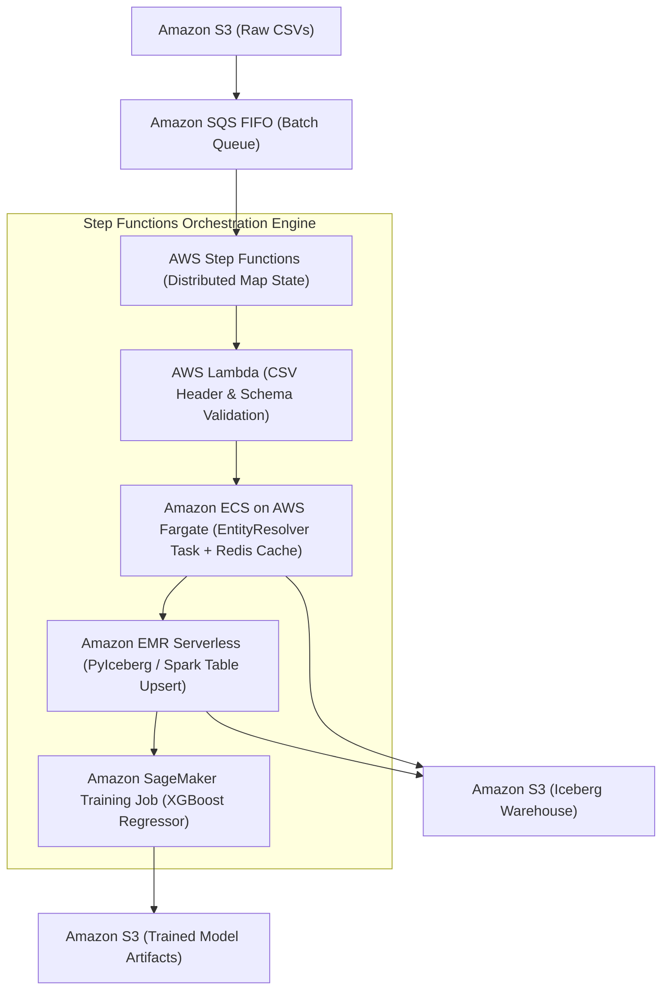

# Serverless Alternative Architecture & Comparative Analysis

## 1. Executive Summary

The primary platform implementation utilizes **Amazon EKS with KubeRay, Ray Data, Ray Train, and Apache Iceberg**. This document provides an objective, technically rigorous evaluation of a **Serverless Alternative** on AWS, assessing whether the corporate entity resolution and revenue prediction workload could be executed without a continuously managed Kubernetes cluster.

---

## 2. Serverless Architectural Blueprint

### Component Mapping

| Platform Responsibility | Kubernetes + Ray Implementation | Serverless Alternative Implementation |
| :--- | :--- | :--- |
| **Orchestration & Workflow** | KubeRay Operator (`RayJob` CRD) | AWS Step Functions (State Machine) |
| **Distributed Data Ingestion** | Ray Data (`ray.data.read_csv`) | AWS Step Functions Distributed Map + AWS Lambda |
| **Stateful Entity Resolution** | `EntityResolver` Ray Actor (Custom Resource slot) | Amazon ECS on AWS Fargate with Amazon ElastiCache (Redis) |
| **Transactional Table Sink** | PyIceberg with AWS Glue Catalog | Amazon EMR Serverless (Apache Iceberg Spark runtime) |
| **Model Training & Evaluation** | Ray Train (`XGBoostTrainer`) | Amazon SageMaker Serverless Training Job |
| **Catalog & Lakehouse** | AWS Glue Data Catalog + Amazon S3 | AWS Glue Data Catalog + Amazon S3 |

---

## 3. Comprehensive Technical Comparison

### 3.1 Distributed Execution & Inter-Worker Communication
- **Ray on EKS:** Ray provides a shared in-memory object store (Apache Arrow via `/dev/shm`) enabling **zero-copy inter-process communication** across workers on the same node, and high-throughput TCP RPC across nodes. An actor (`EntityResolver`) can maintain gigabytes of in-memory hash indices and answer lookups in microseconds.
- **Serverless Alternative:** AWS Lambda functions are stateless and isolated. Inter-worker communication requires serializing records to an external data store (Amazon ElastiCache Redis, DynamoDB, or S3). For 100,000 corporate records, external state queries introduce network latency ($1 - 5\text{ ms}$ per call vs $< 50\text{ }\mu\text{s}$ in Ray actor memory).

### 3.2 Job Duration & Memory Limits
- **Ray on EKS:** No execution duration limits. Ray pods can run for hours or days performing distributed model training, hyperparameter sweeps, or massive batch deduplication. Nodes have up to hundreds of gigabytes of RAM.
- **Serverless Alternative:** AWS Lambda has a strict **15-minute maximum timeout** and a **10 GiB memory limit**. While sufficient for 1,200 records, processing production datasets exceeding 50 million records exceeds Lambda timeouts, forcing a transition to ECS Fargate or EMR Serverless.

### 3.3 Machine Learning Training Workflow
- **Ray on EKS:** Ray Train natively integrates distributed data preprocessing (Ray Data) with distributed training (Ray Train XGBoost/PyTorch) in a single unified Python script (`ray_pipeline.py`). Memory does not leave the cluster.
- **Serverless Alternative:** Amazon SageMaker Training Jobs must provision a dedicated EC2 training instance behind the scenes, incurring container launch latency ($2 - 4\text{ minutes}$ cold-start). Passing datasets from Lambda/Step Functions to SageMaker requires writing intermediate files back to S3.

### 3.4 Operational Complexity & Day-2 Management
- **Ray on EKS:** Requires maintaining EKS cluster upgrades, Kubernetes node groups, KubeRay CRDs, network policies, and pod autoscaling. Higher initial platform engineering investment.
- **Serverless Alternative:** Zero cluster patching, zero node management, automatic high availability across 3 AZs, and native AWS IAM integration. Minimal operational maintenance overhead.

---

## 4. Cost Inflection Analysis

$$\text{Monthly Cost (Ray on EKS)} = \$73.00\text{ (EKS Control Plane)} + \$32.40\text{ (NAT Gateway)} + \text{EC2 Compute (Spot)}$$
$$\text{Baseline Fixed Cost (EKS)} \approx \$140.00 / \text{month}$$

$$\text{Monthly Cost (Serverless)} = \text{Step Functions} + \text{Lambda Invocations} + \text{SageMaker Training Seconds} + \text{S3/Glue}$$
$$\text{Baseline Fixed Cost (Serverless)} \approx \$0.00 / \text{month}$$

### Cost Inflection Curve
1. **Low / Batch Volume ($< 10$ runs per day):** Serverless is drastically cheaper ($\approx \$5 - \$15 / \text{month}$ vs $\$140 / \text{month}$ for EKS).
2. **High / Continuous Data Volume ($> 500$ runs per day or streaming):** EKS with Diversified Spot worker nodes ($\sim \$0.048 / \text{hour}$ per node) becomes **$40\% - 65\%$ cheaper** than per-second Lambda, Step Functions State Transitions, and SageMaker billing.

---

## 5. Architectural Recommendation

| Scenario | Recommended Architecture |
| :--- | :--- |
| **Take-home / Production Continuous Distributed AI Platform** | **Amazon EKS + KubeRay + Ray Train + Iceberg** (Chosen Solution) |
| **Infrequent Batch Processing ($< 2$ times per week) with lean team** | **AWS Step Functions + AWS Lambda + SageMaker Training** |
