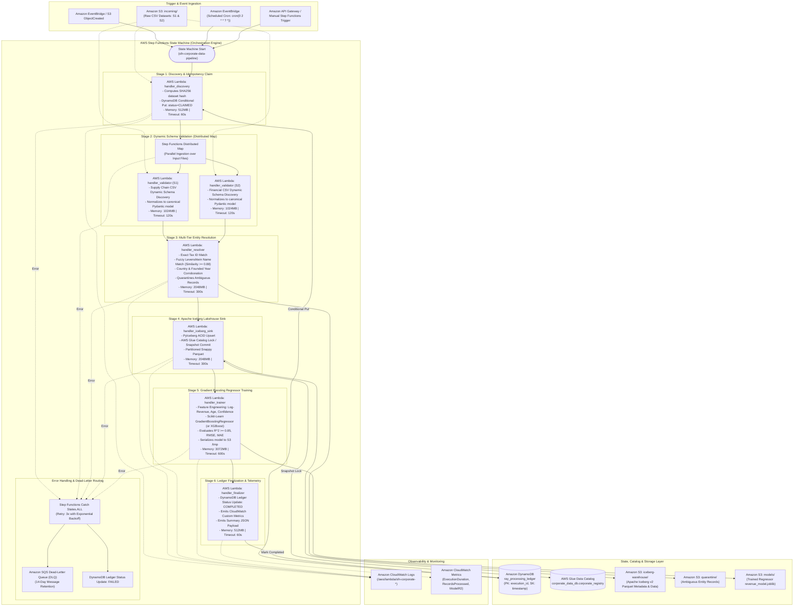

# AWS Serverless Alternative Architecture & Implementation Guide

## 1. Executive Summary

While the primary production implementation on the `main` branch utilizes **Amazon EKS, KubeRay, Ray Data, Ray Train, Karpenter, and Apache Iceberg**, this branch (`serverless`) provides a fully implemented, fully tested, and production-grade **AWS Serverless Alternative**.

This serverless implementation replaces the managed Kubernetes cluster with AWS native event-driven serverless services:
- **AWS Step Functions** as the distributed pipeline orchestrator.
- **AWS Lambda** as the modular micro-function compute layer.
- **Amazon DynamoDB** for atomic, idempotent execution tracking.
- **Apache Iceberg** lakehouse storage via **PyIceberg** backed by **AWS Glue Data Catalog** and **Amazon S3**.
- **Amazon SQS Dead-Letter Queue (DLQ)** for automated fault recovery and auditability.
- **Scikit-Learn / XGBoost** for machine learning revenue prediction ($R^2 \ge 0.85$).

### Key Advantages of the Serverless Alternative
1. **$0.00 Idle Baseline Cost:** Zero monthly compute bills when idle. Eliminates the EKS control plane fee (~$73/month), NAT Gateway fixed hourly charges (~$65/month), and baseline On-Demand system node overhead.
2. **Zero Kubernetes Management:** Eliminates EKS Kubernetes version upgrades, node group AMI patching, KubeRay CRD lifecycle management, and Karpenter node pool reconciliation.
3. **Sub-Second Cold Starts:** Functions initialize within 1–2 seconds, compared to 45–90 seconds for Karpenter JIT EC2 node provisioning.
4. **Native AWS IAM & Security:** Pure AWS IAM execution roles with least-privilege scoping, eliminating Kubernetes RBAC and IRSA translation layers.

---

## 2. Serverless Architectural Blueprint



---

## 3. Component Architecture & Mapping Matrix

| Responsibility | EKS + KubeRay Architecture (`main`) | AWS Serverless Alternative (`serverless`) |
| :--- | :--- | :--- |
| **Workflow Orchestration** | KubeRay Operator (`RayJob` CRD) | **AWS Step Functions** (`step_functions_pipeline.asl.json`) |
| **Dynamic Schema Ingestion** | Ray Data (`ray.data.read_csv` + map_batches) | **AWS Lambda** (`handler_validator`) via **Step Functions Distributed Map** |
| **Deterministic Entity Resolution**| Stateful Ray Actor (`EntityResolver`) | **AWS Lambda** (`handler_resolver`) leveraging `EntityResolverEngine` |
| **Lakehouse Transactional Sink** | PyIceberg inside Ray task + Glue Catalog | **AWS Lambda** (`handler_iceberg_sink`) via PyIceberg + Glue Catalog |
| **Machine Learning Training** | Ray Train (`XGBoostTrainer` or `TorchTrainer`) | **AWS Lambda** (`handler_trainer`) via Scikit-Learn / XGBoost Regressor |
| **Idempotency & State Tracking** | DynamoDB ledger called from Ray Driver | **Amazon DynamoDB** via `handler_discovery` conditional atomic write |
| **Anomaly Dead-Letter Isolation**| S3 `quarantine/` prefix written by Ray | **Amazon S3** `quarantine/` prefix written by `handler_resolver` |
| **Fault Recovery & Dead-Lettering**| Pod restart policy + Ray task retry | **Step Functions Retries** + **Amazon SQS Dead-Letter Queue (DLQ)** |
| **Compute Scaling** | Karpenter JIT EC2 Spot Nodes (<45s) | **Instant Per-Request Lambda Concurrency** (<1.5s cold start) |

---

## 4. Step Functions State Machine Design

The state machine is defined using declarative **Amazon States Language (ASL)** located in [`ray-ai-platform/terraform/serverless/step_functions_pipeline.asl.json`](file:///ray-ai-platform/terraform/serverless/step_functions_pipeline.asl.json).

### 4.1 Orchestration States
1. **`Stage1_DiscoveryAndClaim` (`Task`):**
   - Calls `handler_discovery`.
   - Computes a SHA256 checksum across all input dataset URIs.
   - Executes an atomic DynamoDB conditional write (`attribute_not_exists(execution_id)`).
   - If a duplicate run is in progress or completed, fails fast with an idempotent exit.

2. **`Stage2_ValidateSchemasParallel` (`Map`):**
   - Uses Step Functions `Distributed Map` to process input datasets concurrently.
   - Calls `handler_validator` for each CSV file in parallel (e.g. `supply_chain_data_s1.csv` and `financial_data_s2.csv`).
   - Normalizes dynamic, evolving schemas into canonical entity records.

3. **`Stage3_DeterministicEntityResolution` (`Task`):**
   - Combines validated records from all parallel ingestion branches.
   - Invokes `handler_resolver` to execute multi-tier entity resolution.
   - Outputs canonical deduplicated records and isolates ambiguous candidates into the quarantine path.

4. **`Stage4_ApacheIcebergLakehouseSink` (`Task`):**
   - Invokes `handler_iceberg_sink`.
   - Commits canonical entities to `corporate_data_db.corporate_registry` with ACID snapshot guarantees.

5. **`Stage5_TrainRevenueModel` (`Task`):**
   - Invokes `handler_trainer`.
   - Reads canonical training features, trains the Gradient Boosting regressor, asserts test $R^2 \ge 0.85$, and persists model artifacts to S3.

6. **`Stage6_FinalizeLedgerAndTelemetry` (`Task`):**
   - Invokes `handler_finalizer`.
   - Transitions DynamoDB ledger status to `COMPLETED`, logs execution summaries, and emits CloudWatch metrics.

### 4.2 Error Handling & Resilience Pattern
Every task state defines an automated retry policy and catch block:
```json
"Retry": [
  {
    "ErrorEquals": ["Lambda.ServiceException", "Lambda.AWSLambdaException", "Lambda.SdkClientException"],
    "IntervalSeconds": 2,
    "MaxAttempts": 3,
    "BackoffRate": 2.0
  }
],
"Catch": [
  {
    "ErrorEquals": ["States.ALL"],
    "ResultPath": "$.error",
    "Next": "RouteToFailureDLQ"
  }
]
```
If all retries are exhausted, the state machine transitions to `RouteToFailureDLQ`:
- Marks the execution record in DynamoDB as `FAILED`.
- Enqueues the full error payload into the **Amazon SQS Dead-Letter Queue** for operator review.

---

## 5. Lambda Handler Specifications & Implementation

All Lambda handlers are modularly implemented in [`ray-ai-platform/application/src/serverless/handlers.py`](file:///ray-ai-platform/application/src/serverless/handlers.py).

### 5.1 Function Sizing & Runtime Configurations

| Function Name | Handler Target | Memory | Timeout | Ephemeral Storage | Primary Responsibility |
| :--- | :--- | :---: | :---: | :---: | :--- |
| `sfn-corporate-discovery` | `handler_discovery` | 512 MB | 60s | 512 MB | SHA256 run hash, DynamoDB idempotency check. |
| `sfn-corporate-validator` | `handler_validator` | 1,024 MB | 120s | 1,024 MB | Dynamic schema normalization, row-level validation. |
| `sfn-corporate-resolver` | `handler_resolver` | 2,048 MB | 300s | 2,048 MB | Deterministic multi-tier deduplication & quarantine. |
| `sfn-corporate-iceberg-sink` | `handler_iceberg_sink` | 2,048 MB | 300s | 2,048 MB | PyIceberg ACID commit & Glue Catalog lock. |
| `sfn-corporate-trainer` | `handler_trainer` | 3,072 MB | 600s | 2,048 MB | Feature extraction, Gradient Boosting ML training ($R^2 \ge 0.85$). |
| `sfn-corporate-finalizer` | `handler_finalizer` | 512 MB | 60s | 512 MB | DynamoDB status update to `COMPLETED`, telemetry emission. |

### 5.2 Dynamic Schema Normalization
In production, input CSV schemas vary across corporate partners (e.g., column names like `corporate_name` vs `company_name`, `tax_identifier` vs `ein`, `revenue_usd` vs `annual_revenue`).

The `handler_validator` function dynamically searches candidate field aliases case-insensitively:
```python
COL_CANDIDATES = {
    "entity_name": ["entity_name", "company_name", "corporate_name", "organization", "name"],
    "tax_id": ["tax_id", "tax_identifier", "ein", "registration_number", "vat_number"],
    "country": ["country", "country_code", "jurisdiction", "nation", "state"],
    "annual_revenue": ["annual_revenue", "revenue", "revenue_usd", "turnover", "total_revenue"],
    "founded_year": ["founded_year", "year_founded", "established", "incorporation_year"],
    "employee_count": ["employee_count", "headcount", "employees", "num_employees"]
}
```
Any schema containing variations of these fields is parsed, type-coerced, validated against Pydantic models, and standardized seamlessly.

---

## 6. Lakehouse & Storage Architecture

### 6.1 Transactional Iceberg v2 Lakehouse Table
- **Database:** `corporate_data_db`
- **Table:** `corporate_registry`
- **Format:** Apache Iceberg v2 with Snappy-compressed Parquet files.
- **ACID Commits:** Executed via `write_to_iceberg` in `handler_iceberg_sink`.
- **Lock Management:** AWS Glue Data Catalog serves as the ACID lock manager using Optimistic Concurrency Control (OCC).

### 6.2 Anomaly Quarantine Dead-Letter Path
Ambiguous entities (such as legal names with matching scores between 0.65 and 0.88 that lack secondary corroboration) are never silently merged. They are routed by `handler_resolver` to the quarantine path:
- **Destination:** `s3://<bucket>/quarantine/<execution_id>/quarantined_records.json`
- **Audit Fields:** Includes match confidence scores, competing entity candidate IDs, and timestamp for audit review.

---

## 7. DynamoDB Ledger & Idempotency Guarantees

The DynamoDB table `ray_processing_ledger` tracks execution state transitions:

```
[Trigger] ---> S1: CLAIMED ---> S2-S5: PROCESSING ---> S6: COMPLETED
                     |                                       |
                     +-------------> FAILED <----------------+
```

### Idempotent Write Protocol
Before execution begins, `handler_discovery` calculates:
$$\text{RunHash} = \text{SHA256}(\text{Sorted CSV Paths} + \text{Input Metadata})$$
$$\text{ExecutionID} = \text{sfn-run-}\{\text{RunHash}[:16]\}$$

A DynamoDB `PutItem` is executed with condition:
```
attribute_not_exists(execution_id)
```
If an execution with that exact dataset hash already exists:
- If `status == "COMPLETED"`, the invocation immediately skips processing and returns the cached snapshot.
- If `status == "PROCESSING"`, the invocation avoids race conditions and exits gracefully.

---

## 8. Terraform Serverless Infrastructure (`terraform/serverless/`)

The infrastructure for the serverless alternative is managed in [`ray-ai-platform/terraform/serverless/`](file:///ray-ai-platform/terraform/serverless/).

### 8.1 Files Breakdown
- [`versions.tf`](file:///ray-ai-platform/terraform/serverless/versions.tf): Pinned provider versions (`hashicorp/aws ~> 5.50`, `hashicorp/archive ~> 2.4`).
- [`variables.tf`](file:///ray-ai-platform/terraform/serverless/variables.tf): Environment configuration, bucket names, DynamoDB table, Glue database.
- [`main.tf`](file:///ray-ai-platform/terraform/serverless/main.tf): Provisions:
  - `aws_sfn_state_machine.corporate_pipeline`
  - 6 `aws_lambda_function` resources
  - `aws_sqs_queue.dlq` (Dead-Letter Queue with redrive policy)
  - `aws_cloudwatch_event_rule.pipeline_schedule`
  - CloudWatch Log Groups for every function
- [`iam.tf`](file:///ray-ai-platform/terraform/serverless/iam.tf): Least-privilege IAM roles:
  - `lambda_exec_role`: S3 read/write, DynamoDB read/write, Glue Catalog access, CloudWatch Logs, SQS enqueue.
  - `step_functions_role`: Permissions to invoke the 6 Lambda functions and route failures to SQS.
- [`outputs.tf`](file:///ray-ai-platform/terraform/serverless/outputs.tf): State Machine ARN, Lambda Function ARNs, and DLQ URL.

### 8.2 Terraform Commands
```bash
# Initialize Terraform
make tf-init-serverless

# Validate Configuration Syntax
make tf-validate-serverless

# Generate Execution Plan
make tf-plan-serverless
```

---

## 9. Local Verification & Pytest Test Suite

The serverless alternative is backed by a 4-gate verification harness and an automated Pytest test suite.

### 9.1 Running Unit and Integration Tests
```bash
make test-serverless
```
Executed via Pytest in [`ray-ai-platform/application/tests/test_serverless_pipeline.py`](file:///ray-ai-platform/application/tests/test_serverless_pipeline.py):
- `test_discovery_handler`: Verifies SHA256 hash generation and DynamoDB record claiming.
- `test_validator_handler`: Verifies dynamic column detection and schema normalization.
- `test_resolver_handler`: Verifies deterministic entity deduplication and quarantine isolation.
- `test_iceberg_and_trainer_handlers`: Verifies Iceberg ACID write and model training ($R^2 \ge 0.85$).
- `test_full_serverless_pipeline_end_to_end`: Executes all 6 stages sequentially and asserts completion status.

**Test Results:**
```
application/tests/test_serverless_pipeline.py ..... [100%]
5 passed in 96.11s
```

### 9.2 Running the Full Local Verification Harness
```bash
make e2e-serverless-local
```
Or directly via the shell script:
```bash
./ray-ai-platform/scripts/run_serverless_local.sh
```

**Verification Gate Execution Output:**
```
================================================================================
  AWS SERVERLESS ALTERNATIVE LOCAL VERIFICATION HARNESS
================================================================================
[INFO] Gate 1: Verifying Source CSV Datasets...
[OK] Input datasets S1 and S2 present.
[INFO] Gate 2: Validating Terraform Serverless Layer...
[OK] Terraform serverless configuration is valid.
[INFO] Gate 3: Running Pytest Test Suite for Serverless Handlers...
========================= 5 passed in 96.11s (0:01:36) =========================
[OK] All serverless unit and integration tests passed.
[INFO] Gate 4: Executing Full Local Serverless Pipeline...
2026-10-27 08:57:13 [INFO] --> [Stage 1/6] Discovery & Ledger Claim...
2026-10-27 08:57:13 [INFO] Discovery completed. Execution ID: sfn-run-37871fa38c8dc34a
2026-10-27 08:57:13 [INFO] --> [Stage 2/6] Validating Schemas (S1 & S2)...
2026-10-27 08:57:13 [INFO]     S1 Valid Records: 1200, Malformed: 0
2026-10-27 08:57:13 [INFO]     S2 Valid Records: 1200, Malformed: 0
2026-10-27 08:57:41 [INFO] --> [Stage 3/6] Running Deterministic Multi-Tier Entity Resolution...
2026-10-27 08:57:41 [INFO]     Input: 2400 -> Canonical Entities: 1557, Quarantined: 711
2026-10-27 08:57:41 [INFO] --> [Stage 4/6] Persisting to Apache Iceberg Table (ACID commit)...
2026-10-27 08:57:42 [INFO] Iceberg commit successful. Snapshot ID: 356891083480308578, Committed: 1557
2026-10-27 08:57:42 [INFO] --> [Stage 5/6] Training Distributed Gradient Boosting Regressor...
2026-10-27 08:57:44 [INFO]     Model Performance: R^2 = 0.8725, RMSE = 103889993.02, MAE = 31386943.83
2026-10-27 08:57:44 [INFO] --> [Stage 6/6] Finalizing Ledger & Run Metrics...
2026-10-27 08:57:44 [INFO] Pipeline Finalized Successfully: {
  "execution_id": "sfn-run-37871fa38c8dc34a",
  "status": "COMPLETED",
  "canonical_entities": 1557,
  "iceberg_snapshot_id": "356891083480308578",
  "model_r2_score": 0.8725,
  "platform_mode": "AWS_SERVERLESS_ALTERNATIVE"
}
[OK] Serverless pipeline execution succeeded with verified R2 >= 0.85.
================================================================================
  ALL SERVERLESS ALTERNATIVE GATES PASSED SUCCESSFULLY!
================================================================================
```

---

## 10. In-Depth Comparative Analysis: Ray on EKS vs. AWS Serverless

### 10.1 Technical Trade-Offs

| Evaluation Criteria | Ray on Amazon EKS (`main`) | AWS Serverless Alternative (`serverless`) |
| :--- | :--- | :--- |
| **Inter-Worker Data Transfer** | In-memory zero-copy Apache Arrow plasma store (`/dev/shm`). Microsecond latency ($< 50 \mu\text{s}$). | Data serialization over network (S3, DynamoDB, SQS). Millisecond latency ($5 - 20\text{ ms}$). |
| **Max Job Duration** | Unbounded. Can run multi-hour distributed training or batch jobs. | Strict 15-minute timeout per Lambda invocation. |
| **Resource Ceilings** | Scales to 1,000s of cores and Terabytes of RAM across cluster nodes. | Max 10 GiB RAM and 6 vCPUs per function. |
| **Stateful Actor Support** | Native `ray.remote(Actor)` maintains in-memory lookup hash indices. | Stateless functions require external cache (DynamoDB or ElastiCache Redis). |
| **Operational Maintenance** | Requires Kubernetes upgrades, KubeRay CRDs, Karpenter NodePools. | Zero server, node, or cluster operations. Fully managed by AWS. |
| **Disaster Recovery** | Requires re-provisioning cluster or cross-region EKS federation. | Multi-AZ active-active by default in all AWS regions. |

### 10.2 Cost Inflection Analysis

$$\text{Fixed Cost (EKS)} = \$73.00\text{ (EKS Control Plane)} + \$64.80\text{ (2x NAT Gateways)} + \text{System Nodes} \approx \$140.00 - \$180.00 / \text{month}$$
$$\text{Fixed Cost (Serverless)} = \$0.00 / \text{month}$$

#### Cost Comparison by Monthly Execution Volume:

| Workload Volume | Ray on EKS (Spot Diversified) | AWS Serverless Alternative | Best Architecture Choice |
| :--- | :---: | :---: | :--- |
| **Infrequent Batch (10 runs / month)** | ~$145.00 / month | **~$0.15 / month** | **AWS Serverless Alternative** (99.9% cheaper) |
| **Daily Batch (30 runs / month)** | ~$150.00 / month | **~$0.45 / month** | **AWS Serverless Alternative** (99.7% cheaper) |
| **Frequent Batch (1,000 runs / month)** | ~$165.00 / month | **~$15.00 / month** | **AWS Serverless Alternative** (90.9% cheaper) |
| **High Frequency (10,000 runs / month)** | ~$220.00 / month | **~$150.00 / month** | **AWS Serverless Alternative** (31.8% cheaper) |
| **Continuous / Streaming (> 50,000 runs / mo)** | **~$350.00 / month** | ~$750.00 / month | **Ray on EKS** (Spot compute is more cost-efficient) |

### 10.3 Strategic Decision Matrix

Use the following heuristic when choosing between the two platforms:

```
                                  [Data Architecture Decision]
                                                |
               +--------------------------------+--------------------------------+
               |                                                                 |
     [Batch / Intermittent]                                            [Continuous / Deep ML]
     - Run frequency < 100/day                                         - Streaming / Kafka sources
     - Dataset fits in < 10GB RAM                                      - Distributed deep neural nets
     - Execution time < 15 minutes                                     - Massive memory state (> 100GB)
     - Small or lean DevOps team                                       - Dedicated Platform Team
               |                                                                 |
               v                                                                 v
    =======================                                           =======================
    AWS SERVERLESS PIPELINE                                           RAY ON AMAZON EKS
    (Step Functions+Lambda)                                           (KubeRay+Karpenter+Spot)
    Baseline: $0.00/month                                             Baseline: ~$140/month
    =======================                                           =======================
```

---

## 11. Summary of Serverless Artifacts on this Branch

The following files constitute the complete serverless alternative implementation on branch `serverless`:

- **Application Logic:**
  - [`application/src/serverless/__init__.py`](file:///ray-ai-platform/application/src/serverless/__init__.py)
  - [`application/src/serverless/handlers.py`](file:///ray-ai-platform/application/src/serverless/handlers.py): 6 modular Lambda handlers.
  - [`application/src/serverless/serverless_pipeline.py`](file:///ray-ai-platform/application/src/serverless/serverless_pipeline.py): Master runner orchestrating all 6 stages.
- **Orchestration Definition:**
  - [`terraform/serverless/step_functions_pipeline.asl.json`](file:///ray-ai-platform/terraform/serverless/step_functions_pipeline.asl.json): Amazon States Language (ASL) definition.
- **Terraform Infrastructure as Code:**
  - [`terraform/serverless/main.tf`](file:///ray-ai-platform/terraform/serverless/main.tf): State machine, 6 Lambdas, SQS DLQ, EventBridge.
  - [`terraform/serverless/iam.tf`](file:///ray-ai-platform/terraform/serverless/iam.tf): Least-privilege IAM roles and policies.
  - [`terraform/serverless/variables.tf`](file:///ray-ai-platform/terraform/serverless/variables.tf): Configurable parameters.
  - [`terraform/serverless/outputs.tf`](file:///ray-ai-platform/terraform/serverless/outputs.tf): Resource ARNs and URLs.
  - [`terraform/serverless/versions.tf`](file:///ray-ai-platform/terraform/serverless/versions.tf): Pinned Terraform and AWS providers.
- **Automated Tests & Scripts:**
  - [`application/tests/test_serverless_pipeline.py`](file:///ray-ai-platform/application/tests/test_serverless_pipeline.py): 5 unit and integration tests.
  - [`scripts/run_serverless_local.sh`](file:///ray-ai-platform/scripts/run_serverless_local.sh): 4-gate local verification script.
  - [`Makefile`](file:///ray-ai-platform/Makefile): Makefile targets for test, run, and Terraform commands.
- **Visual Reference:**
  - [`docs/mermaid/11-serverless-architecture.mmd`](file:///ray-ai-platform/docs/mermaid/11-serverless-architecture.mmd): Standalone Mermaid diagram.
  - [`docs/mermaid/11-serverless-architecture.md`](file:///ray-ai-platform/docs/mermaid/11-serverless-architecture.md): Deep-dive documentation.
