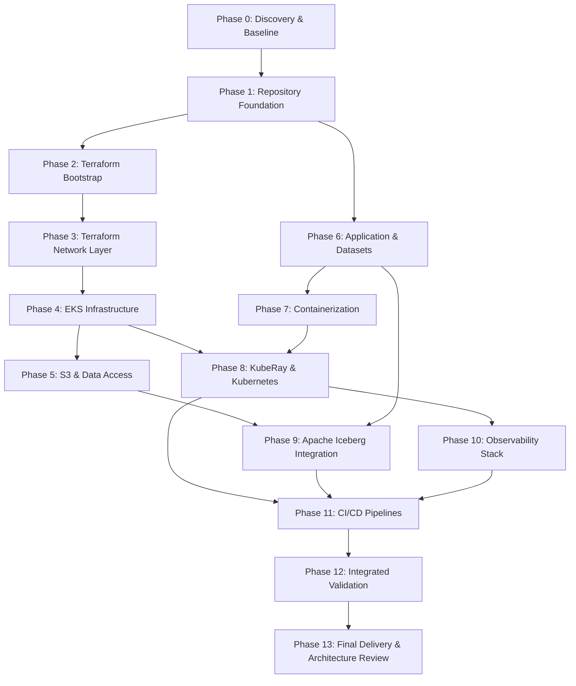

# Implementation Plan — Ray AI Platform on Kubernetes

## 1. Project Overview & Scope
This plan details the phase-by-phase execution of the **Distributed AI Foundation** platform take-home assignment. The target platform is an automated, production-like data-processing and ML training engine running on AWS EKS with KubeRay, Ray Data, Ray Train, and Apache Iceberg.

## 2. Phase Execution Sequence & Dependencies

---

## 3. Phase Descriptions & Validation Criteria

### Phase 0: Discovery and Baseline
- **Objective:** Discover repository baseline, installed tools, assignment documents, unknowns, and construct traceability and implementation plans.
- **Dependencies:** None.
- **Deliverables:**
  - `REQUIREMENTS_TRACEABILITY.md`
  - `IMPLEMENTATION_PLAN.md`
  - Environment audit and tool version record.
- **Validation:** Tool versions recorded; all assignment requirements accounted for in matrix.

### Phase 1: Repository Foundation
- **Objective:** Establish the repository structure, code standards, `.gitignore`, `.dockerignore`, linters, and validation scripts.
- **Dependencies:** Phase 0.
- **Deliverables:**
  - Clean directory tree according to specification.
  - `.gitignore`, `.dockerignore`, `pyproject.toml`, `.flake8` / `ruff.toml`.
  - Foundational validation shell script `scripts/validate_repo.sh`.
- **Validation:** Repository layout matches target; formatting rules enforced.

### Phase 2: Terraform Bootstrap
- **Objective:** Create the remote state backend resources (S3 bucket with SSE-KMS, versioning, public access block; DynamoDB state locking table).
- **Dependencies:** Phase 1.
- **Deliverables:**
  - `terraform/bootstrap/main.tf`, `variables.tf`, `outputs.tf`, `terraform.tfvars.example`.
- **Validation:** `terraform fmt -check`, `terraform validate`. (Gate: Do not apply to AWS without explicit approval).

### Phase 3: Terraform Network Layer
- **Objective:** Implement modular VPC across 3 Availability Zones, public/private subnets, NAT Gateway, S3 Gateway VPC Endpoint, and route tables.
- **Dependencies:** Phase 2.
- **Deliverables:**
  - `terraform/modules/vpc/`
  - `terraform/network/main.tf`, `variables.tf`, `outputs.tf`.
- **Validation:** Static validation and security review of subnet CIDRs and endpoint routing.

### Phase 4: EKS Infrastructure
- **Objective:** Implement AWS EKS cluster (v1.31) with OIDC provider, cluster security groups, and decoupled node groups (On-Demand Head/System pool and Autoscaling Spot Worker pool).
- **Dependencies:** Phase 3.
- **Deliverables:**
  - `terraform/modules/eks/`
  - `terraform/eks/main.tf`, `node_groups.tf`, `iam.tf`, `variables.tf`, `outputs.tf`.
- **Validation:** `terraform validate`, review of Spot diversification and capacity allocation strategy.

### Phase 5: S3 and Data Access Layer
- **Objective:** Implement data lakehouse storage, AWS Glue Data Catalog database, DynamoDB processing ledger, and IRSA role with least-privilege IAM policies.
- **Dependencies:** Phase 4.
- **Deliverables:**
  - `terraform/modules/s3_iceberg/`, `terraform/modules/ledger/`, `terraform/modules/irsa/`
  - `terraform/data/main.tf`, `s3.tf`, `glue.tf`, `dynamodb.tf`, `iam_irsa.tf`.
- **Validation:** `terraform validate`, IAM boundary inspection.

### Phase 6: Application and Datasets
- **Objective:** Implement reproducible dataset generation scripts creating 2 datasets ($\ge 1,000$ rows each: `supply_chain_data_s1.csv` and `financial_data_s2.csv`), parallel ingestion with Ray Data, deterministic multi-tier `EntityResolver` actor, schema normalization, and revenue prediction model with Ray Train.
- **Dependencies:** Phase 1.
- **Deliverables:**
  - `application/src/generate_datasets.py`
  - `application/data/supply_chain_data_s1.csv`, `application/data/financial_data_s2.csv`
  - `application/src/normalizer.py`, `application/src/entity_resolver.py`
  - `application/src/ingest.py`, `application/src/train_model.py`, `application/src/ray_pipeline.py`
  - `application/tests/test_dataset_generator.py`, `application/tests/test_entity_resolver.py`, `application/tests/test_pipeline.py`
- **Validation:** Python tests run locally with `pytest`; record counts $\ge 1,000$ verified; entity resolution accuracy checked.

### Phase 7: Containerization
- **Objective:** Create a hardened, reproducible, non-root Dockerfile for the Ray application with pinned compatible dependencies.
- **Dependencies:** Phase 6.
- **Deliverables:**
  - `application/Dockerfile`
  - `application/requirements.txt`
  - `.dockerignore`
  - `scripts/build_image.sh`
- **Validation:** Dockerfile syntax validation, dependency pinning verification, image structure check.

### Phase 8: KubeRay and Kubernetes Manifests
- **Objective:** Configure KubeRay Operator Helm values, `RayCluster` CRD with dedicated head/worker pools, `/dev/shm` 4Gi mounts, object store sizing, and `EntityResolver` scheduling constraints (`entity_resolver_slot: 1`), and `RayJob` CRD.
- **Dependencies:** Phase 4, Phase 7.
- **Deliverables:**
  - `helm/kuberay-operator/values.yaml`
  - `kubernetes/namespaces/namespaces.yaml`
  - `kubernetes/security/service-account.yaml`, `kubernetes/security/rbac.yaml`, `kubernetes/security/secrets.yaml`
  - `kubernetes/ray/ray-cluster.yaml`
  - `kubernetes/jobs/ray-job.yaml`
- **Validation:** Manifest linting, schema validation against KubeRay v1.2.2 CRD definitions.

### Phase 9: Apache Iceberg Integration
- **Objective:** Implement real transactional Iceberg catalog integration using PyIceberg (supporting both AWS Glue in cloud and SQLite/REST catalog in local testing) to maintain the `corporate_registry` table with ACID upserts.
- **Dependencies:** Phase 5, Phase 6.
- **Deliverables:**
  - `application/src/iceberg_sink.py`
  - `application/src/catalog_factory.py`
  - `application/tests/test_iceberg_sink.py`
- **Validation:** Execute real PyIceberg commits, test schema evolution, verify snapshot isolation and row count integrity.

### Phase 10: Observability Stack
- **Objective:** Configure Prometheus `PodMonitor` for Ray metrics (:8080), secure Ray Dashboard exposure (ClusterIP only), centralized logging via Fluent Bit to CloudWatch Logs, and Grafana dashboard JSON.
- **Dependencies:** Phase 8.
- **Deliverables:**
  - `kubernetes/observability/ray-podmonitor.yaml`
  - `kubernetes/observability/fluent-bit-config.yaml`
  - `kubernetes/observability/grafana-dashboards/ray-platform.json`
  - `kubernetes/observability/ingress-auth.yaml`
  - `scripts/check_ray_health.sh`
- **Validation:** Manifest validation, Prometheus metric format check, Fluent Bit parser review.

### Phase 11: CI/CD Pipelines
- **Objective:** Implement GitHub Actions workflows for PR validation (`pr-validation.yml`) and merge deployment (`deploy.yml`) utilizing AWS OIDC federation, container build/push, and RayJob CRD submission.
- **Dependencies:** Phases 1-10.
- **Deliverables:**
  - `.github/workflows/pr-validation.yml`
  - `.github/workflows/deploy.yml`
- **Validation:** Workflow syntax validation with actionlint / schema validator.

### Phase 12: Integrated Validation
- **Objective:** Execute end-to-end local test suite, validate all Terraform modules and Kubernetes manifests, simulate pipeline execution, verify Iceberg writes, and evaluate trained model artifacts.
- **Dependencies:** Phases 1-11.
- **Deliverables:**
  - `scripts/run_local_e2e.sh`
  - End-to-end execution logs and test reports.
  - Traceability matrix updated with verified PASS/FAIL results.
- **Validation:** 100% of unit and integration tests pass locally.

### Phase 13: Final Delivery & Architecture Review
- **Objective:** Deliver unified, production-ready documentation, architecture review, Spot interruption analysis, serverless alternative analysis, and cleanup guide.
- **Dependencies:** Phase 12.
- **Deliverables:**
  - `README.md`
  - `docs/architecture.md`
  - `docs/architecture-review.md`
  - `docs/deployment.md`
  - `docs/security.md`
  - `docs/troubleshooting.md`
  - `docs/cost-analysis.md`
  - `docs/serverless-alternative.md`
- **Validation:** Cross-documentation coherence check, peer review checklist compliance.

---

## 4. Phase Gate & Approval Protocol
1. **Local Autonomous Progression:** All safe local operations (file generation, dependency installation in virtual environments, code editing, linting, testing, `terraform validate`) run autonomously without blocking.
2. **Strict Cloud Approval Gates:** Pausing for user confirmation is required before:
   - Executing `terraform apply` on any live AWS infrastructure.
   - Creating billable cloud resources (EKS, NAT Gateways, EC2 instances).
   - Performing destructive operations (`terraform destroy`).
   - Requesting or configuring external AWS credentials/tokens.
