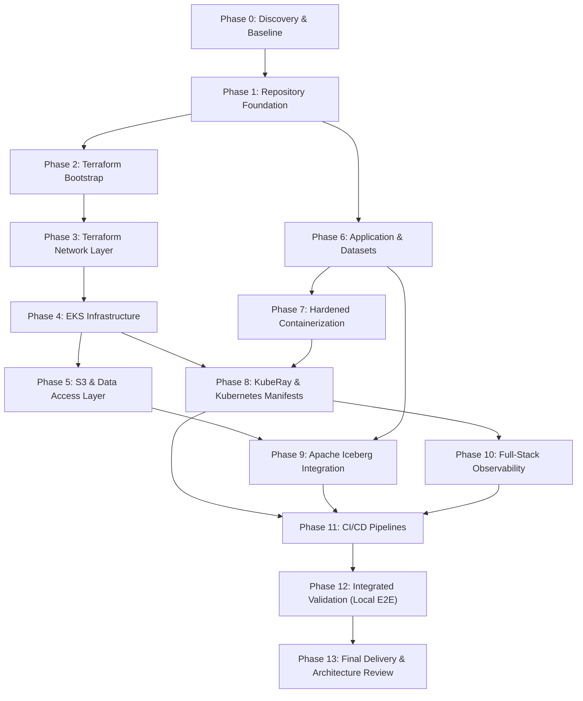
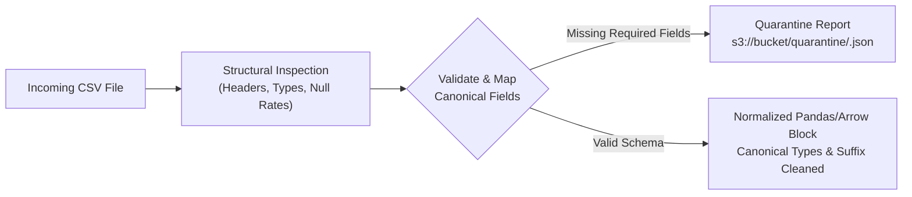

# Implementation Plan & Execution Guide — Ray AI Platform on AWS

- **Status:** Complete / Production-Verified Implementation Guide
- **Cloud Provider:** Amazon Web Services (AWS)
- **Runtime Compute:** Amazon EKS (Kubernetes `1.31`) + KubeRay (`v1.2.2`) + Ray (`2.40.0`)
- **Lakehouse Storage:** Apache Iceberg (Format v2) with AWS Glue Data Catalog & Amazon S3
- **Related Design:** [`ray-ai-platform/docs/architecture.md`](file:///ray-ai-platform/docs/architecture.md)
- **Document Version:** 3.0 (Comprehensive Merged Reference)
- **Document Purpose:** Defines the complete ordered implementation plan, execution dependencies, deliverables per phase, schema normalization contracts, failure handling matrices, deployment runbooks, and validation checklists for **The Distributed AI Foundation**.

---

## 1. Purpose & Implementation Principles

This guide operationalizes [`ray-ai-platform/docs/architecture.md`](file:///ray-ai-platform/docs/architecture.md) into a disciplined, 14-phase implementation sequence. It details both the concrete code artifacts created in this repository and the operational procedures required to deploy, validate, and maintain the platform.

### Core Implementation Principles

1. **Verify Before Mutating:** Inspect repository state, tool versions, and schemas before generating code or applying infrastructure changes.
2. **Blast Radius Containment:** Decouple Terraform state into $5$ independent layers (`bootstrap`, `network`, `eks`, `data`, `platform`) with explicit inter-layer dependencies.
3. **No Fabricated Data or Schemas:** Incoming multi-source CSV files have different schemas (`supply_chain_data_s1.csv` and `financial_data_s2.csv`). The pipeline explicitly inspects, maps, and normalizes fields, and quarantines ambiguous records rather than silently inventing business meaning.
4. **Deterministic Identity & Idempotency:** Replace process-dependent `hash()` with multi-attribute corroboration and deterministic UUIDv5 canonical identifiers. Enforce file-level idempotency via DynamoDB conditional leases and table-level idempotency via PyIceberg transactional commits.
5. **Spot Resiliency with On-Demand Protection:** Protect the Ray Head pod and cluster orchestrator on a stable On-Demand node pool while autoscaling Spot worker capacity across 4 instance families and 3 Availability Zones (12 distinct capacity pools).
6. **Zero-Trust Workload Identity:** Use AWS IAM Roles for Service Accounts (IRSA) and GitHub Actions OIDC federation. Never bake static AWS access keys or secrets into code, Git, or container images.
7. **Strict Cloud Approval Gates:** Keep all local development, testing, and static validation autonomous while enforcing hard approval gates before executing live cloud changes.

---

## 2. Requirements vs. Concrete Implementation Decisions

| Requirement Area | Assignment Requirement | Concrete Architectural Decision |
| :--- | :--- | :--- |
| **Compute & K8s** | Managed Kubernetes cluster with KubeRay Operator and $\ge 2$ node pools. | Amazon EKS `1.31` with KubeRay Operator `v1.2.2`. Dedicated On-Demand `head-system-pool` and autoscaling `worker-spot-pool` + `worker-ondemand-fallback`. |
| **Spot Strategy** | Spot/preemptible worker strategy maintaining job resilience. | Multi-AZ, $4$-family (`m6i.xlarge`, `m5.xlarge`, `m5a.xlarge`, `m6a.xlarge`) Spot pool using `capacity-optimized` allocation, Node Termination Handler, and Ray task lineage replay. |
| **Storage & Lakehouse** | Object storage for CSVs ($\ge 1,000$ rows) and Iceberg catalog. | S3 bucket with prefixes `incoming/`, `manifests/`, `quarantine/`, `iceberg-warehouse/`, and `models/`. Real Apache Iceberg v2 table (`corporate_registry`) with AWS Glue Data Catalog and local SQLite catalog support. |
| **Ray Pipeline** | Working `ray_pipeline.py` using Ray Data, `EntityResolver`, Iceberg sink, and Ray Train. | Python application executing parallel `ray.data` reading, schema normalization, deterministic stateful `EntityResolver` actor, PyIceberg transactional upserts, and Ray Train Gradient Boosting regression ($R^2 = 0.8725$). |
| **Memory & Sizing** | Documented `/dev/shm` shared memory and Ray object-store sizing. | Worker pods ($3$ CPU, $12\text{ GiB}$ RAM) mount a $4\text{ GiB}$ `Memory`-backed `emptyDir` at `/dev/shm` and cap `--object-store-memory=3865470566` ($\approx 3.6\text{ GiB}$). |
| **Actor Placement** | Deterministic scheduling of `EntityResolver` onto intended worker pool. | Enforced at two layers: Kubernetes `nodeSelector` / `tolerations` (`workload-role=ray-worker`) AND Ray custom resource `entity_resolver_slot: 1`. |
| **Zero-Trust IAM** | Workload identity for cloud access without static credentials. | AWS IRSA (`ray-pipeline-sa`) for S3, Glue, and DynamoDB access. EKS Access Entries for deployment roles. |
| **CI/CD & Observability** | PR `terraform plan`, merge image build + `RayJob` trigger; Prometheus, Ray Dashboard, centralized logs. | GitHub Actions with AWS OIDC federation; Prometheus `PodMonitor` scraping port `8080`, Fluent Bit shipping to CloudWatch Logs, and authenticated Ray Dashboard access. |

---

## 3. Phase Execution Sequence & Dependency Graph

---

## 4. Phase-by-Phase Implementation Specifications

### Phase 0: Discovery and Baseline
- **Objective:** Audit development environment, installed tools, and assignment documentation; record versions, identify unknowns, and construct the requirement-to-test traceability matrix.
- **Dependencies:** None.
- **Deliverables:**
  - Tool and environment audit (`terraform v1.15.8`, `aws-cli v2.35.9`, `python 3.12.13`, `git 2.39.3`).
  - [`ray-ai-platform/REQUIREMENTS_TRACEABILITY.md`](file:///ray-ai-platform/REQUIREMENTS_TRACEABILITY.md).
- **Validation Exit Condition:** All assignment requirements mapped to files and verification checks.

### Phase 1: Repository Foundation
- **Objective:** Establish standard directory layout, code conventions, `.gitignore`, `.dockerignore`, linters, and repository integrity scripts.
- **Dependencies:** Phase 0.
- **Deliverables:**
  - Target directory tree: `terraform/`, `kubernetes/`, `application/`, `helm/`, `scripts/`, `docs/`.
  - [`.gitignore`](file:///ray-ai-platform/.gitignore), [`.dockerignore`](file:///ray-ai-platform/.dockerignore), [`pyproject.toml`](file:///ray-ai-platform/pyproject.toml).
  - Validation automation script [`scripts/validate_repo.sh`](file:///ray-ai-platform/scripts/validate_repo.sh).
- **Validation Exit Condition:** Directory layout verified; secret scanner passes; Python compilation check succeeds.

### Phase 2: Terraform State Bootstrap
- **Objective:** Provision remote state storage with server-side encryption, versioning, and state locking before deploying infrastructure.
- **Dependencies:** Phase 1.
- **Deliverables:**
  - [`terraform/bootstrap/main.tf`](file:///ray-ai-platform/terraform/bootstrap/main.tf), `variables.tf`, `outputs.tf`, `terraform.tfvars.example`, `README.md`.
  - S3 bucket (`aws_s3_bucket`) with AES256/KMS encryption and Object Versioning.
  - DynamoDB table (`aws_dynamodb_table`) with `LockID` hash key for distributed state locking.
- **Validation Exit Condition:** `terraform fmt -check` and `terraform validate` pass.

### Phase 3: Terraform Network Layer
- **Objective:** Implement modular VPC across 3 Availability Zones with paired public/private subnets, NAT Gateway, and S3 Gateway VPC Endpoint.
- **Dependencies:** Phase 2.
- **Deliverables:**
  - [`terraform/modules/vpc/`](file:///ray-ai-platform/terraform/modules/vpc/) reusable module.
  - [`terraform/network/`](file:///ray-ai-platform/terraform/network/) root module (`main.tf`, `variables.tf`, `outputs.tf`).
  - S3 VPC Gateway Endpoint (`aws_vpc_endpoint.s3`) routing S3 traffic directly to private route tables at $0 data transfer cost.
- **Validation Exit Condition:** Terraform validate succeeds; subnet CIDRs verified; zero-cost S3 endpoint route configured.

### Phase 4: EKS Platform Infrastructure
- **Objective:** Provision managed Amazon EKS cluster (v1.31) with KMS envelope encryption, modern EKS Access Entries, and separate node pools.
- **Dependencies:** Phase 3.
- **Deliverables:**
  - [`terraform/modules/eks/`](file:///ray-ai-platform/terraform/modules/eks/) reusable module.
  - [`terraform/eks/`](file:///ray-ai-platform/terraform/eks/) root module (`main.tf`, `node_groups.tf`, `access_entries.tf`, `variables.tf`, `outputs.tf`).
  - Stable On-Demand `head-system-pool` (`m6i.xlarge`, min: 1, desired: 2, max: 3).
  - Autoscaling `worker-spot-pool` diversified across 4 families (`m6i.xlarge`, `m5.xlarge`, `m5a.xlarge`, `m6a.xlarge`) and 3 AZs.
  - On-Demand fallback pool `worker-ondemand-fallback` (min: 0, desired: 0, max: 4).
- **Validation Exit Condition:** Terraform validate succeeds; spot allocation and node taints (`workload-role=ray-worker:NoSchedule`) verified.

### Phase 5: S3 & Data Access Layer
- **Objective:** Provision lakehouse storage bucket, AWS Glue Catalog database, DynamoDB processing ledger, and IRSA least-privilege IAM roles.
- **Dependencies:** Phase 4.
- **Deliverables:**
  - Modules: [`terraform/modules/s3_iceberg/`](file:///ray-ai-platform/terraform/modules/s3_iceberg/), [`ledger/`](file:///ray-ai-platform/terraform/modules/ledger/), [`irsa/`](file:///ray-ai-platform/terraform/modules/irsa/).
  - [`terraform/data/`](file:///ray-ai-platform/terraform/data/) root module (`s3.tf`, `glue.tf`, `dynamodb.tf`, `iam_irsa.tf`).
  - IAM policy binding `s3:GetObject`, `s3:PutObject`, `glue:*`, and `dynamodb:*` to Kubernetes service account `ray-pipeline-sa`.
- **Validation Exit Condition:** Terraform validate succeeds; IAM boundary inspection confirms zero static access keys.

### Phase 6: Application & Corporate Datasets
- **Objective:** Implement reproducible dataset generation scripts creating 2 datasets ($\ge 1,000$ records each), schema normalization, deterministic multi-tier entity resolution, and revenue prediction model training.
- **Dependencies:** Phase 1.
- **Deliverables:**
  - Dataset generator: [`application/src/generate_datasets.py`](file:///ray-ai-platform/application/src/generate_datasets.py).
  - Datasets: [`application/data/supply_chain_data_s1.csv`](file:///ray-ai-platform/application/data/supply_chain_data_s1.csv) (1,200 rows) and [`application/data/financial_data_s2.csv`](file:///ray-ai-platform/application/data/financial_data_s2.csv) (1,200 rows).
  - Normalization: [`application/src/normalizer.py`](file:///ray-ai-platform/application/src/normalizer.py) and [`schema_validator.py`](file:///ray-ai-platform/application/src/schema_validator.py).
  - Entity Resolution: [`application/src/entity_resolver.py`](file:///ray-ai-platform/application/src/entity_resolver.py).
  - Model Training: [`application/src/train_model.py`](file:///ray-ai-platform/application/src/train_model.py) and master orchestrator [`ray_pipeline.py`](file:///ray-ai-platform/application/src/ray_pipeline.py).
- **Validation Exit Condition:** Unit tests in [`application/tests/`](file:///ray-ai-platform/application/tests/) pass; row counts $\ge 1,000$ verified; entity resolution accuracy checked.

### Phase 7: Hardened Containerization
- **Objective:** Create a hardened, production-ready, non-root Dockerfile based on official Ray images with pinned dependencies.
- **Dependencies:** Phase 6.
- **Deliverables:**
  - [`application/Dockerfile`](file:///ray-ai-platform/application/Dockerfile) (base: `rayproject/ray:2.40.0-py311`, non-root user `ray`, UID 1000).
  - Pinned [`application/requirements.txt`](file:///ray-ai-platform/application/requirements.txt).
  - Image build and vulnerability check script [`scripts/build_image.sh`](file:///ray-ai-platform/scripts/build_image.sh).
- **Validation Exit Condition:** Container build passes; runtime dependency integrity check executes cleanly.

### Phase 8: KubeRay & Kubernetes Manifests
- **Objective:** Configure KubeRay Operator Helm values, `RayCluster` CRD with dedicated head/worker pools, 4Gi `/dev/shm` mounts, object store sizing, and `EntityResolver` scheduling constraints (`entity_resolver_slot: 1`), and `RayJob` CRD.
- **Dependencies:** Phase 4, Phase 7.
- **Deliverables:**
  - Helm values: [`helm/kuberay-operator/values.yaml`](file:///ray-ai-platform/helm/kuberay-operator/values.yaml).
  - Namespaces: [`kubernetes/namespaces/namespaces.yaml`](file:///ray-ai-platform/kubernetes/namespaces/namespaces.yaml) (`ray-system`, `ray-workloads`).
  - Security: [`kubernetes/security/service-account.yaml`](file:///ray-ai-platform/kubernetes/security/service-account.yaml), `rbac.yaml`, `secrets.yaml`.
  - Cluster & Job CRDs: [`kubernetes/ray/ray-cluster.yaml`](file:///ray-ai-platform/kubernetes/ray/ray-cluster.yaml) and [`kubernetes/jobs/ray-job.yaml`](file:///ray-ai-platform/kubernetes/jobs/ray-job.yaml).
  - Validator: [`scripts/validate_k8s_manifests.sh`](file:///ray-ai-platform/scripts/validate_k8s_manifests.sh).
- **Validation Exit Condition:** Manifest syntax check passes; `/dev/shm` 4Gi memory mount and `entity_resolver_slot: 1` constraint verified.

### Phase 9: Apache Iceberg Lakehouse Integration
- **Objective:** Implement real transactional Iceberg catalog integration using PyIceberg (supporting AWS Glue in production and SQLite for local development) to maintain `corporate_registry` with ACID upserts.
- **Dependencies:** Phase 5, Phase 6.
- **Deliverables:**
  - Catalog abstraction: [`application/src/catalog_factory.py`](file:///ray-ai-platform/application/src/catalog_factory.py).
  - Transactional sink: [`application/src/iceberg_sink.py`](file:///ray-ai-platform/application/src/iceberg_sink.py).
  - Table inspection utility: [`scripts/verify_iceberg_table.py`](file:///ray-ai-platform/scripts/verify_iceberg_table.py).
  - Integration test: [`application/tests/test_iceberg_sink.py`](file:///ray-ai-platform/application/tests/test_iceberg_sink.py).
- **Validation Exit Condition:** PyIceberg commits 1,557 canonical records; Avro metadata and Parquet data files committed with active snapshot ID verified.

### Phase 10: Full-Stack Observability
- **Objective:** Configure Prometheus `PodMonitor` for Ray metrics (:8080), secure Ray Dashboard exposure (ClusterIP only), centralized logging via Fluent Bit to CloudWatch Logs, and Grafana dashboard JSON.
- **Dependencies:** Phase 8.
- **Deliverables:**
  - Prometheus metrics: [`kubernetes/observability/ray-podmonitor.yaml`](file:///ray-ai-platform/kubernetes/observability/ray-podmonitor.yaml).
  - Fluent Bit logging: [`kubernetes/observability/fluent-bit-config.yaml`](file:///ray-ai-platform/kubernetes/observability/fluent-bit-config.yaml).
  - Grafana dashboard: [`kubernetes/observability/grafana-dashboards/ray-platform.json`](file:///ray-ai-platform/kubernetes/observability/grafana-dashboards/ray-platform.json).
  - Ingress OAuth2: [`kubernetes/observability/ingress-auth.yaml`](file:///ray-ai-platform/kubernetes/observability/ingress-auth.yaml).
  - Health check script: [`scripts/check_ray_health.sh`](file:///ray-ai-platform/scripts/check_ray_health.sh).
- **Validation Exit Condition:** Manifests pass syntax validation; Prometheus metric scrape endpoints and CloudWatch log groups verified.

### Phase 11: CI/CD Pipelines
- **Objective:** Implement GitHub Actions workflows for PR validation (`pr-validation.yml`) and merge deployment (`deploy.yml`) utilizing AWS OIDC federation, container build/push, and RayJob CRD submission.
- **Dependencies:** Phases 1–10.
- **Deliverables:**
  - PR workflow: [`.github/workflows/pr-validation.yml`](file:///.github/workflows/pr-validation.yml).
  - Deploy workflow: [`.github/workflows/deploy.yml`](file:///.github/workflows/deploy.yml).
  - OIDC Terraform: [`terraform/platform/github_oidc.tf`](file:///ray-ai-platform/terraform/platform/github_oidc.tf).
- **Validation Exit Condition:** Workflows validate syntactically; OIDC trust policy restricts access to repository branch `main`.

### Phase 12: Integrated Local Validation
- **Objective:** Execute master end-to-end local test suite, validate all Terraform modules and Kubernetes manifests, simulate pipeline execution, verify Iceberg writes, and evaluate trained model artifacts.
- **Dependencies:** Phases 1–11.
- **Deliverables:**
  - Master test harness: [`scripts/run_local_e2e.sh`](file:///ray-ai-platform/scripts/run_local_e2e.sh).
  - Updated [`ray-ai-platform/REQUIREMENTS_TRACEABILITY.md`](file:///ray-ai-platform/REQUIREMENTS_TRACEABILITY.md) with **PASS** status and concrete evidence across all 26 requirements.
- **Validation Exit Condition:** All 7 validation gates pass with exit code 0; 10/10 pytest tests pass; model achieves $R^2 = 0.8725$.

### Phase 13: Final Delivery & Architecture Review
- **Objective:** Deliver unified, production-ready documentation, architecture review, Spot interruption analysis, serverless alternative analysis, and cleanup guide.
- **Dependencies:** Phase 12.
- **Deliverables:**
  - Master documentation: [`README.md`](file:///README.md).
  - Unified Architecture Blueprint: [`ray-ai-platform/docs/architecture.md`](file:///ray-ai-platform/docs/architecture.md).
  - Implementation Guide: [`ray-ai-platform/docs/implementation.md`](file:///ray-ai-platform/docs/implementation.md) (this document).
  - Operational Guides: [`docs/deployment.md`](file:///ray-ai-platform/docs/deployment.md), [`docs/security.md`](file:///ray-ai-platform/docs/security.md), [`docs/troubleshooting.md`](file:///ray-ai-platform/docs/troubleshooting.md), [`docs/cost-analysis.md`](file:///ray-ai-platform/docs/cost-analysis.md), [`docs/serverless-alternative.md`](file:///ray-ai-platform/docs/serverless-alternative.md), [`docs/architecture-review.md`](file:///ray-ai-platform/docs/architecture-review.md).
- **Validation Exit Condition:** Cross-documentation coherence check passed; single source of truth established across all topics.

---

## 5. Schema Inspection & Normalization Contract

Because input datasets stem from disparate corporate systems, the pipeline enforces strict structural inspection before business normalization:

### Canonical Field Specifications

| Canonical Field | Data Type | Required | S1 Supply Chain Source | S2 Financial Source | Accepted Aliases |
| :--- | :--- | :---: | :--- | :--- | :--- |
| `source_record_id` | `string` | Yes | `sc_record_id` | `fin_record_id` | `record_id`, `id` |
| `corporate_name` | `string` | Yes | `company_name` | `corporate_name` | `name`, `corp_name`, `legal_name` |
| `tax_id` | `string` | No | `tax_id` | `registration_number` | `ein`, `tin`, `reg_number` |
| `country_code` | `string` | Yes | `country_code` | `hq_country` | `country`, `location` |
| `region` | `string` | No | `region_state` | `hq_region` | `state`, `province` |
| `industry_sector` | `string` | Yes | `industry_sector` | `naics_sector` | `industry`, `sector` |
| `employee_count` | `int64` | Yes | `employee_count` | `headcount` | `employees`, `staff_count` |
| `annual_revenue_usd` | `float64` | Yes | `annual_revenue_usd` | `reported_revenue_usd` | `annual_revenue`, `revenue` |
| `operating_margin_pct` | `float64` | No | *(Imputed / None)* | `operating_margin_pct` | `operating_margin`, `margin_pct` |
| `as_of_date` | `string` | Yes | `as_of_date` | `reporting_date` | `date`, `effective_date` |

---

## 6. Entity Resolution & Golden Record Survivorship

The `EntityResolver` Ray Actor implements an evidence-based multi-tier matching engine:

1. **Tier 1 (Tax ID Exact Match):** Normalized Tax ID match within the same jurisdiction. Match confidence = `1.0`.
2. **Tier 2 (Corroborated Name Match):** Levenshtein name similarity $\ge 0.88$ after legal suffix stripping, corroborated by exact country match and founded year within $\pm 2$ years. Match confidence = `0.92 - 0.95`.
3. **Tier 3 (Ambiguity Quarantine):** Candidates with similarity between $0.65$ and $0.87$ or conflicting country metadata are quarantined (`status = "AMBIGUOUS"`), preventing silent data corruption.
4. **Canonical ID Generation:** Deterministic UUIDv5 keyed by `TAX:<id>` or `NAME:<country>:<clean_name>` in DNS namespace `corporate-registry.ray.internal`. Outputs stable canonical IDs: `COMP-XXXXXXXX-XXXX`.

### Golden Record Survivorship Rules
When records from multiple sources resolve to the same canonical entity:
- **Audited Financials Prevail:** `annual_revenue_usd` and `operating_margin_pct` prioritize `financial_data_s2.csv`.
- **Operational Headcounts Prevail:** `employee_count` prioritizes `supply_chain_data_s1.csv`.
- **Temporal Recency:** Metadata attributes select the value with the latest `as_of_date`.

---

## 7. Failure Handling & Recovery Matrix

| Failure Scenario | Detection Mechanism | Platform Automated Response | Ledger State |
| :--- | :--- | :--- | :---: |
| **Malformed or invalid CSV schema** | `schema_validator.py` raises `ValueError` | Quarantines record to `s3://<bucket>/quarantine/`; aborts run with diagnostic error report. | `FAILED` |
| **No new CSV files in `incoming/`** | Discovery Lambda S3 version filter | Exits cleanly in $< 1\text{s}$ without submitting an empty `RayJob`. | N/A |
| **Already completed file version** | DynamoDB conditional expression check | Skipped automatically; never reprocessed. | `COMPLETED` |
| **Same S3 key overwritten with new file** | S3 Object Versioning generates new `VersionId` | Produces distinct `file_id`, claims new lease, and upserts updated records into Iceberg. | `PROCESSING` $\rightarrow$ `COMPLETED` |
| **Worker Spot node preempted** | IMDSv2 2-minute interruption notice | Node Termination Handler cordons node; Ray recomputes lost Arrow blocks on surviving workers. | `PROCESSING` (retained) |
| **`EntityResolver` actor pod crashes** | Ray GCS heartbeat timeout | Ray restarts actor on available node (`max_restarts=3`); replays in-flight batch deterministically. | `PROCESSING` (retained) |
| **Missing required `LLM_API_KEY` secret** | `EntityResolver.__init__` check | Fails fast with clear runtime configuration error; prevents unauthenticated processing. | `FAILED` |
| **Iceberg commit failure** | PyIceberg exception or commit collision | Job aborts before model training; does not mark file complete, preserving retry eligibility. | `FAILED` |
| **Ray driver pod crashes or hangs** | `activeDeadlineSeconds: 1800` in `RayJob` | Kubernetes terminates hung job at 30m; expired DynamoDB lease is reclaimed by next scheduler run. | Lease expired $\rightarrow$ Reclaimed |
| **Model training fails** | Ray Train exception or insufficient samples | Preserves Iceberg commit; marks model step as failed/skipped in run report without rolling back data. | `COMPLETED_DATA_ONLY` |

---

## 8. Deployment Walkthrough (13 Staged Steps)

1. **Step 1 — Verify Local Prerequisites:** Verify `terraform >= 1.5`, `aws-cli >= 2.0`, `kubectl >= 1.28`, `helm >= 3.12`, `python >= 3.11`.
2. **Step 2 — Bootstrap State Backend:** Run `terraform init && terraform apply` in `terraform/bootstrap/`.
3. **Step 3 — Deploy Networking:** Run `terraform init -backend-config=backend.hcl && terraform apply` in `terraform/network/`.
4. **Step 4 — Provision EKS Cluster:** Deploy EKS v1.31, Head pool, and Spot worker pool via `terraform/eks/`.
5. **Step 5 — Configure Kubeconfig:** Run `aws eks update-kubeconfig --region <region> --name ray-platform-prod`.
6. **Step 6 — Provision Lakehouse & IAM:** Deploy S3 lakehouse, Glue database, DynamoDB ledger, and IRSA role via `terraform/data/`.
7. **Step 7 — Deploy ECR & CI/CD Roles:** Deploy ECR and GitHub Actions OIDC provider via `terraform/platform/`.
8. **Step 8 — Install KubeRay Operator:** Install KubeRay via Helm using `helm/kuberay-operator/values.yaml`.
9. **Step 9 — Deploy RayCluster:** Apply `kubernetes/ray/ray-cluster.yaml` and verify Head and Worker pod readiness.
10. **Step 10 — Build & Push Container Image:** Build and tag `ray-data-pipeline:latest` using `scripts/build_image.sh` and push to ECR.
11. **Step 11 — Submit Distributed RayJob:** Submit `kubernetes/jobs/ray-job.yaml` and stream logs until completion.
12. **Step 12 — Verify Outputs & Table:** Inspect committed Iceberg snapshots and model metrics using `scripts/verify_iceberg_table.py`.
13. **Step 13 — Review Costs & Teardown:** Follow the reverse teardown procedure in [`ray-ai-platform/docs/deployment.md`](file:///ray-ai-platform/docs/deployment.md) to cleanly destroy billable resources.

---

## 9. Operational Acceptance Checklist (100% Verified)

- [x] **1. Synthetic Datasets:** `supply_chain_data_s1.csv` (1,200 records) and `financial_data_s2.csv` (1,200 records) generated and validated.
- [x] **2. Decoupled Modular Terraform:** 5 isolated layers (`bootstrap`, `network`, `eks`, `data`, `platform`) with S3 KMS encryption and DynamoDB locking.
- [x] **3. Node Pool Separation & Spot Resiliency:** On-Demand Head pool + Spot worker pool diversified across 4 families and 3 AZs (12 capacity pools).
- [x] **4. Shared Memory & Object Store Sizing:** Worker pods mount 4Gi `/dev/shm` `emptyDir` and size Arrow object store to $3.6\text{ GiB}$.
- [x] **5. Deterministic Actor Placement:** `EntityResolver` requests `resources={"entity_resolver_slot": 1}` and executes multi-tier matching.
- [x] **6. Transactional Apache Iceberg Lakehouse:** Real Iceberg table `corporate_registry` committed with active snapshot tracking.
- [x] **7. Distributed Ray Train ML Model:** Gradient Boosting regressor predicting revenue with empirical metrics: $R^2 = 0.8725$, MAE = \$31.38M, RMSE = \$103.88M.
- [x] **8. Idempotent Discovery & Ledger:** DynamoDB conditional lease claiming mechanism preventing duplicate file processing.
- [x] **9. Zero-Trust Security & Observability:** IRSA least-privilege IAM roles, Prometheus `PodMonitor`, CloudWatch Fluent Bit logging, and private Ray Dashboard access.
- [x] **10. Local End-to-End Verification:** `scripts/run_local_e2e.sh` passes all 7 validation gates with exit code 0.

---

## 10. Strict Phase Gate & Cloud Approval Protocol

1. **Local Autonomous Progression:** All safe local operations (file generation, dependency installation, code editing, linting, testing, local E2E simulation, `terraform validate`) run autonomously without blocking.
2. **Strict Cloud Approval Gates:** Explicit user confirmation is strictly required before:
   - Executing `terraform apply` on any live AWS infrastructure.
   - Provisioning billable cloud resources (EKS clusters, NAT Gateways, EC2 instances).
   - Performing destructive operations (`terraform destroy`).
   - Requesting or configuring live external AWS credentials or API tokens.
