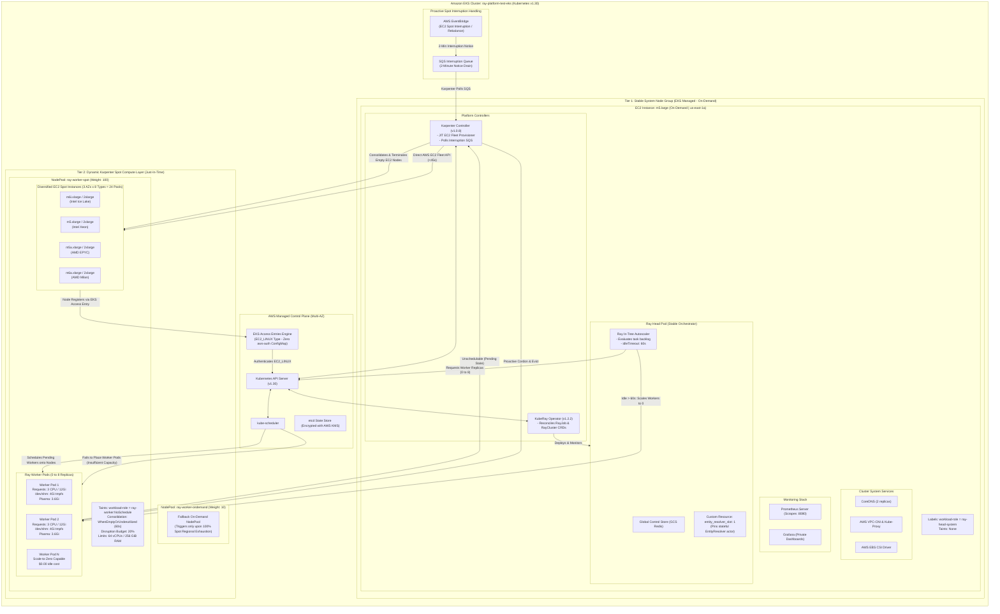

# 03 — Compute Architecture & Capacity Tiering

This document outlines the **Compute Architecture and Capacity Tiering Model** for the Ray AI Platform on Amazon EKS.

---

## Compute Topology Diagram

---

## Capacity Tier Specifications

### Tier 1: Stable System Node Group (On-Demand)
- **Role:** Dedicated control and system orchestration plane.
- **Instance Sizing:** `m5.large` (2 vCPU, 8 GiB RAM).
- **Scale Bounds:** Min: 1, Max: 2, Desired: 1.
- **Hosted Workloads:** CoreDNS, VPC-CNI, kube-proxy, EBS CSI Driver, KubeRay Operator (`v1.2.2`), Karpenter Controller (`v1.0.8`), Prometheus, Grafana, and the **Ray Head Pod**.
- **Resiliency Rationale:** Prevents cluster deadlocks. Because the Karpenter controller itself lives on stable On-Demand capacity, it never preempts its own host or loses the ability to launch replacement worker nodes.

### Tier 2: Dynamic Karpenter Spot Compute Layer
- **Role:** Pure stateless and elastic computational tasks (data ingestion, validation, normalization, distributed Ray Train).
- **Instance Diversification:** 8 instance types (`m6i.xlarge`, `m5.xlarge`, `m5a.xlarge`, `m6a.xlarge`, `m6i.2xlarge`, `m5.2xlarge`, `m5a.2xlarge`, `m6a.2xlarge`) spread across 3 Availability Zones ($8 \times 3 = 24$ distinct capacity pools).
- **Tolerations & Taints:** Nodes are tainted with `workload-role=ray-worker:NoSchedule`. Non-Ray pods are barred from landing on worker Spot capacity.
- **Consolidation Policy:** `WhenEmptyOrUnderutilized` with a 60-second idle threshold and a 20% disruption budget. When no Ray tasks are active, workers scale to 0 and all EC2 nodes are terminated within 60 seconds.

### Node Authentication via EKS Access Entries
Static or legacy `aws-auth` ConfigMaps have been eliminated. Nodes authenticate via `aws_eks_access_entry` configured with `type = "EC2_LINUX"` and `principal_arn = aws_iam_role.karpenter_node.arn`. This enables sub-45-second zero-trust node joining without ConfigMap mutex contention.
