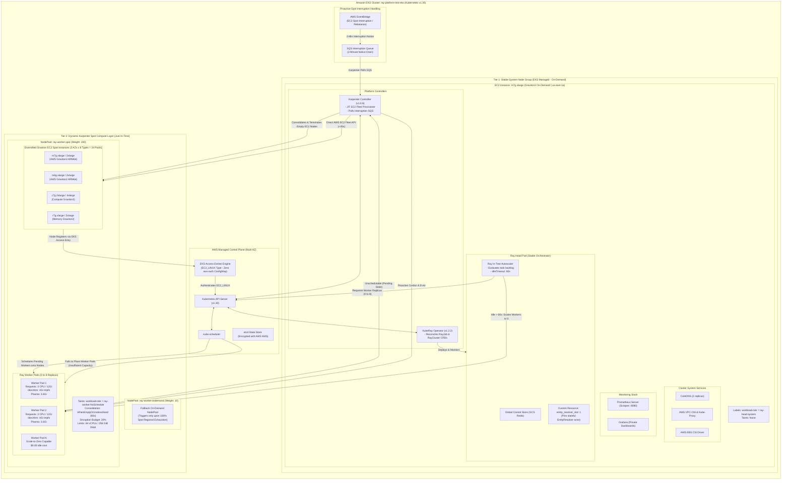
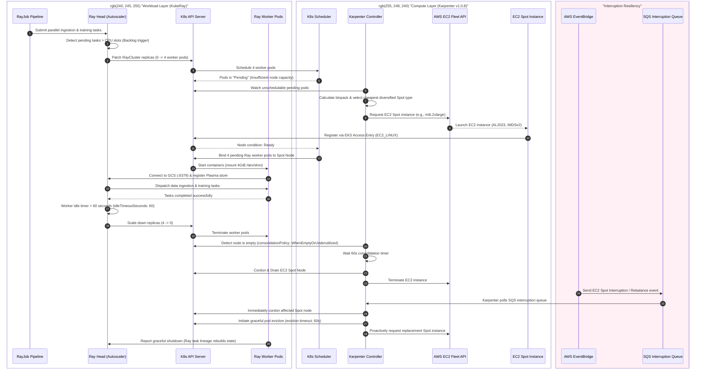
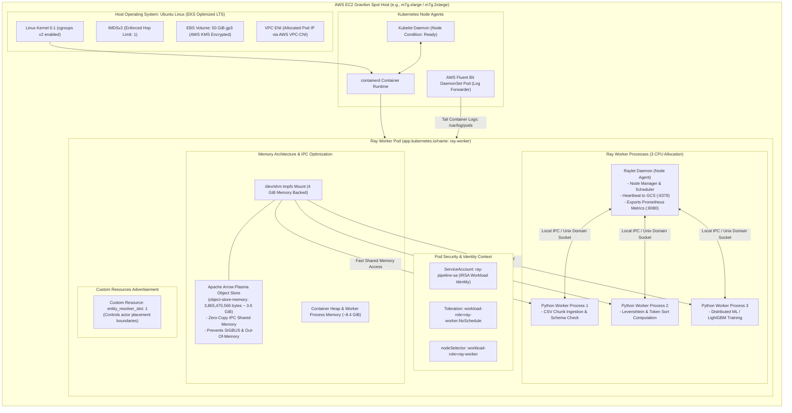
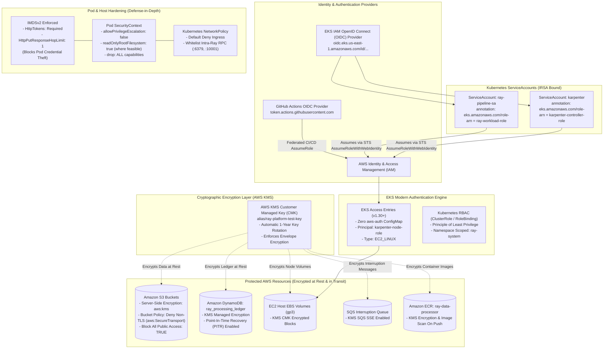
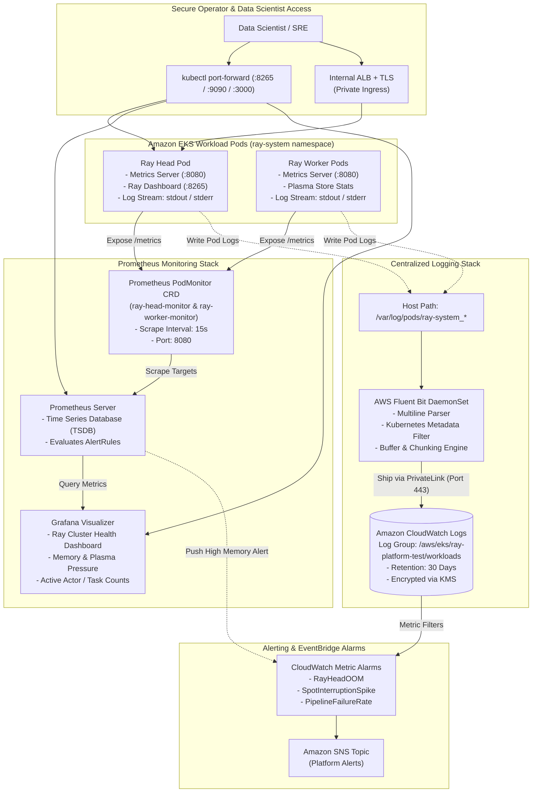
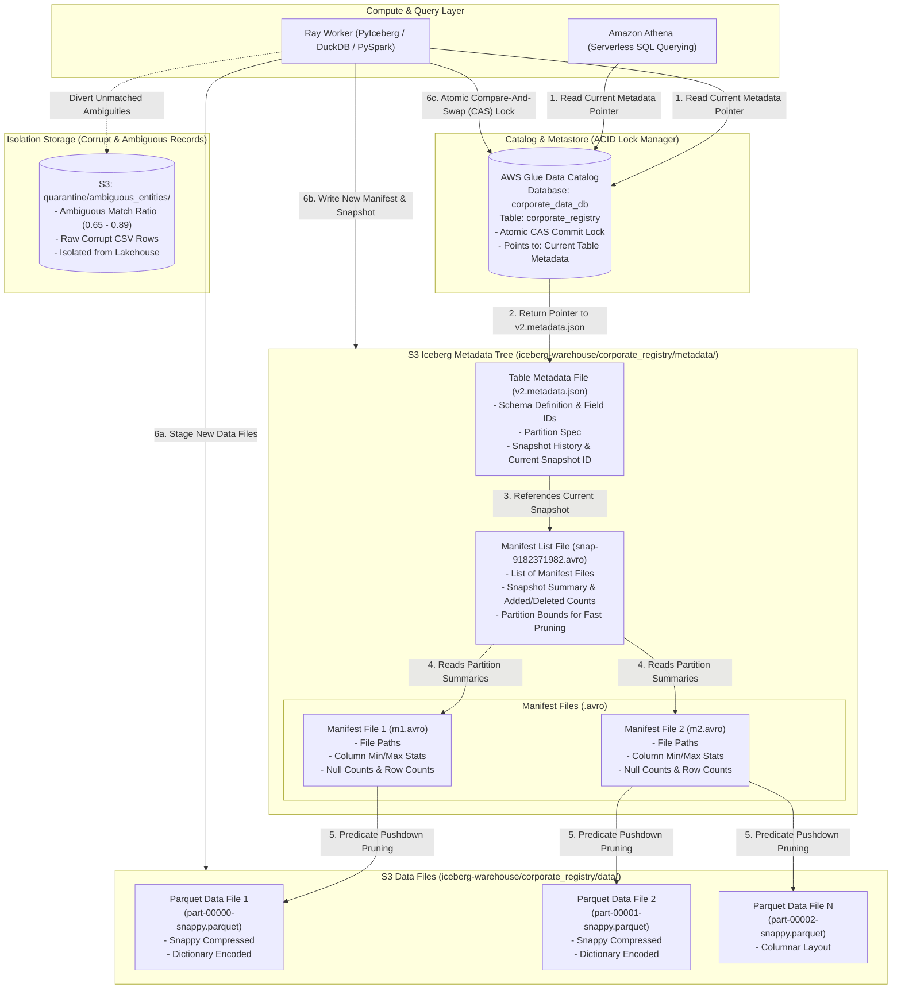
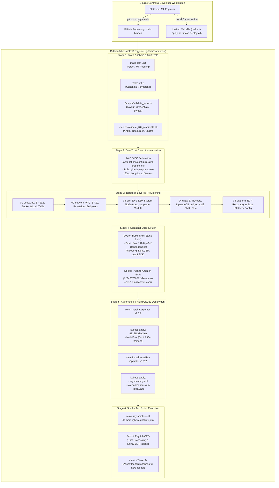
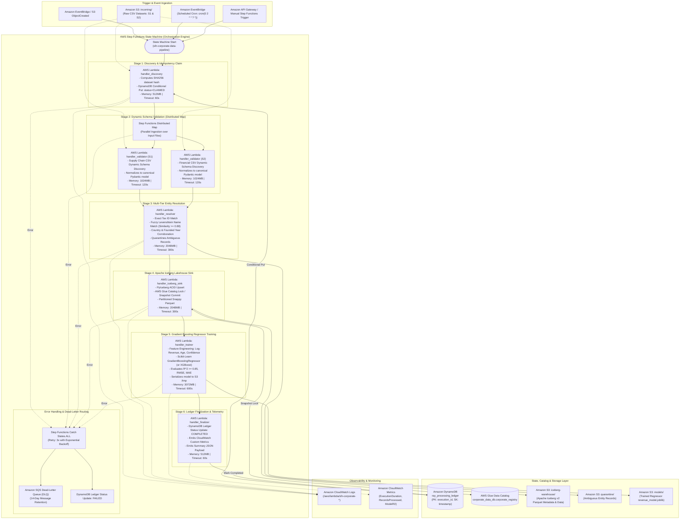

# Ray AI Platform — Master Architecture Diagrams & Visual Reference

This directory serves as the centralized visual architecture library for the **Distributed Ray AI Platform** on AWS EKS (`test` environment).

Every diagram is authored in standard [Mermaid.js](https://mermaid.js.org/) syntax, allowing direct GitHub/IDE rendering and programmatic export to SVG, PNG, and PDF.

---

## Diagram Index

| # | Diagram Title | Scope & Description | Source File | Deep-Dive Document |
| :---: | :--- | :--- | :---: | :---: |
| **01** | [Complete Platform Architecture](#01--complete-platform-architecture) | End-to-end cloud infrastructure, VPC, EKS, KubeRay, Karpenter, S3 Lakehouse, DynamoDB ledger, and CI/CD. | [`01-complete-architecture.mmd`](01-complete-architecture.mmd) | [`01-complete-architecture.md`](01-complete-architecture.md) |
| **02** | [Network Isolation & Zero-Trust](#02--network-isolation--zero-trust-architecture) | 3-tier Multi-AZ subnet topology, AWS PrivateLink VPC endpoints, Security Group chaining, NetworkPolicies, and IMDSv2. | [`02-network-zero-trust.mmd`](02-network-zero-trust.mmd) | [`02-network-zero-trust.md`](02-network-zero-trust.md) |
| **03** | [Compute Architecture & Capacity Tiering](#03--compute-architecture--capacity-tiering) | EKS Control Plane, On-Demand System Node Group, Karpenter JIT Spot NodePool, Fallback On-Demand, and EKS Access Entries. | [`03-compute-architecture.mmd`](03-compute-architecture.mmd) | [`03-compute-architecture.md`](03-compute-architecture.md) |
| **04** | [End-to-End Pipeline & Data Processing Flow](#04--end-to-end-pipeline--data-processing-flow) | CSV ingestion, dynamic schema inspection, multi-tier entity resolution, Ray Train ML regression, and Iceberg ACID commit. | [`04-pipeline-flow.mmd`](04-pipeline-flow.mmd) | [`04-pipeline-flow.md`](04-pipeline-flow.md) |
| **05** | [Two-Level Autoscaling & Spot Interruption](#05--two-level-autoscaling-lifecycle--spot-interruption) | KubeRay pod scaling, Karpenter sub-45s JIT EC2 provisioning, EventBridge 2-min Spot notice drain, and scale-to-zero ($0 cost). | [`05-autoscaling-lifecycle.mmd`](05-autoscaling-lifecycle.mmd) | [`05-autoscaling-lifecycle.md`](05-autoscaling-lifecycle.md) |
| **06** | [Ray Worker Node & Pod Internal Topology](#06--ray-worker-node--pod-internal-topology) | Linux kernel cgroups v2, 4 GiB `/dev/shm` tmpfs memory mount, Apache Arrow Plasma object store (3.6 GiB), and Raylet agents. | [`06-ray-worker-node.mmd`](06-ray-worker-node.mmd) | [`06-ray-worker-node.md`](06-ray-worker-node.md) |
| **07** | [Zero-Trust Security & Identity Federation](#07--zero-trust-security-identity--cryptographic-architecture) | IAM Roles for Service Accounts (IRSA), GitHub OIDC, AWS KMS CMK envelope encryption, EKS Access Entries, and RBAC. | [`07-security-identity.mmd`](07-security-identity.mmd) | [`07-security-identity.md`](07-security-identity.md) |
| **08** | [Observability, Metrics & Centralized Logging](#08--observability-metrics--centralized-logging-architecture) | Prometheus `PodMonitor` scraping port `:8080`, Grafana dashboards, Fluent Bit DaemonSet, and CloudWatch Logs over PrivateLink. | [`08-observability-telemetry.mmd`](08-observability-telemetry.mmd) | [`08-observability-telemetry.md`](08-observability-telemetry.md) |
| **09** | [Apache Iceberg ACID Lakehouse Storage](#09--apache-iceberg-acid-lakehouse-storage-architecture) | AWS Glue Data Catalog CAS lock, snapshot hierarchy, metadata tree, Snappy Parquet files, and dead-letter quarantine. | [`09-lakehouse-iceberg.mmd`](09-lakehouse-iceberg.mmd) | [`09-lakehouse-iceberg.md`](09-lakehouse-iceberg.md) |
| **10** | [CI/CD Pipeline & GitOps Deployment](#10--cicd-pipeline-gitops--infrastructure-lifecycle) | Static testing gates, 5 decoupled Terraform layers, multi-stage Docker build, ECR publishing, Helm releases, and smoke tests. | [`10-cicd-deployment.mmd`](10-cicd-deployment.mmd) | [`10-cicd-deployment.md`](10-cicd-deployment.md) |
| **11** | [Serverless Alternative Architecture](#11--aws-serverless-alternative-architecture) | AWS Step Functions, Lambda handlers (S1-S6), SQS DLQ, S3 lakehouse, DynamoDB ledger, and Glue Catalog. | [`11-serverless-architecture.mmd`](11-serverless-architecture.mmd) | [`11-serverless-architecture.md`](11-serverless-architecture.md) |

---

## 01 — Complete Platform Architecture

```mermaid
flowchart TD
    subgraph External["External World & Source Data"]
        S1["Source S1: Supply Chain CSV"]
        S2["Source S2: Financial Records CSV"]
        DEV["DevOps / Data Engineer (kubectl & AWS CLI)"]
        GHA["GitHub Actions CI/CD (OIDC Federated)"]
    end

    subgraph AWS["AWS Cloud (us-east-1) - Test Environment"]
        subgraph IAM_KMS["Identity & Cryptographic Foundations"]
            OIDC["AWS IAM OpenID Connect Provider"]
            KMS["AWS KMS Customer Managed Key (CMK)"]
            IRSA_RAY["IRSA: ray-workload-role"]
            IRSA_KARP["IRSA: karpenter-controller-role"]
            NODE_ROLE["IAM Role: karpenter-node-role"]
        end

        subgraph VPC["AWS VPC: 10.0.0.0/16 (3 AZs: us-east-1a, 1b, 1c)"]
            subgraph PublicSubnets["Public Subnets (NAT Gateway & IGW)"]
                NAT["NAT Gateways (Multi-AZ)"]
                ALB["Internal Ingress / ALB Controller"]
            end

            subgraph PrivateEndpoints["VPC Endpoints (AWS PrivateLink)"]
                VPCE_S3["S3 Gateway Endpoint"]
                VPCE_DDB["DynamoDB Gateway Endpoint"]
                VPCE_ECR["ECR API & DKR Interface Endpoints"]
                VPCE_CW["CloudWatch Logs Interface Endpoint"]
                VPCE_STS["STS Interface Endpoint"]
                VPCE_SQS["SQS Interface Endpoint"]
            end

            subgraph EKS["Amazon EKS Cluster: ray-platform-test-eks (v1.30)"]
                EKS_API["EKS Control Plane & Kubernetes API Server"]

                subgraph SystemNodeGroup["System Capacity: On-Demand Node Group (m5.large)"]
                    COREDNS["CoreDNS & VPC-CNI"]
                    KUBERAY["KubeRay Operator (v1.2.2)"]
                    KARP_CTRL["Karpenter Controller (v1.0.8)"]
                    PROM["Prometheus Server & Node Exporter"]
                    GRAFANA["Grafana Dashboards"]
                    FLUENT["AWS Fluent Bit DaemonSet"]
                end

                subgraph RayHeadPlacement["Ray Head Placement (On-Demand System Tier)"]
                    RAY_HEAD["Ray Head Pod (ray-cluster-kuberay-head)\n- GCS Global Control Store\n- In-Tree Autoscaler\n- Dashboard Port: 8265\n- Metrics Port: 8080\n- Custom Resource: entity_resolver_slot: 1"]
                end

                subgraph KarpenterCompute["Dynamic Compute Layer: Karpenter JIT Provisioned"]
                    subgraph SpotFleet["Diversified EC2 Spot Instances (m6i, m5, m5a, m6a)"]
                        RAY_WORKER_1["Ray Worker Pod 1\n- 4 CPU / 16GiB RAM\n- 4GiB /dev/shm tmpfs\n- Plasma Store: 3.6GiB"]
                        RAY_WORKER_2["Ray Worker Pod 2\n- Ingestion & Validation\n- Feature Extraction"]
                        RAY_WORKER_N["Ray Worker Pod N\n- Ray Train Distributed ML\n- Scale-to-Zero Capable"]
                    end
                end
            end
        end

        subgraph Eventing["Event-Driven Interruption & Orchestration"]
            EB_SPOT["AWS EventBridge (Spot Interruption & Rebalance Notice)"]
            SQS_KARP["SQS Interruption Queue\n(ray-platform-test-eks-karpenter-interruption)"]
            EB_CRON["EventBridge Cron Trigger (rate: 15m)"]
            LAMBDA["Discovery Lambda (S3 Poller & Ledger Registrar)"]
        end

        subgraph Storage["Storage & Transactional Lakehouse"]
            S3_DATA[("Amazon S3 Data Bucket\n- incoming/ (Raw CSVs)\n- quarantine/ (Ambiguous Rows)\n- iceberg-warehouse/ (Parquet)\n- models/ (LightGBM Artifacts)")]
            DDB_LEDGER[("DynamoDB Processing Ledger\n(ray_processing_ledger)\n- Conditional Locks\n- Idempotency Tracking")]
            GLUE_CATALOG[("AWS Glue Data Catalog\n(corporate_data_db)")]
        end

        subgraph Registry["Container & Artifact Registry"]
            ECR["Amazon ECR: ray-data-processor"]
        end

        subgraph Logs["Observability & Auditing"]
            CW_LOGS["Amazon CloudWatch Logs\n(/aws/eks/ray-platform-test/workloads)"]
        end
    end

    S1 -->|"Upload Raw CSV"| S3_DATA
    S2 -->|"Upload Raw CSV"| S3_DATA
    EB_CRON -->|"Trigger Discovery"| LAMBDA
    LAMBDA -->|"Inspect S3 incoming/"| S3_DATA
    LAMBDA <-->|"Acquire Atomic Lease"| DDB_LEDGER
    LAMBDA -->|"Submit RayJob CRD"| EKS_API
    DEV -->|"Git Push"| GHA
    GHA -->|"Authenticate via OIDC"| OIDC
    GHA -->|"Build & Push Container"| ECR
    GHA -->|"Deploy Helm & Manifests"| EKS_API
    EKS_API -->|"Reconcile RayJob"| KUBERAY
    KUBERAY -->|"Manage Cluster Lifecycle"| RAY_HEAD
    RAY_HEAD -->|"Workload Demand (Scale 0 to 8)"| RAY_WORKER_1
    RAY_HEAD -->|"Demand Triggers Unschedulable Pods"| KARP_CTRL
    KARP_CTRL -->|"Launch EC2 Spot Fleet (<45s)"| SpotFleet
    EB_SPOT -->|"2-Minute Preemption Warning"| SQS_KARP
    SQS_KARP -->|"Poll & Proactive Cordon/Drain"| KARP_CTRL
    RAY_WORKER_1 <-->|"Read Raw CSVs"| S3_DATA
    RAY_WORKER_1 <-->|"Update Stage Progress"| DDB_LEDGER
    RAY_WORKER_1 -->|"Commit ACID Upserts"| GLUE_CATALOG
    RAY_WORKER_1 -->|"Write Parquet & Manifests"| S3_DATA
    RAY_WORKER_1 -->|"Quarantine Ambiguous Records"| S3_DATA
    RAY_HEAD -->|"Export Metrics (:8080)"| PROM
    RAY_WORKER_1 -->|"Export Metrics (:8080)"| PROM
    PROM -->|"Visualize"| GRAFANA
    FLUENT -->|"Ship Pod Logs via PrivateLink"| CW_LOGS
```



---

## 02 — Network Isolation & Zero-Trust Architecture

```mermaid
flowchart TD
    subgraph InternetZone["Public Internet (External)"]
        CLIENT["Authenticated Developer / CI Runner"]
    end

    subgraph AWS_Cloud["AWS Cloud (us-east-1)"]
        IGW["Internet Gateway (IGW)"]

        subgraph VPC["VPC: 10.0.0.0/16 (Isolated Network Boundary)"]
            subgraph PublicSubnets["Tier 1: Public Subnets (10.0.0.0/20, 10.0.16.0/20, 10.0.32.0/20)"]
                NAT_A["NAT Gateway (us-east-1a)"]
                NAT_B["NAT Gateway (us-east-1b)"]
                ALB_INGRESS["Private/Internal ALB Ingress Controller\n(Port 443 with TLS 1.3 Termination)"]
            end

            subgraph PrivateComputeSubnets["Tier 2: Private Compute Subnets (10.0.128.0/20, 10.0.144.0/20, 10.0.160.0/20)"]
                direction TB
                subgraph SG_ControlPlane["Security Group: EKS Control Plane"]
                    EKS_ENI["EKS Managed ENIs\n- Private API Server Endpoint (:443)\n- No Public Route"]
                end

                subgraph SG_SystemNodes["Security Group: System Node Group"]
                    SYSTEM_NODE["System EC2 Instances (m5.large)\n- KubeRay Operator\n- Karpenter Controller\n- CoreDNS (:53)\n- Prometheus (:9090)"]
                end

                subgraph SG_KarpenterNodes["Security Group: Karpenter Worker Fleet (karpenter.sh/discovery)"]
                    HEAD_POD["Ray Head Pod\n- GCS: 6379\n- Client: 10001\n- Dashboard: 8265\n- Metrics: 8080"]
                    WORKER_PODS["Ray Worker Pods\n- Intra-Ray: 10000-19999\n- Zero Inbound from Internet\n- IMDSv2 Hop Limit = 1"]
                end

                subgraph K8s_Network_Policy["Kubernetes NetworkPolicy Enforcement (Calico / VPC CNI)"]
                    NP_INGRESS["Default Deny All Ingress\nAllow Only Head <--> Worker on Ray Ports"]
                    NP_EGRESS["Restricted Egress\nAllow Only VPC CIDR + AWS PrivateLink Endpoints + DNS:53"]
                end
            end

            subgraph IsolatedDataSubnets["Tier 3: Isolated Data Subnets (10.0.192.0/20, 10.0.208.0/20, 10.0.224.0/20)"]
                DATA_ENIS["Isolated ENIs (No Default Route / No NAT Access)"]
            end

            subgraph PrivateLinkEndpoints["AWS PrivateLink & Gateway VPC Endpoints (Zero Internet Egress)"]
                direction LR
                VPCE_S3_GW["S3 Gateway Endpoint\n(Prefix List: pl-63a5400a)\n(Bucket Policy Restricted)"]
                VPCE_DDB_GW["DynamoDB Gateway Endpoint\n(Prefix List: pl-6ba54002)\n(Table Policy Restricted)"]
                VPCE_ECR_API["ECR API Interface Endpoint (:443)"]
                VPCE_ECR_DKR["ECR DKR Interface Endpoint (:443)"]
                VPCE_STS["STS Interface Endpoint (:443)"]
                VPCE_CW["CloudWatch Logs Endpoint (:443)"]
                VPCE_SQS["SQS Interface Endpoint (:443)"]
                VPCE_KMS["KMS Interface Endpoint (:443)"]
            end
        end

        subgraph AWSServices["AWS Managed Services (Private Backbone Access Only)"]
            S3["Amazon S3 Buckets (test-ray-platform-*)"]
            DDB["Amazon DynamoDB (ray_processing_ledger)"]
            ECR["Amazon ECR Registry"]
            CW["Amazon CloudWatch Logs"]
            STS["AWS Security Token Service (STS)"]
            SQS["Amazon SQS (Karpenter Interruption)"]
            KMS["AWS Key Management Service (KMS)"]
        end
    end

    CLIENT -->|"TLS VPN / Bastion (SSM Session Mgr)"| EKS_ENI
    IGW -.->|"Egress Only for Updates via NAT"| NAT_A
    NAT_A -.->|"No Ingress Allowed"| PrivateComputeSubnets
    EKS_ENI <-->|"Mutual TLS Port 10250 (Kubelet)"| SYSTEM_NODE
    EKS_ENI <-->|"Mutual TLS Port 10250 (Kubelet)"| HEAD_POD
    HEAD_POD <-->|"RPC Ports: 6379, 10001, 10000-19999"| WORKER_PODS
    WORKER_PODS -->|"VPC Route (No NAT cost)"| VPCE_S3_GW
    WORKER_PODS -->|"VPC Route (No NAT cost)"| VPCE_DDB_GW
    WORKER_PODS -->|"Private ENI (Port 443)"| VPCE_ECR_API
    WORKER_PODS -->|"Private ENI (Port 443)"| VPCE_ECR_DKR
    WORKER_PODS -->|"Private ENI (Port 443)"| VPCE_STS
    WORKER_PODS -->|"Private ENI (Port 443)"| VPCE_CW
    WORKER_PODS -->|"Private ENI (Port 443)"| VPCE_SQS
    WORKER_PODS -->|"Private ENI (Port 443)"| VPCE_KMS
    VPCE_S3_GW --> S3
    VPCE_DDB_GW --> DDB
    VPCE_ECR_API --> ECR
    VPCE_ECR_DKR --> ECR
    VPCE_STS --> STS
    VPCE_CW --> CW
    VPCE_SQS --> SQS
    VPCE_KMS --> KMS
```



---

## 03 — Compute Architecture & Capacity Tiering



---

## 04 — End-to-End Pipeline & Data Processing Flow

```mermaid
flowchart TD
    subgraph S0_Ingestion["Stage 0: Ingestion & Trigger"]
        CSV_S1["Raw S1 CSV: Supply Chain (1,200 rows)"]
        CSV_S2["Raw S2 CSV: Financial Data (1,200 rows)"]
        S3_IN["S3: incoming/"]
        LAMBDA["Discovery Lambda"]
        DDB_LEDGER[("DynamoDB Ledger: ray_processing_ledger")]
        K8S_RAYJOB["RayJob Submission (ray-job.yaml)"]
    end

    subgraph S1_Validation["Stage 1: Dynamic Schema Inspection & Validation"]
        RAY_DATA_READ["Ray Data: read_csv (Distributed Slices)"]
        SCHEMA_DETECT["Dynamic Schema Inspector\n- Detect Unknown Columns\n- Identify Tax ID, Name, Revenue Candidates\n- Handle Missing / Corrupt Types"]
        VALID_RECORDS["Validated Record Stream"]
        CORRUPT_RECORDS["Unparseable Records"]
        S3_MALFORMED["S3: dead-letter/malformed/"]
    end

    subgraph S2_Normalization["Stage 2: Canonical Normalization & Cleaning"]
        CLEAN_TEXT["String Sanitization\n- Lowercase & Unicode normalize\n- Strip Corporate Suffixes (Inc, LLC, Corp, GmbH, Ltd)\n- Whitespace collapsing"]
        CLEAN_TAX["Tax ID Normalization\n- Strip hyphens, spaces, punctuation\n- Uppercase alphanumeric"]
        CLEAN_GEO["ISO Country Code Standardization\n- Map aliases to ISO 3166-1 alpha-2"]
    end

    subgraph S3_EntityResolution["Stage 3: Multi-Tier Deterministic Entity Resolution"]
        ACTOR_CALL["Call EntityResolver Actor\n(Pinned via entity_resolver_slot: 1)"]
        MATCH_TIER1{"Tier 1:\nExact Tax ID Match?"}
        MATCH_TIER2{"Tier 2:\nToken Sort Ratio >= 0.90\n& Country / Year Match?"}
        MATCH_TIER3{"Tier 3:\nAmbiguous Score\n(0.65 <= Ratio < 0.90)?"}
        ASSIGN_EXISTING["Merge with Existing Entity\n(Assign Known Entity ID)"]
        ASSIGN_NEW["Mint New Canonical ID\n(UUIDv5: COMP-XXXXXXXX-XXXX)"]
        QUARANTINE_RECORD["Quarantine Ambiguous Entity\n(Human Review Queue)"]
        S3_QUARANTINE["S3: quarantine/ambiguous_entities/"]
    end

    subgraph S4_ML_Training["Stage 4: Ray Train Distributed Machine Learning"]
        FEATURE_ENG["Feature Engineering\n- Log Transform Target (Annual Revenue)\n- One-Hot Country & Industry Encodings\n- ESG & Risk Score Scaling"]
        TRAIN_SPLIT["Distributed Train/Test Split (80/20)"]
        RAY_TRAINER["Ray Train Distributed Regressor\n(Gradient Boosting / LightGBM)"]
        EVAL_METRICS["Model Evaluation\n- Target R² >= 0.85\n- Calculate RMSE & MAE"]
        SAVE_MODEL["Persist Model Artifacts\n- S3: models/model.tar.gz\n- S3: models/metrics.json"]
    end

    subgraph S5_Lakehouse["Stage 5: Apache Iceberg Transactional Lakehouse"]
        ICEBERG_TABLE[("Apache Iceberg Table:\ncorporate_data_db.corporate_registry")]
        GLUE_CATALOG[("AWS Glue Data Catalog (Lock & Metastore)")]
        S3_WAREHOUSE[("S3: iceberg-warehouse/corporate_registry/\n- Data Parquet Files\n- Avro Manifests & Snapshot Logs")]
    end

    subgraph S6_Finalize["Stage 6: Ledger Finalization & Audit"]
        AUDIT_METRICS["Compile Run Statistics\n- Total Rows Processed\n- Entities Resolved\n- Quarantine Count\n- Model R² Score"]
        DDB_COMPLETE[("Update DynamoDB Status: COMPLETED\n(Atomic Conditional Update)")]
    end

    CSV_S1 --> S3_IN
    CSV_S2 --> S3_IN
    S3_IN --> LAMBDA
    LAMBDA <-->|"Conditional Lease Lock"| DDB_LEDGER
    LAMBDA -->|"Submit Job"| K8S_RAYJOB
    K8S_RAYJOB --> RAY_DATA_READ
    RAY_DATA_READ --> SCHEMA_DETECT
    SCHEMA_DETECT -->|Valid Schema| VALID_RECORDS
    SCHEMA_DETECT -->|Corrupt Schema| CORRUPT_RECORDS
    CORRUPT_RECORDS --> S3_MALFORMED
    VALID_RECORDS --> CLEAN_TEXT
    CLEAN_TEXT --> CLEAN_TAX
    CLEAN_TAX --> CLEAN_GEO
    CLEAN_GEO --> ACTOR_CALL
    ACTOR_CALL --> MATCH_TIER1
    MATCH_TIER1 -->|Yes (Confidence: 1.0)| ASSIGN_EXISTING
    MATCH_TIER1 -->|No| MATCH_TIER2
    MATCH_TIER2 -->|Yes (Confidence >= 0.90)| ASSIGN_EXISTING
    MATCH_TIER2 -->|No| MATCH_TIER3
    MATCH_TIER3 -->|Yes (0.65 - 0.89)| QUARANTINE_RECORD
    MATCH_TIER3 -->|No (Confidence < 0.65)| ASSIGN_NEW
    QUARANTINE_RECORD --> S3_QUARANTINE
    ASSIGN_EXISTING --> FEATURE_ENG
    ASSIGN_NEW --> FEATURE_ENG
    FEATURE_ENG --> TRAIN_SPLIT
    TRAIN_SPLIT --> RAY_TRAINER
    RAY_TRAINER --> EVAL_METRICS
    EVAL_METRICS --> SAVE_MODEL
    ASSIGN_EXISTING --> ICEBERG_TABLE
    ASSIGN_NEW --> ICEBERG_TABLE
    ICEBERG_TABLE <-->|"Acquire Catalog Commit Lock"| GLUE_CATALOG
    ICEBERG_TABLE -->|"Write Parquet & Manifests"| S3_WAREHOUSE
    ICEBERG_TABLE --> AUDIT_METRICS
    SAVE_MODEL --> AUDIT_METRICS
    AUDIT_METRICS --> DDB_COMPLETE
```

---

## 05 — Two-Level Autoscaling Lifecycle & Spot Interruption



---

## 06 — Ray Worker Node & Pod Internal Topology



---

## 07 — Zero-Trust Security, Identity & Cryptographic Architecture



---

## 08 — Observability, Metrics & Centralized Logging Architecture



---

## 09 — Apache Iceberg ACID Lakehouse Storage Architecture



---

## 10 — CI/CD Pipeline, GitOps & Infrastructure Lifecycle



---

## 11 — AWS Serverless Alternative Architecture


